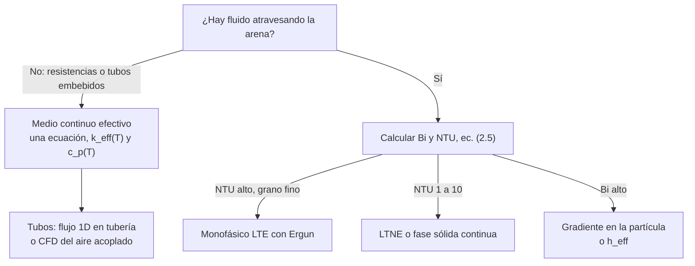

# Capítulo 2. Estado del arte y matriz comparativa
Este capítulo ordena lo que reportan las 20 fichas de la base de investigación para responder tres preguntas: qué configuraciones existen y qué madurez tienen, qué valores reportan los estudios comparables y qué lecciones se trasladan a un módulo de 1 m² que entrega 174 W durante unas 14 h a un sustrato de 20 a 30 °C. Siguiendo a [1], la evidencia se clasifica en tres niveles: validada directamente en arena, transferible desde otros lechos granulares y prospectiva.
## 2.1 Tipos de baterías de arena
En todas las variantes el principio es el mismo: calor sensible almacenado en un lecho granular, con energía
$$
Q_{th} = m \int_{T_1}^{T_2} c_p(T)\, dT \approx m\, \bar{c}_p\, \Delta T, \qquad q_{th} = \frac{Q_{th}}{V} = \rho_{bulk}\, \bar{c}_p\, \Delta T \tag{2.1}
$$
donde 
- $Q_{th}$ [J] es la energía térmica almacenada
- $m$ [kg] la masa del lecho
- $c_p(T)$ [J/kg·K] el calor específico
- $\bar{c}_p$ [J/kg·K] su valor medio en el rango
- $\Delta T$ [K] el salto térmico
- $q_{th}$ [J/m³] la densidad energética
-  $V$ [m³] el volumen
-  $\rho_{bulk}$ [kg/m³] la densidad aparente del lecho [1]. 
Las variantes se diferencian en **cómo entra y sale el calor**.

| Tipo | Principio | Ventajas | Desventajas | TRL | Ref. |
|---|---|---|---|---|---|
| Lecho empacado fijo | Arena inmóvil; el aire forzado atraviesa los poros mediante tuberías perforadas, canales o intercambiadores | Simple, barato y confiable; es el más común | Baja conductividad efectiva y transferencia lenta | 8–9 (500–600 °C) | [1] |
| Lecho con termoclina | Un solo tanque con zona caliente y fría separadas por un frente térmico que baja en la carga y sube en la descarga | Menor costo que dos tanques; el fluido sale a la máxima temperatura disponible | La conducción axial y la dispersión engrosan la termoclina, sobre todo en reposos largos | 7–8 | [1][15] |
| Empaquetado con tuberías intercambiadoras | El fluido (aire, agua o aceite) circula por tubos o serpentines embebidos y nunca toca la arena | Arena fina y compactada; sin pérdida de carga en el lecho; separa el fluido del medio | La extracción queda limitada por la conducción de la arena hacia el tubo | Ver S1 | [2][5][6][7] |
| Lecho fluidizado | Aire a alta velocidad suspende las partículas | Alta transferencia y temperatura uniforme | Consumo de ventiladores, abrasión y complejidad mecánica | 4–6 | [1] |
| Lecho móvil | La arena circula mecánicamente (por ejemplo, con tornillo sin fin) entre calentador, tanque e intercambiador | Operación continua; apto para más de 600 °C | Complejidad mecánica y desgaste | 5–7 | [1] |
| Híbrido arena-PCM | Calor sensible de la arena más calor latente de un PCM encapsulado o en una cámara separada | Mayor densidad energética y temperatura de salida estable | El PCM tiene que mantenerse dentro de su rango admisible: exige separación o control térmico | 3–5 | [1][11][12] |
| Arena con conductividad mejorada | Aditivos metálicos o grafito, aletas, placas o varillas conductoras | Carga y descarga más rápidas | Menor $c_p$ de la mezcla y mayor costo y complejidad | Ver S2 | [3][4][5][6][8] |

> [!warning] Supuestos S1 y S2: TRL no informado
> - **S1.** La revisión [1] no da un TRL propio para la variante de tubos cerrados embebidos. En las fichas solo aparece a escala de laboratorio o en simulación: el prototipo de 205 L [2], los tanques de 18 kg [5] y de Ø 19 cm [6] y el diseño simulado de [7]. Se adopta **TRL 4–5**, que en la escala de [1] corresponde a validación en laboratorio o en un entorno relevante.
> - **S2.** Las mejoras de conductividad solo tienen evidencia en laboratorio [4][5][6] y en un prototipo integrado [3]. Se adopta **TRL 3–4**.

![[Sand Batteries for Thermal Energy Storage - A Review of Operating Principles, Technologies, Challenges and Future Perspectives-1793684267928.webp|546]]
*Figura 2.1. Lecho empacado fijo, de [1].*
![[Sand Batteries for Thermal Energy Storage - A Review of Operating Principles, Technologies, Challenges and Future Perspectives-1793684303436.webp|511]]
*Figura 2.2. Lecho con termoclina, de [1].*
![[Sand Batteries for Thermal Energy Storage - A Review of Operating Principles, Technologies, Challenges and Future Perspectives-1793684363068.webp|582]]
*Figura 2.3. Híbrido arena-PCM: cámara de arena caliente, barrera aislante y cámara de PCM, de [1].*
![[Sand Batteries for Thermal Energy Storage - A Review of Operating Principles, Technologies, Challenges and Future Perspectives-1793684331083.webp|480]]

![[Sand Batteries for Thermal Energy Storage - A Review of Operating Principles, Technologies, Challenges and Future Perspectives-1793684348276.webp]]

**Implicación para el proyecto.** El lecho fluidizado y el móvil quedan descartados para un módulo de 174 W, porque su complejidad mecánica y su consumo propio no se justifican. Las candidatas reales son tres: el lecho fijo con tubos embebidos, el lecho fijo atravesado por aire (con o sin termoclina) y cualquiera de las dos con conductividad mejorada. El híbrido con PCM queda como mejora futura. Se eligen en el capítulo 7.
## 2.2 Matriz comparativa de estudios
### 2.2.1 Estudios de equipos con arena
La columna de eficiencia indica qué mide cada valor, porque no son comparables entre sí: **térmica de carga** ($\eta_{ch}$ o $SR$), **térmica de descarga** ($DR$) o **eléctrica de ida y vuelta** ($RTE$) [1].

| Ref. | Tipo de estudio | Escala / masa | T de trabajo | Carga | Extracción | Aislante | Eficiencia reportada | Qué se aplica |
|---|---|---|---|---|---|---|---|---|
| [2] Homa et al. 2025 | Experimental y CFD (ANSYS) | 205 L, 300 kg de cuarzo | 293 a ~850 K | 5 × 1400 W tubulares (6 × 1 kW en el análisis) | Tubos helicoidales con aire forzado | Lana mineral, 10 cm, λ = 0,040 W/m·K | $SR$ 0,608–0,847; $DR$ 0,88–0,97 | El análogo más cercano: caso de validación, distribución de resistencias, velocidad del aire |
| [3] Batería de Carnot con Stirling, 2026 | Experimental y FEM (COMSOL) | Tanque de 0,2 m³; masa no especificada | Resistencias ~700 °C; cabeza 300–350 °C | 10 × 3 kW | Conducción por placas y bloque de cobre al Stirling | Insulfrax LTX, 2 × 50 mm | $RTE$ 4,4–8,3 % exp.; 19,1–31,6 % sim. | El 64,4 % de la energía se pierde por la envolvente y los puentes térmicos |
| [4] Tetteh et al. 2024 | Experimental y FEM (COMSOL) | 0,0332 m³, ~47–60 kg | 20–500 °C | 2 × 2 kW, On/Off | No implementada | Sin aislar (cara superior expuesta) | No reporta; tasa de calentamiento ×1,70–1,79 | Virutas metálicas; modelo ZBS con radiación validado |
| [5] Arena y arena-cobre, 2025 | Experimental | 18 kg | Arena 72 → 33 °C (agua a 80 °C) | Serpentín de cobre con agua | Sin descarga ensayada | Espuma, 1 cm | No reporta; energía retenida en 12,5 h: 845 kJ (arena) vs. 671 kJ (virutas) | Compromiso entre $k$ y $c_p$; geometría de serpentín |
| [6] Aletas en arena de sílice, 2024 | Experimental | Ø 19 cm × 30,6 cm; masa no especificada | Carga 70 °C, descarga 15 °C | Tubo central con agua | Mismo tubo con aletas de cobre | Espuma, 2,54 cm | No reporta; con 8 aletas radiales, −63,7 % de tiempo de carga y −78,5 % de descarga | El caso de baja temperatura más parecido; aletas |
| [7] Viabilidad residencial, 2026 | Simulación (COMSOL) | 240,2 kg, 0,184 m³ | 20 → 353 °C | 6 × 600 W, separadas 0,27 m | Carcasa y tubos hacia un Stirling (fluido no especificado) | Fibra cerámica, 5 cm | 89,91 % térmica, sin método (no se usa); 20–35 % de conversión | Escala parecida; disposición de resistencias |
| [8] ETES con Stirling, 2021 | Simulación | 1,5 m³, 2446 kg | 180–950 °C | Resistencias en una varilla conductora | Conducción de la varilla al Stirling | Superwool 607 HT por dentro del tanque | $RTE$ 47,4 % | Aislación interior; varilla como puente térmico útil |
| [9] Lecho de arena con agua, 2024 | Simulación (COMSOL) y Taguchi | 221 kg de arena + 34 kg de agua | 100 → 250 °C | Agua de un colector parabólico | Agua en contacto directo, flujo invertido | No estudiado (30 % de pérdidas supuesto) | $\eta_{ch}$ ≈ 100 % (óptimo) vs. 87 % (nominal) | Termoclina; tanque esbelto |
| [10] Arena con RSM, 2024 | Experimental (propiedades) y CFD | No especificada | Propiedades medidas entre 25 y 250 °C | Bobina con fluido caliente | – | No especificado | 6,348 kJ/kg de densidad almacenada (unidad a verificar) | Método RSM para optimizar factores |
| [11] Híbrido arena-PCM | Experimental | No especificada | Arena 25,7 → 53,7 °C; descarga 30–60 °C | Serpentín de cobre desde un colector | Serpentín; el PCM (parafina) en una cámara separada por una partición metálica | No especificado | $\eta_{ch}$ 95,61 %, $\eta_{dis}$ 96,79 %; 1347,1 kJ/kg | El PCM trabaja entre 30 y 60 °C, el mismo rango de entrega al sustrato |

### 2.2.2 Estudios de soporte (propiedades, modelos y revisiones)

| Ref. | Qué aporta | Dato clave para el proyecto |
|---|---|---|
| [13] Propiedades de materiales granulares, 2015 | Fuente primaria de propiedades de la arena de cuarzo | $c_p$ ≈ 850 J/kg·K a 20 °C y 1187 J/kg·K a 600 °C; $k_{lecho}$ 0,25–0,30 W/m·K a 20 °C y 0,85–0,90 a 800 °C; $\rho_{bulk}$ = 1586 kg/m³; ε = 0,44; inversión α→β a 573 °C con +0,8 % de volumen; sin degradación a 4–25 K/min |
| [14] Arena húmeda, 2026 | $k$ de arena húmeda con factores de forma y FEM | $k$ = 1,0–1,5 W/m·K con 8,6–12,6 % de humedad, de 3 a 5 veces la de arena seca |
| [12] PCM y lecho empacado en CSP, 2026 | Receptor con PCM acoplado a un lecho de escoria volcánica con aire | $RTE$ ≈ 66 %; 42,2 kWh/m³; el caudal másico explica más del 70 % de la varianza de la energía almacenada |
| [18] Termoclina industrial con CFD, 2026 | LTNE más Darcy-Forchheimer; 160 m³ de basalto con aceite a 390 °C | Con 0,2 m de lana de roca, pérdidas menores al 0,2 %; $\eta_{ch}$ 92,3 %; partículas de 20 cm bajan $\eta_{ch}$ de 99 % a 83 % |
| [17] Lecho de guijarros con aceite, 2025 | LTNE 2D axisimétrico, validado | Mayor porosidad acelera la carga pero reduce la densidad energética |
| [19] Termoclina con aire, 2025 | Schumann 1D paramétrico | ε entre 35 y 50 %; H/D ≲ 3 |
| [15] Revisión de modelos dinámicos, 2025 | Guía para elegir modelo y método numérico | Fase sólida continua con Euler implícito; $\eta_{dis}$ cae de 62 % a 20 % tras 16 h de reposo |
| [16] Revisión de enfoques de modelado, 2021 | Correlaciones y radiación | Radiación hasta ~32 % del coeficiente convectivo; no despreciarla por encima de ~750 °C; propiedades constantes: error de 1–5 % |
| [1] Revisión de baterías de arena, 2026 | Tipos, TRL, métricas y costos | Sistemas finlandeses a 500–600 °C; autodescarga < 1 % diario solo en tanques grandes |
| [20] Batería de arena rural, 2023 | Metodología conceptual, básica y de detalle | Sin datos técnicos ni experimentales |
## 2.3 Lecciones por eje
### (a) Baja conductividad de la arena y cómo mitigarla
La arena seca tiene una conductividad de lecho de 0,2–0,7 W/m·K [3][4], muy por debajo del cuarzo macizo, porque el aire de los poros y los contactos puntuales entre granos dominan la conducción [4][13]. La medida práctica de la lentitud es la profundidad de penetración térmica:
$$
\alpha = \frac{k_{lecho}}{\rho_{bulk}\, c_p}, \qquad \delta \approx \sqrt{\alpha\, t} \tag{2.2}
$$
donde 
- $\alpha$ [m²/s] es la difusividad térmica
-  $k_{lecho}$ [W/m·K] la conductividad efectiva del lecho
-  $\delta$ [m] la distancia que avanza el calor por conducción 
-  $t$ [s] el tiempo. 
Con los valores de [13] a 20 °C ($k$ = 0,25–0,30 W/m·K, $\rho_{bulk}$ = 1586 kg/m³, $c_p$ ≈ 850 J/kg·K) resulta $\alpha$ ≈ 1,9–2,2 × 10⁻⁷ m²/s:

| $t$ | 1 h | 5 h | 14 h (una noche) |
|---|---|---|---|
| $\delta$ | 2,6–2,8 cm | 5,8–6,3 cm | 9,7–10,6 cm |

En una noche, el calor recorre solo unos 10 cm hasta un tubo o una resistencia. Por eso **los elementos de carga y extracción tienen que distribuirse con un paso del orden de $2\delta$ como máximo**. A mayor temperatura, $k$ y $c_p$ suben juntos [13], así que $\alpha$ varía poco. La misma propiedad tiene una cara favorable: cerca de las paredes, la arena actúa como un aislante propio y retiene el calor del núcleo [2][4].

| Estrategia | Resultado reportado | Costo o limitación | Ref. |
|---|---|---|---|
| Virutas metálicas de desecho | Con 20 % en volumen de aluminio en mezcla uniforme, tasa de calentamiento ×1,70; latón en capas, ×1,79. Con 5–10 % la mejora es chica (×1,18–1,36) porque no se forma una red conductora (umbral de percolación) | — | [4] |
| Cobre en virutas o polvo | $k$ hasta +85 % | $c_p$ entre −17 y −34 %: la arena pura retiene 26 % más energía que la mezcla con virutas | [5] |
| Aletas de cobre (misma masa de cobre) | 8 radiales: −63,7 % de tiempo de carga y −78,5 % de descarga; las radiales superan a las anulares | Fabricación; ensayado solo a ≤ 70 °C | [6] |
| Placas y bloque de cobre | Extienden la superficie de intercambio | Siguen el arranque con caídas de potencia y oscilaciones On/Off: la conducción sigue limitando | [3] |
| Varilla conductora que sostiene las resistencias | Distribuye el calor en la carga y lo concentra en la descarga | Solo simulado | [8] |
| Distribución de resistencias | Cerca del eje pero no juntas es la mejor variante (mayor $SR$, vaina a 1240 K); cerca de las paredes aumentan las pérdidas | Las vainas se sobrecalientan: hace falta control con histéresis (encendido a 673 K, apagado a 1073 K) | [2] |
| Resistencias equidistantes | 6 elementos a 0,27 m para evitar zonas frías | Solo simulado | [7] |
| Arena fina | Carga más rápida que la gruesa (11,86 vs. 13,36 h) | Descarga algo más lenta en el caso base (17,58 vs. 16,55 h) | [6] |

> [!note] Lectura cruzada
> Las mejoras de conductividad aceleran la carga y la descarga, pero bajan la capacidad o agregan costo [5]. En este proyecto la descarga es lenta (14 h) y de baja potencia (174 W), y la carga depende de las horas de sol. El cuello de botella probable es **la carga**, que concentra mucha energía en pocas horas. Esto se verifica en el capítulo 8.
### (b) Aislación y pérdidas
Las pérdidas por la envolvente se describen con resistencias térmicas en serie. Para un tanque cilíndrico:
$$
\dot{Q}_{perd} = \frac{T_{arena} - T_{amb}}{R_{tot}}, \qquad R_{tot} = \frac{\ln(r_2/r_1)}{2\pi k_{ais} L} + \frac{1}{h\, 2\pi r_2 L} + R_{puentes}, \qquad r_c = \frac{k_{ais}}{h} \tag{2.3}
$$
donde 
- $\dot{Q}_{perd}$ [W] es la potencia perdida
-  $T_{amb}$ [K] la temperatura del ambiente
- $R_{tot}$ [K/W] la resistencia total
-  $r_1$ y $r_2$ [m] los radios interior y exterior de la aislación
- $k_{ais}$ [W/m·K] su conductividad
-  $L$ [m] la altura
- $h$ [W/m²·K] el coeficiente exterior combinado
-  $R_{puentes}$ [K/W] el efecto de soportes y pasamuros (en paralelo, reduce $R_{tot}$)
- $r_c$ [m] el radio crítico de aislación.

Las fichas parecen contradecirse:

| Posición | Contexto | Ref. |
|---|---|---|
| 10 cm de lana mineral son insuficientes (el mejor $SR$ es 0,67); el espesor óptimo es **0,403 m**, porque más espesor aumenta la superficie exterior | Tanque de 205 L, ensayos de 2 h de carga y 46 h de reposo; cálculo estacionario con propiedades constantes | [2] |
| El modelo es **"insensible a las pérdidas"**: multiplicar $h$ por 4 y subir las emisividades baja solo un 1 % la temperatura del centro | Caja sin aislar; se mide la temperatura local entre dos resistencias, no la energía almacenada en un ciclo | [4] |
| Se pierde el **64,4 %** de la energía de carga, aunque el modelo predecía la cara exterior a temperatura ambiente | Puentes térmicos (marcos y soportes soldados, pasamuros) no modelados, y una estructura compleja de aislar | [3] |
| Con 0,2 m de lana de roca, las pérdidas son menores al 0,2 % | Tanque de 160 m³: relación superficie/volumen muy baja | [18] |

> [!note] Cómo se concilian
> - **[4] no contradice a [2] ni a [3].** Mide la sensibilidad de una temperatura en el núcleo durante una carga corta, no las pérdidas de energía de un ciclo. Muestra que la arena aísla su propio centro, pero nada dice sobre la energía que se pierde.
> - **El óptimo de 0,403 m de [2] no se explica por el radio crítico.** Con $k_{ais}$ = 0,040 W/m·K [2] y $h$ ≈ 5 W/m²·K, el valor usado en [3] y [4], la ec. (2.3) da $r_c$ ≈ 8 mm, mucho menor que el radio del tanque (~0,30 m). En ese régimen, más espesor siempre reduce las pérdidas. El mínimo de [2] tiene que venir de otros supuestos del cálculo.
> - **La escala manda.** Comparando [18] con [2] y [3], las pérdidas relativas crecen al achicar el equipo ($A/V \propto V^{-1/3}$). Un módulo por m² está del lado de [2] y [3].
> - **Los puentes térmicos pueden dominar.** En [3] es la causa principal, y en el módulo propio habrá pasamuros de resistencias, tubos y sensores, y soportes.

> [!warning] Dato a determinar: espesor de aislación
> El espesor de 0,403 m de [2] no se usa como dato. El espesor del módulo se calcula con la ec. (2.3) y su geometría, incluyendo $R_{puentes}$ (capítulo 8.5).

Materiales aislantes que aparecen en las fichas: lana mineral con λ = 0,040 W/m·K [2], Insulfrax LTX [3], Superwool 607 HT hasta 1300 °C colocada dentro del tanque, lo que mantiene la chapa de acero más fría [8], fibra cerámica [7] y lana de roca [18]. La revisión [15] agrega que en los lechos con termoclina el reposo degrada la estratificación aunque las pérdidas globales sean chicas: la eficiencia de descarga cae de 62 % a 20 % tras 16 h.
### (c) Modelado
Todos los estudios que simulan un lecho de arena **estático** lo tratan como un medio continuo con propiedades efectivas, y validan con errores de 8 a 20 K: [2] con 9–20 K, [4] con menos de 8 °C. El modelo de [3] sobreestima la duración y subestima las pérdidas: los autores lo presentan como **cota superior**. Los detalles se comparan en la sección 2.4.
### (d) Extracción y caudales
Resultados de [2] para la descarga con aire por tubos helicoidales en 300 kg de arena:

| Velocidad del aire (m/s) | Caudal (kg/h) | $DR$ | $P_{max}$ (W) |
|---|---|---|---|
| 0,5 | 2,64 | 0,88 | 280 |
| 1,0 | 5,29 | 0,93 | 552 |
| 2,0 | 10,58 | 0,95 | 1028 |
| 5,0 | 26,44 | 0,97 | 2083 |

$$
DR = \frac{E_{outlet}}{E_{outlet} + E_{loss}}, \qquad \dot{Q}_{ext} = \dot{m}_a\, c_{p,a}\, (T_{a,sal} - T_{a,ent}) \tag{2.4}
$$
donde $DR$ [–] es la relación de descarga, $E_{outlet}$ [J] la energía que sale con el aire, $E_{loss}$ [J] las pérdidas al ambiente durante la descarga, $\dot{Q}_{ext}$ [W] la potencia extraída, $\dot{m}_a$ [kg/s] el caudal de aire, $c_{p,a}$ [J/kg·K] su calor específico y $T_{a,ent}$, $T_{a,sal}$ [K] las temperaturas de entrada y salida.

Lecciones:
1. **Más caudal da más potencia pico, pero enfría localmente la arena junto al tubo.** Pasadas unas 33 h, la potencia converge a unos 257 W para cualquier velocidad: manda la conducción en la arena, no el aire [2]. A 1 m/s, el aire sale a la temperatura media del lecho [2]. En [8], la descarga ideal de 15,5 h a potencia constante se reduce a 2,5 h por la conducción finita.
2. **A baja velocidad, la potencia de [2] ya supera la demanda propia.** A 0,5 m/s se obtienen 280 W pico frente a 174 W. Pero de la ec. (2.4) sale un salto del aire de unos 380 K, porque el aire sale casi a la temperatura de la arena. **Ningún estudio de las fichas entrega calor a ≤ 60 °C desde arena caliente**, que es lo que pide este proyecto. Los únicos casos de entrega a baja temperatura son de arena tibia: [5], [6] y [11].
3. **Cota de caudal con datos del proyecto.** Si el aire entra del invernadero (≥ 10 °C) y no puede superar los 60 °C del elemento, $\Delta T_a \le 50$ K. Con $c_{p,a}$ ≈ 1007 J/kg·K, entregar 174 W exige $\dot{m}_a \ge 174/(1007 \times 50) \approx 3{,}5 \times 10^{-3}$ kg/s (unos 12 kg/h) en el punto de entrega. Como el aire que pasa por la arena sale mucho más caliente, la configuración necesita **mezcla con aire frío (bypass) o un circuito intermedio** (capítulo 7).
4. **Si el aire atraviesa el lecho, la granulometría fija la pérdida de carga** (Ergun [15]). El grano chico agudiza la termoclina pero sube $\Delta P$ [19]; el grano grande atrasa el sólido respecto del fluido [18]. Valores de diseño reportados: ε entre 35 y 50 %, H/D ≲ 3 [19]; H/D mayor que 2 no mejora mucho la estratificación [16]; un tanque esbelto cargó mejor en [9]. Con tubos embebidos, la granulometría no afecta el flujo y conviene arena fina y compactada [6].
5. **El caudal es la variable de control dominante** (más del 70 % de la varianza en [12]). Debe ser regulable, no fijo.
6. **La humedad cambia la física.** La arena húmeda conduce de 3 a 5 veces más [14], y la nebulización del invernadero puede humedecer un lecho mal sellado. Además, a 75 °C aparecieron aglomerados frágiles tras pocos ciclos [5].

> [!warning] Datos a determinar: temperatura de entrega y configuración de mezcla
> Falta definir la temperatura de entrega del fluido al sustrato y si habrá bypass o circuito intermedio. Sin eso no se pueden fijar $\dot{m}_a$ ni $T_{min}$ de la arena (capítulos 7 y 8.4).
## 2.4 Comparación de modelos físicos y matemáticos

| Modelo | Ecuación de energía | Supuestos | Cuándo usarlo | Usado en |
|---|---|---|---|---|
| Concentrado (0D) | $Q = m c_p \Delta T$; $\tau = \rho c_p V/(hA)$ | Temperatura uniforme | Predimensionamiento y balances | [5][7][8] |
| Medio continuo efectivo (una ecuación, sin flujo) | $\rho c_p(T)\,\partial T/\partial t = \nabla\cdot(k_{eff}(T)\nabla T) + Q_v$ | La arena es un sólido homogéneo con propiedades efectivas; no hay fluido en los poros | Lecho estático con resistencias o tubos | [2][3][4][14] |
| Monofásico LTE con flujo | $[(1-\varepsilon)\rho_s c_s + \varepsilon\rho_f c_f]\,\partial_t T + \rho_f c_f \varepsilon u\,\partial_z T = K_{eff}\,\partial_{zz}T + U a_b (T_\infty - T)$ | $T_f = T_s$ | Fluido a través de grano fino ($Bi$ bajo, NTU alto) | [15] |
| Schumann (dos fases) | Fluido: $\varepsilon\rho_f c_f(\partial_t T_f + u\,\partial_z T_f) = h a_s (T_s - T_f)$; sólido: $(1-\varepsilon)\rho_s c_s\,\partial_t T_s = h a_s (T_f - T_s)$ | Sin conducción ni pérdidas | Estudios paramétricos rápidos de termoclina | [15][19] |
| Fase sólida continua (dos fases) | Schumann más conducción efectiva en cada fase y pérdidas $U a_b$ | Gradiente nulo dentro de la partícula | Mejor equilibrio entre precisión y costo según [15] | [15] |
| LTNE con Darcy-Forchheimer | Dos ecuaciones de energía, más continuidad y momento en medio poroso | REV; $h_v$ por correlación (Wakao-Kaguei, válida para $15 < Re_p < 8500$) | Partículas grandes o NTU del orden de 1 a 10 | [17][18] |
| Gradiente en la partícula o trifásico | Agrega la conducción radial en la partícula o la pared como tercera fase | — | $Bi$ alto; tanques chicos donde la pared importa | [15][16] |
| Optimización estadística | RSM o Taguchi sobre resultados de CFD | Superficie de respuesta ajustada | Barrer factores sin simular todas las combinaciones | [9][10] |

**Criterios de selección** [15][18]:
$$
Bi = \frac{h\, d_p}{k_s}, \qquad NTU = \frac{h_v\, L}{\dot{m}\, c_{p,f}/A}, \qquad a = \frac{6(1-\varepsilon)}{d_p} \tag{2.5}
$$
donde 
- $Bi$ [–] es el número de Biot de la partícula
- $d_p$ [m] su diámetro
-  $k_s$ [W/m·K] la conductividad del sólido
 - $NTU$ [–] el número de unidades de transferencia
 -  $h_v = h\,a$ [W/m³·K] el coeficiente volumétrico
 -  $L$ [m] la longitud del lecho
 -  $A$ [m²] la sección de paso y $a$ [m⁻¹] el área específica. 

Con $Bi < 0{,}5$ alcanza un modelo monofásico o de Schumann [15]. Con NTU del orden de 1 a 10 hace falta LTNE, y con NTU de cientos o más, el equilibrio local (LTE) es suficiente [18]

*Figura 2.4. Criterio de selección del modelo, a partir de [15] y [18].*

Submodelos comunes a todos los enfoques:

| Submodelo | Qué usan los estudios | Ref. |
|---|---|---|
| Propiedades de la arena | $c_p(T) = T + 427$ J/kg·K y $k_c(T) = 0{,}0006\,T - 0{,}0102$ W/m·K, con $T$ en K, válidas entre 323 y 846 K (ajuste de [13]) | [2][13] |
| Conductividad efectiva | Siete correlaciones (Yagi-Kunii, Kunii-Smith, ZS, ZBS, Batchelor, Hadley, Gonzo). **ZBS con radiación** es la única con error menor a 8 °C | [4] |
| Radiación entre granos | Importa por encima de ~350 °C en arena [4]; no despreciable por encima de ~750 °C en lechos de partículas mayores [16] | [4][16] |
| Pérdidas exteriores | $h$ = 5 W/m²·K más radiación de cuerpo gris [4][3]; o $Nu(Ra)$ por cara (superior, lateral e inferior) [2] | [2][3][4] |
| Aislación | Pared delgada con *shell conduction* (espesor y λ sin mallar) | [2] |
| Resistencias | Flujo superficial $Q_s = P/A$ (4,77 × 10⁴ W/m² en [2]) o fuente volumétrica condicional On/Off [4] | [2][4] |
| Aire quieto en tubos (carga y reposo) | Conducción equivalente $k_{eff} = k_{aire}\,Nu$ | [2] |
| Discretización | Malla de 0,05 m en el lecho y 0,0005 m en la superficie de las resistencias [2]; en 1D, $\Delta z/L \le 0{,}0025$ y $\Delta t$ de 1 a 5 s con Euler implícito [15] | [2][15] |

> [!note] Elección preliminar para el proyecto
> - Si la configuración es arena estática con tubos (hipótesis de aire por tubos), alcanza el **medio continuo efectivo** con ZBS más radiación, $c_p(T)$ de [13] y aislación como *shell conduction*. 
> - Para la descarga se acopla el aire con un modelo 1D de tubería o con CFD. Es el esquema de [2], que además sirve como caso de validación. Si se eligiera aire a través del lecho, primero hay que calcular NTU con la ec. (2.5). Se desarrolla en los capítulos 5 y 9.
> - Es decir que en la ecuacion de conductividad efectiva  que depende de la temperatura ($k_{c}(T)$) se analizan todos los mecanismos jutnos: conduccion por los granos, conduccion del aire de los poros y radiacion entre granos.
> 	- Lo que se propone es definir $k(T)$ como lo definido por ZBS mas el termino $4F_B\sigma d_p T^3$ que corresponde a la radiacion. 
> 
> | |k(T) medida (Homa)|ZBS + radiación (Tetteh)|
> |---|---|---|
> |Origen|Ajuste lineal de mediciones|Fórmula con $d_p$, ε, emisividad, $k_s$ y $k_{aire}$|
> |Validación|Errores de 9–20 K contra su prototipo|Error menor a 8 °C contra su ensayo|
> |Validez|Solo 323–846 K, para esa arena|Se adapta a tu granulometría y porosidad|
> |Riesgo|Si tu arena es distinta, la recta puede no representarla|Necesita datos de tu arena que hoy no tenés|

> [!warning] Discrepancia a resolver: umbral de radiación
> [4] encuentra que la radiación pesa desde ~350 °C en arena, y [16] la ubica por encima de ~750 °C. La diferencia probablemente se debe al tamaño de partícula y a lo que mide cada estudio (temperatura de un lecho de arena vs. coeficiente convectivo en lechos gruesos). Mientras no se resuelva, se incluye el término radiativo en todo el rango (capítulo 5).
## Referencias
1. [[Sand Batteries for Thermal Energy Storage - A Review of Operating Principles, Technologies, Challenges and Future Perspectives]] (2026)
2. Homa et al. [[Numerical analysis of the prototype of the high-temperature thermal energy storage based on sand bed]] (2025)
3. [[Stirling engine-based Carnot battery with sand as heat storage medium - 1 kWe prototype]] (2026)
4. Tetteh et al. [[Improved effective thermal conductivity of sand bed in thermal energy storage systems]] (2024)
5. [[Evaluation of sand and sand-copper mixtures for efficient thermal energy storage]] (2025)
6. [[Experimental Study of a Silica Sand Sensible Heat Storage System Enhanced by Fins]] (2024)
7. [[Viabilidad tecnica y economica del uso de baterias de arena para el almacenamiento termico en el autoabastecimiento energetico residencial]] (2026)
8. [[Cost-effective Electro-Thermal Energy Storage to balance small scale renewable energy systems]] (2021)
9. [[Simulation and Optimization of Energy Efficiency and Total Enthalpy Analysis of Sand Based Packed Bed Solar Thermal Energy Storage]] (2024)
10. [[Performance evaluation of a sand energy storage unit using response surface methodology]] (2024)
11. [[Hybrid sand-PCM thermal energy storage driven with a solar parabolic trough concentrator for enhanced charging - discharging performance]] (2026) y [[Performance assessment of a sand-PCM based hybrid thermal storage for medium-to-high temperature applications]] (2024), tratados como un único estudio
12. [[Performance analysis of a hybrid PCM-packed bed thermal energy storage system for mitigating solar intermittency in concentrated solar power applications]] (2026)
13. [[Properties of granular materials as heat transfer and storage medium in CSP application]] (2015)
14. [[Experimental determination and finite element modeling of thermal conductivity in moist sand]] (2026)
15. [[Comprehensive review of dynamical simulation models of packed-bed systems for thermal energy storage applications in renewable power production]] (2025)
16. [[Review on modeling approaches for packed-bed thermal storage systems]] (2021)
17. [[Modeling and Simulation of Thermodynamic Behavior in a Packed Bed Thermal Energy Storage System]] (2025)
18. [[Parametric Optimization of Sensible Thermocline Packed Bed Thermal Energy Storage Systems - A Computation Fluid Dynamics Study]] (2026)
19. [[Numerical analysis of the impact of various parameters on the axial temperature distribution in a packed bed for thermocline energy storage]] (2025)
20. [[Desarrollo de una bateria de arena para almacenamiento de energia renovable en zonas rurales]] (2023)
