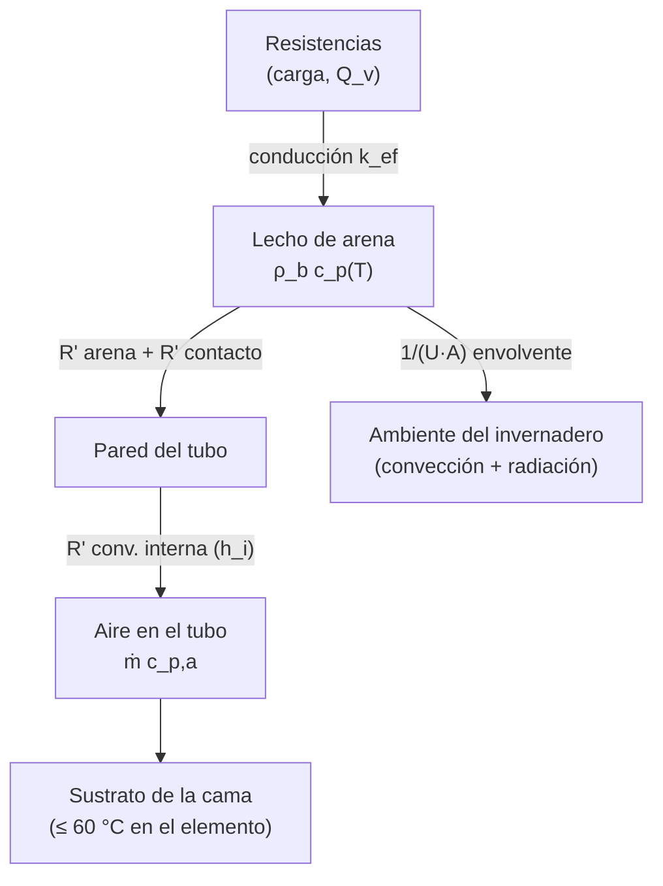
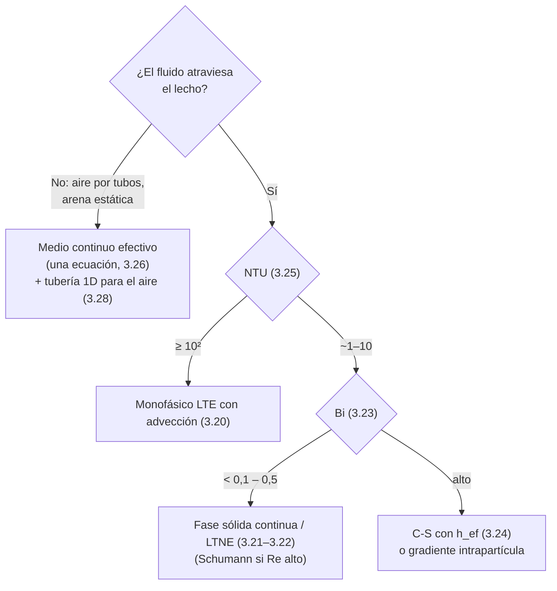
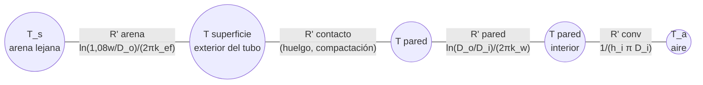

# Capítulo 3. Fundamentos físicos, propiedades y modelos matemáticos

## 3.1 Objetivo y alcance
Este capítulo fija las propiedades de la arena, las leyes físicas y el modelo matemático que se usan después en el predimensionamiento (cap. 8 del plan) y en el modelo de simulación (cap. 9 del plan). 
El desarrollo se concentra en tres temas: la conductividad efectiva del lecho (3.4), la elección del modelo de lecho (3.7) y la transferencia de calor en los tubos de extracción y en la envolvente (3.9).

La configuración de referencia es la hipótesis preferida del proyecto [10]: **arena estática, carga con resistencias eléctricas embebidas y extracción con aire que circula por tubos**, sin contacto entre el aire y la arena. El aire que atraviesa el lecho se trata solo como alternativa de comparación.

> [!note] Convenciones
> - **(IE)** marca ecuaciones de ingeniería estándar de transferencia de calor que no provienen de las notas; conviene contrastarlas con un texto de referencia (Incropera, Çengel) antes de la entrega.
> - **(cálculo propio)** marca resultados calculados con datos de las notas que no figuran en ellas.
> - Las temperaturas en las correlaciones van en kelvin; en el texto se informan en °C.

El calor recorre una cadena de resistencias en serie: resistencia eléctrica → arena → pared del tubo → aire → sustrato. Las pérdidas salen en paralelo por la envolvente.

## 3.2 Propiedades de la arena de cuarzo
### 3.2.1 Tabla de propiedades de diseño

| Propiedad | Valor o expresión | Validez / condición | Fuente |
|---|---|---|---|
| Densidad aparente $\rho_b$ | 1586 kg/m³ | arena de cuarzo, $d_p$ = 0,80 mm | [3] |
| Densidad aparente $\rho_b$ (alternativa) | 1425 kg/m³ (medida); 1625–1747 kg/m³ en caída libre | arena sílice / arenas de UAE | [1], [7] |
| Densidad del grano $\rho_s$ | 2650 kg/m³ | — | [1] |
| Porosidad $\varepsilon$ | 0,44 | arena de cuarzo | [3] |
| Calor específico $c_p$ | ≈ 850 J/(kg·K) a 20 °C; 1187 J/(kg·K) a 600 °C; medio 1062 J/(kg·K) entre 45 y 600 °C | DSC, argón | [3] |
| Calor específico (ajuste) | $c_p(T) = T + 427$ J/(kg·K), $T$ en K | 323–846 K | [2] |
| Conductividad del lecho seco $k_{ef}$ | 0,25–0,30 W/(m·K) a 20 °C; 0,85–0,90 W/(m·K) a 800 °C | hot-wire, $d_p$ = 2 mm, $\varepsilon$ = 0,44 | [3] |
| Conductividad (ajuste) | $k_c(T) = 0{,}0006\,T - 0{,}0102$ W/(m·K), $T$ en K | 323–846 K | [2] |
| Conductividad arena húmeda | 1,0–1,5 W/(m·K) | 8,6–12,6 % de agua en peso, < 100 °C | [8] |
| Inversión α→β del cuarzo | 573 °C (846 K): pico de $c_p$ y +0,8 % de volumen | — | [3] |
| Emisividad del grano $\psi$ | 0,7 | — | [1] |

> [!warning] Dato faltante D1. Propiedades de la arena que se va a comprar
> Las cifras de la tabla corresponden a arenas de otros países. Hay que caracterizar la arena real (granulometría por tamizado, densidad aparente en caída libre y compactada, humedad residual). La conductividad es la propiedad más incierta (ver 3.4.5).
### 3.2.2 Calor específico $c_p(T)$
El calor específico crece con la temperatura. El ajuste lineal de [2] es el que se usa en simulación porque se integra de forma cerrada:
$$
c_p(T) = T + 427 \qquad [\text{J/(kg·K)}],\quad 323\ \text{K} \le T \le 846\ \text{K}
\tag{3.1}
$$
donde $T$ es la temperatura absoluta del lecho [K].

> [!note] Discrepancia entre fuentes
> - Extrapolado a 20 °C, (3.1) da 720 J/(kg·K) frente a 850 J/(kg·K) medidos en [3]
> - cerca de 573 °C da 1273 J/(kg·K) frente a ~1187 J/(kg·K) a 600 °C en [3]. 
> - Es decir, subestima a baja temperatura y sobreestima cerca de la inversión. 
> - Para el balance de energía conviene comparar el resultado con el valor medio de 1062 J/(kg·K) de [3] y tomar el menor como caso conservador.

### 3.2.4 Inversión del cuarzo a 573 °C
A 573 °C el cuarzo pasa de la fase α a la β. Según [3] esto produce:
- un **pico marcado de $c_p$** (por encima de 573 °C se estabiliza cerca de 1100 J/(kg·K));
- una **expansión volumétrica súbita de 0,8 %**;
- **fractura de granos** solo con enfriamiento extremo (templado en agua desde ~810 °C). Con tasas normales de 25 K/min en calentamiento y 4 K/min en enfriamiento no se midió degradación.
La afirmación de que la arena es "estable por encima de 800 °C" (por ejemplo, el "hasta 800 °C" de [2]) necesita esta salvedad. Además, (3.1) y el ajuste de $k_c$ de [2] **dejan de valer por encima de 846 K**.

> [!warning] Supuesto crítico S1. La temperatura que importa es la local, no la media
> - En la validación de [2], a las 2 h de carga la arena tenía 470 K de media pero **1392 K de máxima** junto a las resistencias. Aunque la temperatura media de diseño quede por debajo de 573 °C, la arena que toca las vainas puede atravesar la inversión en cada ciclo. 
> - El límite de 573 °C se aplica a la **temperatura máxima local de la arena** y se verifica en la simulación (cap. 9 del plan). La expansión de 0,8 % entra en el cálculo de holguras del contenedor (cap. 8.6 del plan).
### 3.2.5 Humedad y aglomeración
La humedad cambia la conductividad por un factor de 3 a 5 [8]:

| Estado de la arena | $k_{ef}$ [W/(m·K)] | Fuente |
|---|---|---|
| Seca | 0,2–0,4 | [8] |
| Húmeda (8,6–12,6 % en peso) | 1,0–1,5 | [8] |
| Saturada | 2–3 | [8] |

El agua reemplaza al aire de los poros y crea un camino conductivo [8]. 
En un acumulador que trabaja por encima de 100 °C la arena estará seca en régimen, por lo que **el diseño se hace con $k$ de arena seca**. Los valores de humedad sirven para dos cosas: el primer calentamiento y el riesgo de reabsorción en el invernadero con nebulización [10].

El agua que se reabsorbe se evapora en cada carga y consume calor latente (IE):
$$
E_{lat} = w\, m_{arena}\, h_{fg}
\tag{3.2}
$$
donde $w$ es el contenido de agua [kg agua/kg arena seca], $m_{arena}$ la masa de arena seca [kg] y $h_{fg} \approx 2{,}26\times10^{6}$ J/kg el calor latente de vaporización del agua.

> [!note] Orden de magnitud (cálculo propio, ilustrativo)
> Con 30 kg de arena (orden de magnitud de la sección 2 del plan [10]) y una humedad de 10 % en peso, $E_{lat} \approx 0{,}1 \cdot 30 \cdot 2{,}26 \approx 6{,}8$ MJ, comparable con los ~8,8 MJ de la noche de peor caso [10]. **El contenedor debe ser estanco a la humedad del invernadero** y necesita un venteo para el vapor del primer secado.

## 3.3 Calor sensible y densidad energética
La energía almacenada en una masa de arena que pasa de $T_1$ a $T_2$ es:
$$
Q = m \int_{T_1}^{T_2} c_p(T)\, dT = m\, \bar c_p\, (T_2 - T_1)
\tag{3.3}
$$
donde $Q$ es la energía [J], $m$ la masa de arena [kg], $c_p(T)$ el calor específico [J/(kg·K)], $T_1$ y $T_2$ las temperaturas inicial y final [K] y $\bar c_p$ el calor específico medio en el intervalo [J/(kg·K)].

Con (3.1) la integral es cerrada:
$$
\Delta h = \int_{T_1}^{T_2} (T + 427)\, dT = \frac{T_2^2 - T_1^2}{2} + 427\,(T_2 - T_1),
\qquad \bar c_p = 427 + \frac{T_1 + T_2}{2}
\tag{3.4}
$$
donde $\Delta h$ es la energía específica [J/kg].

La densidad energética volumétrica del lecho es:
$$
e_v = \rho_b\, \Delta h
\tag{3.5}
$$
donde $e_v$ se expresa en J/m³ (÷ 3,6·10⁶ para kWh/m³) y $\rho_b$ es la densidad aparente [kg/m³].

$T_1$ (temperatura mínima útil) y $T_2$ (temperatura máxima) son variables de diseño que se fijan en el cap. 8 del plan. 

La tabla muestra cómo cambian los resultados para valores posibles (cálculo propio, (3.4) y (3.5) con $\rho_b$ = 1586 kg/m³ [3]). La última columna es la masa necesaria para entregar 8,8 MJ (174 W durante 14 h, peor caso nominal [10]) **sin pérdidas ni energía no extraíble**.

| $T_1$ [°C] | $T_2$ [°C] | $\bar c_p$ [J/(kg·K)] | $\Delta h$ [kJ/kg] | $e_v$ [kWh/m³] | Error con $c_p$ = 850 constante | Masa para 8,8 MJ [kg] |
|---|---|---|---|---|---|---|
| 60 | 200 | 830 | 116 | 51 | +2 % | 76 |
| 60 | 300 | 880 | 211 | 93 | −3 % | 42 |
| 60 | 400 | 930 | 316 | 139 | −9 % | 28 |
| 60 | 500 | 980 | 431 | 190 | −13 % | 20 |
| 60 | 560 | 1010 | 505 | 223 | −16 % | 17 |
| 100 | 300 | 900 | 180 | 79 | −6 % | 49 |
| 100 | 500 | 1000 | 400 | 176 | −15 % | 22 |

> [!note] Lectura de la tabla
> - Pasar de $T_2$ = 300 °C a 500 °C divide la masa por algo más de dos, pero eleva las pérdidas y acerca la arena a la inversión de 573 °C. Ese es el compromiso del estudio de $T_{max}$ (cap. 8.2 del plan).
> - Usar $c_p$ constante de 20 °C subestima la energía hasta un 16 %. Es coherente con [4], que reporta desviaciones superiores al 12 % si se ignora la variación de las propiedades con $T$. En cambio, [5] reporta errores de 1–5 %; la diferencia depende del rango de temperatura.
> - Como referencia, [2] informa 860 MJ/m³ (239 kWh/m³) para arena a 883 K referida a 293 K, unas 3 veces la del agua a 363 K (394 MJ/m³).

## 3.4 Conductividad térmica efectiva
### 3.4.1 Por qué no se usa la conductividad del cuarzo
El lecho no es un sólido sino una mezcla de granos, aire en los poros y pequeños contactos entre granos. El calor viaja por cinco caminos en paralelo y en serie [1], [5]:
1. conducción dentro del grano;
2. conducción por los contactos entre granos (áreas muy pequeñas);
3. Convección a través de la película de gas que rodea cada contacto;
4. convección en el gas de los poros (el aire aísla: $k_f$ ≈ 0,026 W/(m·K) a 20 °C);
5. radiación entre superficies de granos a través del poro, que crece con $T^3$.

Por eso la conductividad del lecho seco (0,2–0,7 W/(m·K)) es varias veces menor que la del grano (~1,5 W/(m·K)) [1]. Además, según [3], la conductividad del grano influye poco: dominan la porosidad y el tamaño de grano.

Dos cotas teóricas (IE) acotan el problema: fases en paralelo (límite superior) y en serie (límite inferior):
$$
k_{\parallel} = \varepsilon k_f + (1-\varepsilon) k_s,
\qquad
k_{\perp} = \left(\frac{\varepsilon}{k_f} + \frac{1-\varepsilon}{k_s}\right)^{-1}
\tag{3.6}
$$
donde $k_s$ es la conductividad del grano y $k_f$ la del gas [W/(m·K)]. Con los parámetros de [1] a 20 °C ($k_s$ = 1,37, $k_f$ = 0,026, $\varepsilon$ = 0,46) dan 0,75 y 0,055 W/(m·K) (cálculo propio). Las correlaciones de 3.4.3 interpolan entre ambas según la geometría de los contactos.

![[Review on modeling approaches for packed-bed thermal storage systems-1793388500881.webp]]`
> **Descripción:** Fig. 6 de [5]. Fenómenos físicos que componen la conductividad efectiva de un lecho empacado: conducción en el sólido, en los contactos, en el fluido y radiación entre partículas.

### 3.4.2 Variables comunes (Tabla S2 de [1])

| Símbolo | Definición | Valor en [1] | Unidad |
|---|---|---|---|
| $k_s$ | conductividad del grano: $0{,}95 + 1{,}21\cdot10^{-3}T + 7{,}19\cdot10^{-7}T^2$ | función de $T$ | W/(m·K) |
| $k_f$ | conductividad del aire: $6\cdot10^{-5}T + 0{,}0081$ | función de $T$ | W/(m·K) |
| $\kappa$ | $k_s/k_f$ | ~53 a 20 °C | — |
| $\varepsilon$ | $1 - \rho_b/\rho_s$ | 0,462 (1425/2650) | — |
| $B$ | $1{,}25\left(\frac{1-\varepsilon}{\varepsilon}\right)^{10/9}$, factor de forma de la celda (Zehner) | 1,48 | — |
| $\omega$ | fracción de área de contacto (Zehner-Bauer) | 0,0010 | — |
| $d_p$ | diámetro medio de grano | 0,5 mm | m |
| $\psi$ | emisividad del grano | 0,7 | — |
| $\Lambda$ | $k_s/(4\sigma d_p T^3)$ | función de $T$ | — |
| $\beta,\ \gamma$ | parámetros de Yagi-Kunii y Kunii-Smith | 0,9 y 2/3 | — |
| $\phi$ | espesor efectivo de la película de gas (Kunii-Smith) | ver Tabla S2 de [1] | — |
| $\alpha_0,\ f_0$ | parámetros de Hadley: $\log_{10}\alpha_0 = -1{,}084 - 6{,}778(\varepsilon - 0{,}298)$; $f_0 = 0{,}8 + 0{,}1\varepsilon$ | — | — |
| $C$ | $(k_s - k_f)/(k_s + 2k_f)$, polarizabilidad (Gonzo) | — | — |
| $\sigma$ | constante de Stefan-Boltzmann | 5,67·10⁻⁸ | W/(m²·K⁴) |

> [!warning] Supuesto S2. Unidad de $T$ en $k_s(T)$
> La Tabla S2 no indica si $T$ va en K o °C en la expresión de $k_s$. Se adopta **K**, igual que en $k_f(T)$, que con K da 0,026 W/(m·K) a 20 °C (valor correcto del aire). Con °C, $k_{ef}$ bajaría un 8–10 % (cálculo propio). Hay que confirmarlo en la fuente citada en la Tabla S2 (ref. [8] del suplemento).
### 3.4.3 Correlaciones sin radiación (Tabla S1 de [1])
Todas devuelven $k_e$ [W/(m·K)] en función de $k_f$, $\kappa$ y $\varepsilon$.

**Modelos de contacto (Yagi-Kunii y Kunii-Smith).** Suponen que el calor pasa de grano a grano a través de la película de gas que rodea el contacto:
$$
k_e^{YK} = k_f\,\frac{\beta(1-\varepsilon)}{\phi + \gamma\,k_f/k_s},
\qquad
k_e^{KS} = k_f\left(\varepsilon + \frac{\beta(1-\varepsilon)}{\phi + \gamma\,k_f/k_s}\right)
\tag{3.7}
$$
Kunii-Smith agrega el camino del gas en paralelo ($\varepsilon k_f$). Según [1] ajustan bien solo a baja temperatura.

**Modelos de celda unitaria (Zehner-Schlünder y ZBS).** Idealizan el lecho como una celda cilíndrica: una fracción $1-\sqrt{1-\varepsilon}$ es gas en paralelo y el resto es un núcleo de partícula deformada (factor $B$) rodeada de gas:
$$
k_e^{ZS} = k_f\left[\left(1-\sqrt{1-\varepsilon}\right) + \sqrt{1-\varepsilon}\;\Gamma\right]
\tag{3.8}
$$
$$
\Gamma = \frac{2}{N}\left[\frac{\kappa - 1}{N^2}\,\frac{B}{\kappa}\,\ln\!\left(\frac{\kappa}{B}\right) - \frac{B-1}{N} - \frac{B+1}{2}\right],
\qquad N = 1 - \frac{B}{\kappa}
\tag{3.9}
$$

El modelo **Zehner-Bauer-Schlünder (ZBS)** agrega en el núcleo una fracción de área $\omega$ de contacto sólido directo, en paralelo con la conducción a través del gas:
$$
k_e^{ZBS} = k_f\left[\left(1-\sqrt{1-\varepsilon}\right) + \sqrt{1-\varepsilon}\,\big(\omega\kappa + (1-\omega)\,\Gamma\big)\right]
\tag{3.10}
$$

**Modelos de promedio (Hadley, Gonzo y Batchelor).** Combinan las fases en serie y en paralelo con parámetros de ajuste:
$$
k_e^{H} = k_f\left[(1-\alpha_0)\,\frac{\varepsilon f_0 + \kappa(1-\varepsilon f_0)}{1 - \varepsilon(1-f_0) + \kappa\varepsilon(1-f_0)} + \alpha_0\,\frac{2\kappa^2(1-\varepsilon) + (1+2\varepsilon)\kappa}{(2+\varepsilon)\kappa + 1 - \varepsilon}\right]
\tag{3.11}
$$
$$
k_e^{G} = k_f\,\frac{1 + 2C(1-\varepsilon) + (2C^3 - 0{,}1C)(1-\varepsilon)^2 + 0{,}05\,(1-\varepsilon)^3 e^{4{,}5C}}{1 - C(1-\varepsilon)},
\qquad
k_e^{B} = k_f\,(4\ln\kappa - 11)
\tag{3.12}
$$

> [!note] Correcciones de transcripción respecto de la nota de [1]
> - En Hadley, la nota escribe $2\alpha_0\kappa^2(1-\varepsilon)$ dentro del segundo término; en la forma original, $\alpha_0$ multiplica a toda la fracción, como en (3.11).
> - En la interpolación de $\phi$ de Kunii-Smith la nota escribe $(\phi_1 + \phi_2)$; la forma correcta es $\phi = \phi_2 + (\phi_1 - \phi_2)(\varepsilon - 0{,}26)/0{,}216$.
> - Batchelor (3.12) es una asíntota para $\kappa \gg 1$: con $\kappa$ ≈ 50 queda fuera de su rango preciso.
### 3.4.4 Radiación intergranular
A temperatura alta, cada poro actúa como una pequeña cavidad: los granos calientes emiten infrarrojo que atraviesa el gas y calienta al grano vecino [1]. En los modelos de Zehner el aporte radiativo se **suma** en paralelo a la conducción:
$$
k_e^{ZBS,r} = k_e^{ZBS} + k_e^{r},
\qquad
k_e^{r} = 4\,F_B\,\sigma\,d_p\,T^3
\tag{3.13}
$$
$$
F_B = \left(1-\sqrt{1-\varepsilon}\right)\varepsilon + \frac{\sqrt{1-\varepsilon}}{2/\psi - 1}\cdot\frac{B+1}{B}\cdot\frac{1}{1 + \dfrac{1}{(2/\psi - 1)\,\Lambda}}
\tag{3.14}
$$
donde 
- $k_e^r$ es la conductividad radiativa [W/(m·K)],
-  $F_B$ un factor de intercambio adimensional,
-  $d_p$ el diámetro de grano [m],
-  $T$ la temperatura local [K], 
- $\psi$ la emisividad del grano y 
- $\Lambda = k_s/(4\sigma d_p T^3)$ el cociente entre conducción en el grano y radiación (si $\Lambda$ es chico, el grano no logra redistribuir el calor que recibe por radiación).

En Yagi-Kunii y Kunii-Smith la radiación entra con dos coeficientes, uno entre huecos ($h_{rv}$) y otro entre superficies sólidas ($h_{rs}$) [1]:
$$
k_e^{KS,r} = k_f\left[\varepsilon\left(1 + \frac{\beta\,h_{rv}\,d_p}{k_f}\right) + \frac{\beta(1-\varepsilon)}{\gamma\,\dfrac{k_f}{k_s} + \dfrac{1}{1/\phi + d_p h_{rs}/k_f}}\right]
\tag{3.15}
$$
$$
h_{rv} = \frac{0{,}227}{1 + \dfrac{\varepsilon(1-\psi)}{2\psi(1-\varepsilon)}}\left(\frac{T}{100}\right)^3,
\qquad
h_{rs} = \frac{0{,}227\,\psi}{2-\psi}\left(\frac{T}{100}\right)^3
\qquad [\text{W/(m²·K)}]
\tag{3.16}
$$
> [!warning] Supuesto S3. Coeficiente de Yagi-Kunii con radiación
> La Tabla S1 usa 0,1952 en Yagi-Kunii y 0,227 en Kunii-Smith. Es el mismo coeficiente en dos unidades: 0,1952 kcal/(m²·h·K) × 1,163 = 0,227 W/(m²·K) = 4σ·10⁶. Se usa **0,227** en ambos para trabajar en SI.

**¿Desde qué temperatura importa la radiación?** $k_e^r$ crece con $d_p\,T^3$, así que el umbral depende del tamaño de grano. La tabla muestra la fracción radiativa $k_e^r/k_e^{ZBS,r}$ (cálculo propio con el script del apéndice):

| $T$ [°C] | 100 | 200 | 300 | 400 | 500 | 600 |
|---|---|---|---|---|---|---|
| $d_p$ = 0,5 mm | 2,5 % | 4 % | 6,5 % | 9 % | 12 % | 15 % |
| $d_p$ = 2 mm | 9 % | 15 % | 22 % | 28 % | 34 % | 40 % |

Si se toma como criterio que la radiación debe incluirse cuando aporta más del 10 % (criterio propio), **para arena fina de 0,5 mm importa** **a partir de ~450 °C** y para **grano de 2 mm** **a partir de ~110 °C**. Esto es coherente con [1], donde solo el modelo ZBS con radiación reprodujo las mediciones a 500 °C, con RMSE < 8 °C.

> [!note] Dos umbrales distintos en la literatura
> [5] recomienda no despreciar la radiación por encima de 750 °C, pero compara el coeficiente radiativo con el **convectivo** en lechos atravesados por fluido. En un lecho estático la comparación relevante es con la **conducción**, mucho más débil, y la radiación pesa desde temperaturas menores.
### 3.4.5 Resultados y modelo adoptado
![[keff_arena_ZBS.png]]
*Figura 3.1. $k_{ef}(T)$ de arena de cuarzo seca entre 20 y 600 °C con el modelo ZBS (3.10) con y sin radiación (3.13), con los parámetros de la Tabla S2 de [1], comparado con el ajuste lineal de [2] y la medición de [3] a 20 °C. Generada con el script del apéndice.*

![[keff_arena_correlaciones.png]]
*Figura 3.2. Las siete correlaciones de la Tabla S1 de [1] sin radiación (a) y las cuatro con radiación (b), con los mismos parámetros. ZS y ZBS quedan superpuestas porque $\omega$ = 0,001 aporta poco.*

> [!example] Imagen a insertar 2: correlaciones y validación en [1]
> ![[Improved effective thermal conductivity of sand bed in thermal energy storage systems-1790646339593.webp]]
> **Descripción:** Fig. 6 de [1]. Correlaciones de conductividad efectiva desde temperatura ambiente hasta 500 °C, (A) sin radiación y (B) con radiación. Sirve para comparar con la Figura 3.2.
>
> ![[Improved effective thermal conductivity of sand bed in thermal energy storage systems-1790646383853.webp]]
> **Descripción:** Fig. 8 de [1]. Modelo ZBS con radiación frente a las temperaturas medidas en T1–T4: justifica la elección del modelo.

Valores de $k_{ef}$ con ZBS [W/(m·K)] (cálculo propio):

| $T$ [°C] | 20 | 100 | 200 | 300 | 400 | 500 | 573 |
|---|---|---|---|---|---|---|---|
| ZBS sin radiación | 0,154 | 0,178 | 0,209 | 0,240 | 0,271 | 0,303 | 0,327 |
| ZBS + rad., $d_p$ = 0,5 mm | 0,156 | 0,183 | 0,218 | 0,256 | 0,298 | 0,344 | 0,380 |
| ZBS + rad., $d_p$ = 2 mm | 0,163 | 0,196 | 0,246 | 0,305 | 0,377 | 0,461 | 0,533 |
| Ajuste lineal de [2] | — | 0,214 | 0,274 | 0,334 | 0,394 | 0,454 | 0,497 |

Sensibilidad de ZBS sin radiación a 300 °C (cálculo propio): duplicar $k_s$ sube $k_{ef}$ un 24 %; bajar $\varepsilon$ de 0,46 a 0,40 lo sube un 21 %; subir $\omega$ de 0,001 a 0,01 apenas lo mueve (+4 %).

**Modelo adoptado:** ZBS con radiación, (3.10) + (3.13), con $k_{ef} = f(T)$ cargado como propiedad del material. Es el único validado contra mediciones de arena en un lecho calentado por resistencias, con RMSE < 8 °C [1].

> [!warning] Dato faltante D2. Nivel absoluto de $k_{ef}$
> - Con los parámetros de [1], ZBS da 0,15 W/(m·K) a 20 °C, mientras que [3] midió 0,25–0,30 W/(m·K) (otra arena, $d_p$ = 2 mm, $\varepsilon$ = 0,44), y el ajuste de [2] queda 15–30 % por encima de ZBS con radiación. 
> - Hasta medir la arena real, el diseño se hace con una **banda**: límite inferior ZBS + radiación (conservador para la extracción) y límite superior el ajuste de [2] (conservador para las pérdidas internas y la temperatura de las vainas). 
> - Se puede medir con el método de bajo costo de [8], $k = Q/(S\,\Delta T)$ con un factor de forma conocido (3.33).
## 3.5 Mejora de la conductividad efectiva

### 3.5.1 Virutas metálicas de descarte
En [1] se agregaron virutas de aluminio, latón y acero de talleres a un 20 % en volumen, en capas o en mezcla uniforme. La métrica es la tasa máxima de calentamiento en el punto entre resistencias:

| Composición (20 % vol) | Tasa máx. [°C/min] | Relación con arena pura |
|---|---|---|
| Arena pura | 5,0 | 1,00 |
| Latón en capas | 8,8 | 1,79 |
| Metales mixtos en capas | 8,7 | 1,76 |
| Aluminio en capas | 8,5 | 1,71 |
| Aluminio uniforme | 8,4 | 1,70 |
| Latón uniforme | 8,2 | 1,65 |
| Metales mixtos uniforme | 7,3 | 1,48 |

**Umbral de percolación.** La mejora no es lineal con la fracción de aluminio [1]: 5 % → 1,18; 10 % → 1,36; 20 % → 1,70. Por debajo de ~10–20 % las virutas quedan aisladas entre granos; cerca del 20 % forman una red continua y la conducción salta. La geometría importa tanto como la conductividad del metal: el latón de electroerosión, en forma de alambre, se ordena en capas densas que actúan como aletas [1].

> [!example] Imagen: efecto del contenido de aluminio
> ![[Improved effective thermal conductivity of sand bed in thermal energy storage systems-1790646755380.webp]]
> **Descripción:** Fig. 10 de [1]. Temperatura frente al tiempo en T3 y T4 para 5, 10 y 20 % de aluminio en mezcla uniforme. Muestra el salto por percolación.

### 3.5.2 Trade-off con el calor específico (arena-cobre)
En [7] las virutas de cobre subieron $k$ de 0,201 a 0,355–0,414 W/(m·K), pero el $c_p$ de la mezcla bajó hasta un 34 %, porque el cobre tiene ~385 J/(kg·K). En el tanque de ensayo, la arena pura retuvo 845 kJ en 12,5 h, frente a 671 kJ con virutas largas y 632 kJ con piezas pequeñas [7].

El balance debe hacerse por volumen, porque el módulo está limitado por espacio y pérdidas. La capacidad térmica volumétrica de la mezcla es (IE):
$$
(\rho c)_{mez} = (1 - \phi_m)\,\rho_b\,c_{p,arena} + \phi_m\,\rho_{b,m}\,c_{p,m}
\tag{3.17}
$$

donde $\phi_m$ es la fracción volumétrica que ocupan las virutas, $\rho_{b,m}$ la densidad aparente del lecho de virutas (no la del metal macizo) [kg/m³] y $c_{p,m}$ el calor específico del metal [J/(kg·K)].

> [!note] El trade-off depende de si se fija la masa o el volumen
> Por unidad de **masa** el metal siempre baja $c_p$. Por unidad de **volumen** no necesariamente: el aluminio macizo tiene $\rho c$ ≈ 2712·897 ≈ 2,4 MJ/(m³·K), más del doble que la arena a granel (~1,3 MJ/(m³·K)). El resultado depende de $\rho_{b,m}$, que no figura en las notas.

**Para el acumulador nocturno, [7] recomienda arena pura si la prioridad es retener calor. En esta pila**, en cambio, el problema es **extraer potencia de forma estable** hacia los tubos. **Las virutas son una opción para la zona que rodea los tubos y las resistencias, no necesariamente para todo el lecho** (se evalúa en el cap. 7 del plan).
### 3.5.3 Aletas
En [9], un tubo central de cobre en arena de sílice fina, con agua como HTF, redujo los tiempos así frente al tubo liso (misma masa de cobre en todas las variantes):

| Configuración | Carga [h] | Reducción | Descarga [h] | Reducción |
|---|---|---|---|---|
| Sin aletas | 11,86 | — | 17,58 | — |
| 10 anulares | 6,81 | 42,6 % | 6,61 | 62,4 % |
| 20 anulares | 5,19 | 56,2 % | 5,58 | 68,3 % |
| 4 radiales | 4,86 | 59,0 % | 5,42 | 69,2 % |
| 8 radiales | 4,30 | 63,7 % | 3,78 | 78,5 % |

Las aletas radiales (longitudinales) superaron a las anulares. En términos de 3.9.3, una aleta externa aumenta el diámetro equivalente del tubo y reduce la resistencia de la arena (3.31), que es logarítmica en $w/D$.

> [!example] Imagen: configuraciones de aletas
> ![[Experimental Study of a Silica Sand Sensible Heat Storage System Enhanced by Fins-1792542410270.webp]]
> **Descripción:** figura principal de [9]. Esquema del sistema *shell-and-tube* con arena y las configuraciones de aletas anulares y radiales.
## 3.6 Granulometría frente al tipo de fluido
El tamaño de grano tiene efectos opuestos sobre la conducción y sobre el paso de fluido.

**Si el fluido atraviesa el lecho**, la caída de presión sigue la ecuación de Ergun [4], [6]:
$$
\frac{\Delta P}{L} = 150\,\frac{(1-\varepsilon)^2}{\varepsilon^3}\,\frac{\mu_f\,U_s}{d_p^2} + 1{,}75\,\frac{1-\varepsilon}{\varepsilon^3}\,\frac{\rho_f\,U_s^2}{d_p}
\tag{3.18}
$$
$$
\kappa_p = \frac{d_p^2\,\varepsilon^3}{150\,(1-\varepsilon)^2}
\tag{3.19}
$$
donde $\Delta P/L$ es el gradiente de presión [Pa/m], $\mu_f$ la viscosidad dinámica del aire [Pa·s], $\rho_f$ su densidad [kg/m³], $U_s$ la velocidad superficial (caudal volumétrico/área total) [m/s] y $\kappa_p$ la permeabilidad [m²]. El término viscoso crece con $1/d_p^2$: reducir el grano a la mitad cuadruplica la caída de presión, y $\varepsilon^3$ hace que pequeños cambios de compactación pesen mucho [6].

**Si el aire va por tubos**, **no hay flujo en el lecho y Ergun no aplica**. **Lo que importa es la conducción y el contacto con la pared del tubo**.

| Criterio                      | Aire por tubos (hipótesis preferida)                                                                                                         | Aire a través del lecho (alternativa)                                                         |
| ----------------------------- | -------------------------------------------------------------------------------------------------------------------------------------------- | --------------------------------------------------------------------------------------------- |
| **Granulometría recomendada** | **Fina y bien compactada**                                                                                                                   | 0,5–2 mm, lavada y tamizada, distribución estrecha [6]                                        |
| Por qué                       | **Baja** $\varepsilon$ → **mayor** $k_{ef}$ (−0,06 en $\varepsilon$ ≈ +21 %, 3.4.5); **mejor contacto con tubos y resistencias, sin huecos** | La caída de presión baja con $d_p^2$; los finos tapan poros y bajan $\varepsilon$ [6]         |
| Evidencia                     | La arena fina cargó más rápido que la gruesa: 11,86 h frente a 13,36 h [9]; menor grano da mayor coeficiente efectivo [2]                    | Con arena de 0,5 mm la transferencia sólido-fluido no limita (NTU 10³–10⁴, cálculo de [6])    |
| Contrapartida                 | La radiación crece con $d_p$: a 500 °C, 2 mm da $k_{ef}$ 34 % mayor que 0,5 mm (3.4.5)                                                       | Mezclas arena-arcilla reducen la permeabilidad en órdenes de magnitud y son incompatibles [6] |

> [!note] Tensión entre conducción y radiación
> - El ZBS de conducción (3.10) no depende de $d_p$; solo la radiación (3.13) lo hace. 
> - La ventaja experimental de la arena fina a baja temperatura [9] viene de la compactación y el contacto, que ZBS solo captura a través de $\varepsilon$. 
> - A alta temperatura, el grano grueso conduce mejor por radiación. 
> - La granulometría óptima depende entonces de $T_{max}$ y se define junto con el cap. 8.2 del plan.
## 3.7 Modelos de lecho: comparación y elección
### 3.7.1 Familia de modelos

| Modelo | Ecuaciones de energía | Hipótesis principal | Cuándo se usa | Costo | Fuente |
|---|---|---|---|---|---|
| **Medio continuo efectivo** (parámetros sustitutos) | 1: sólido homogéneo con $\rho_b$, $c_p(T)$, $k_{ef}(T)$ | Sin flujo en el lecho; el gas de los poros solo entra en $k_{ef}$ | Arena estática con resistencias o tubos | Bajo; permite transitorios de días | [1], [2] |
| Monofásico con flujo (LTE) | 1, con término advectivo | $T_f = T_s$ en cada punto | Fluido que atraviesa el lecho con NTU muy alto | Bajo | [4], [5] |
| Schumann | 2 (fluido y sólido) | Sin conducción en ninguna fase ni pérdidas | Lechos con Re alto | Bajo | [4], [5] |
| Fase sólida continua (C-S) / LTNE | 2, con conducción efectiva en cada fase e intercambio $h a_s$ | $T_f \ne T_s$; grano isotérmico | Flujo con NTU del orden de 1–10 | Medio | [4], [6] |
| Gradiente intrapartícula (D-C) | 2 + conducción radial en la partícula | Grano no isotérmico | Partículas grandes, Bi alto | Alto: 9,6 a 57 veces más lento que C-S | [4], [5] |
| Trifásico | 3 (fluido, sólido, pared) | La pared almacena y conduce | Tanques chicos con mucho efecto de pared | Medio-alto | [5] |
| Discreto (DEM) | Una por partícula | — | Investigación | Prohibitivo para transitorios largos | [2] |

Ecuaciones de referencia de las dos familias principales (1D, de [4]).

Monofásico con flujo:
$$
\left[(1-\varepsilon)\rho_s c_{p,s} + \varepsilon\rho_f c_{p,f}\right]\frac{\partial T}{\partial t} + \varepsilon\rho_f c_{p,f}\,u\,\frac{\partial T}{\partial z} = k_{ef,z}\,\frac{\partial^2 T}{\partial z^2} + U a_b\,(T_\infty - T)
\tag{3.20}
$$

Fase sólida continua (dos ecuaciones):
$$
\varepsilon\rho_f c_{p,f}\left(\frac{\partial T_f}{\partial t} + u\,\frac{\partial T_f}{\partial z}\right) = \frac{\partial}{\partial z}\!\left(k_{f,ef}\,\frac{\partial T_f}{\partial z}\right) + h\,a_s\,(T_s - T_f) + U a_b\,(T_\infty - T_f)
\tag{3.21}
$$
$$
(1-\varepsilon)\rho_s c_{p,s}\,\frac{\partial T_s}{\partial t} = \frac{\partial}{\partial z}\!\left(k_{s,ef}\,\frac{\partial T_s}{\partial z}\right) + h\,a_s\,(T_f - T_s)
\tag{3.22}
$$

donde $T_f$, $T_s$ son las temperaturas del fluido y del sólido [K]; $u$ la velocidad intersticial [m/s]; $z$ la coordenada axial [m]; $h$ el coeficiente partícula-fluido [W/(m²·K)]; $a_s = 6(1-\varepsilon)/d_p$ la superficie específica [m⁻¹]; $U$ el coeficiente global de pérdidas [W/(m²·K)]; $a_b$ la superficie lateral por unidad de volumen [m⁻¹]; y $T_\infty$ la temperatura ambiente [K]. Schumann es (3.21)–(3.22) sin los términos de conducción ni de pérdidas [4].

> [!example] Imagen 5: mecanismos y modelos
> ![[Review on modeling approaches for packed-bed thermal storage systems-1793386572598.webp]]
> **Descripción:** Fig. 3 de [5]. Mecanismos internos de transferencia de calor en un lecho empacado; ayuda a explicar qué término de cada modelo representa cada mecanismo.

### 3.7.2 Criterios de selección: Bi y NTU
**Número de Biot de la partícula:** compara la resistencia interna del grano con la externa:
$$
Bi = \frac{h\,L_c}{k_s}
\tag{3.23}
$$
donde $L_c$ es la longitud característica del grano [m].
[4] usa $L_c = d_p$ y acepta modelos sin gradiente interno si $Bi$ < 0,5; [6] usa $L_c = d_p/6$ (volumen/superficie de una esfera) con el criterio clásico $Bi$ < 0,1. 
Para partículas con Bi alto, [4] propone un coeficiente efectivo en lugar del modelo D-C:
$$
h_{ef} = \left(\frac{1}{h} + \frac{d_p}{10\,k_s}\right)^{-1}
\tag{3.24}
$$

**Número de unidades de transferencia del lecho:** compara la rapidez del intercambio fluido-sólido con la del transporte por el fluido [6]:
$$
NTU = \frac{h_v\,L}{G\,c_{p,f}},\qquad h_v = h\,a_s,\qquad G = \frac{\dot m}{A_{secc}}
\tag{3.25}
$$
donde 
- $h_v$ es el coeficiente volumétrico [W/(m³·K)], 
- $L$ la longitud del lecho en el sentido del flujo [m],
-  $G$ el flujo másico por unidad de área [kg/(m²·s)] 
-  $A_{secc}$ el área de la sección [m²].
Con NTU de 1–10 hace falta LTNE; con NTU de cientos o miles alcanza LTE [6].

### 3.7.3 Justificación para arena estática con aire por tubos
Con la configuración de referencia, el medio continuo efectivo es suficiente por cuatro razones:
1. **No hay advección en el lecho.** El aire de los poros está quieto: $u = 0$ en (3.20)–(3.22), desaparecen el término convectivo y el intercambio fluido-sólido, y el gas solo participa en $k_{ef}$.
2. **El gas de los poros no almacena energía apreciable.** $\varepsilon\rho_f c_{p,f}$ ≈ 0,46·1,2·1007 ≈ 560 J/(m³·K) a 20 °C, frente a $\rho_b c_p$ ≈ 1,3·10⁶ J/(m³·K): una relación del orden de 10⁻⁴ (cálculo propio).
3. **El grano es isotérmico.** Con un $Nu$ ≈ 2 de conducción pura alrededor del grano, $Bi = 2k_f/k_s$ ≈ 0,04–0,05 con $L_c = d_p$ (cálculo propio, valores de la Tabla S2). El tiempo de difusión interno del grano ($d_p^2/\alpha_s$) es del orden de décimas de segundo, frente a horas del proceso.
4. **Está validado para este tipo de equipo.** [1] (COMSOL, *Heat Transfer in Solids*) obtuvo RMSE < 8 °C y [2] (ANSYS Fluent, dominio sólido) diferencias medias de 9–20 K frente a ensayos de lechos de arena calentados por resistencias.

El aire de los tubos se resuelve aparte: en carga y reposo, como sólido equivalente con su conductividad molecular (en [2] la diferencia con un caso de convección natural exagerada fue < 0,2 %), y en descarga, con un modelo 1D de tubería acoplado a la pared (3.9.1) o con CFD (k-ε, $y^+$ entre 20 y 200) [2].
## 3.8 Ecuación gobernante transitoria
En el dominio de arena:
$$
\rho_b\,c_p(T)\,\frac{\partial T}{\partial t} = \nabla\cdot\big(k_{ef}(T)\,\nabla T\big) + Q_v(\mathbf{x},t)
\tag{3.26}
$$
donde: 
- $\rho_b$ es la densidad aparente [kg/m³]
-  $c_p(T)$ el calor específico de la arena (3.1) [J/(kg·K)], de modo que $\rho_b c_p = (1-\varepsilon)\rho_s c_{p,s} + \varepsilon\rho_f c_{p,f}$ ≈ $(1-\varepsilon)\rho_s c_{p,s}$
-  $T(\mathbf{x},t)$ la temperatura [K]; $t$ el tiempo [s];
-  $k_{ef}(T)$ la conductividad efectiva ZBS con radiación [W/(m·K)]
-  y $Q_v$ la generación volumétrica [W/m³], no nula solo dentro de las resistencias si se modelan como volumen. 
- Si hay virutas, $\rho_b c_p$ se reemplaza por (3.17) y $k_{ef}$ por un valor medido.

> [!note] Corrección respecto de la nota de [2]
> La ecuación 3 transcripta en la nota de [2] ($\rho\,\partial T/\partial t = (k_c/C_p)\nabla^2 T$) es dimensionalmente inconsistente. La forma correcta es $\rho\,c_p\,\partial T/\partial t = k\,\nabla^2 T$. Además, con $k = k(T)$ debe escribirse $\nabla\cdot(k\nabla T)$, que agrega el término $(dk/dT)\,|\nabla T|^2$; Fluent y COMSOL lo resuelven solos si $k$ se carga como función de $T$.

**Condiciones de borde e iniciales:**

| Frontera | Condición | Expresión | Fuente |
|---|---|---|---|
| Resistencias (alternativa 1) | Flujo impuesto en la superficie de la vaina | $-k_{ef}\nabla T\cdot\mathbf n = q_s = P/A_s$ (en [2]: 1400 W / 2,93·10⁻² m² = 4,77·10⁴ W/m²) | [2] |
| Resistencias (alternativa 2) | Fuente volumétrica en el dominio del calentador | $Q_v = P/V_h$ | [1] |
| Control de carga | On/Off con histéresis sobre la temperatura de vaina o de arena | p. ej. en [2]: enciende ≤ 673 K, apaga ≥ 1073 K; en [1]: 2000 W si T3 < 500 °C | [1], [2] |
| Pared del tubo | Acople con el aire (3.28) | $-k_{ef}\nabla T\cdot\mathbf n = (T_{pared} - T_a)/R''_{int}$ | — |
| Envolvente exterior | Pérdidas a través de la aislación (*shell conduction*) más convección y radiación | $-k_{ef}\nabla T\cdot\mathbf n = U\,(T - T_\infty)$, con $U$ de (3.36) | [2], [4] |
| Planos de simetría | Adiabático | $\partial T/\partial n = 0$ | [2] |
| Inicial | Lecho a la temperatura del invernadero | $T(\mathbf x,0) = T_{inv}$ | [2], [6] |

> [!warning] Supuesto S4. Inversión del cuarzo en el modelo
> - (3.1) y el ajuste de $k_c$ de [2] no representan el pico de $c_p$ a 573 °C. 
> - Si la simulación muestra arena por encima de 573 °C junto a las vainas (S1), hay que cargar $c_p(T)$ con el pico (método de capacidad aparente) a partir de las curvas DSC de [3], o limitar el control para que no se alcance.
## 3.9 Transferencia de calor en los tubos de extracción y en la envolvente
### 3.9.1 Balance del aire en el tubo
Por unidad de longitud de tubo, el calor que pasa de la arena (a una temperatura "lejana" $T_s$) al aire ($T_a$) atraviesa cuatro resistencias en serie (IE):
$$
q' = \frac{T_s - T_a}{R'_{tot}},
\qquad
R'_{tot} = R'_{arena} + R'_{c} + R'_{pared} + R'_{conv}
\tag{3.27}
$$
donde 
- $q'$ es el calor por unidad de longitud [W/m] y cada $R'$ es una resistencia por unidad de longitud [m·K/W]: 
- R´_arena (3.31): conduccion a traves de la arena desde la zona lejana hasta la superficie exterior del tubo
- $R'_{c}$: resistencia de contacto entre la arena y la pared del tubo, causada por huecos de aire y rugosidad en la interfaz
- $R'_{\text{pared}}$: conduccion a traves del espesor del tubo metalico (eq. 3.30). 
- $R´_{conv}$: convección interna (3.29) entre la pared del tubo y el aire. 

Como las 4 estan en serie, la resistencia total es simplemente su suma y el resistor mas grande domina el resultado. Si la conductividad de la arena es baja, $R´_{arena}$ suele ser el termino principal. 

El aire se calienta a lo largo del tubo según el balance 1D (IE):. 
	*Este balance usa el mismo q´como fuente de energía: el calor cedido por unidad de longitud aumenta la T del aire a medida que avanza, así que T_a deja de ser una constante y varia con la posición x*
$$
\dot m\,c_{p,a}\,\frac{dT_a}{dx} = \frac{T_s - T_a}{R'_{tot}}
\tag{3.28}
$$
donde $\dot m$ es el caudal másico de aire [kg/s], $c_{p,a}$ su calor específico (~1007–1050 J/(kg·K) entre 20 y 300 °C) y $x$ la coordenada a lo largo del tubo [m].

Si $T_s$ es aproximadamente uniforme a lo largo del tubo, integrar entre la entrada ($T_{a,in}$) y la salida en $x = L_t$ da:
$$
T_{a,out} = T_s - (T_s - T_{a,in})\,e^{-NTU_t},
\qquad
\dot Q = \dot m\,c_{p,a}\,(T_s - T_{a,in})\left(1 - e^{-NTU_t}\right),
\qquad
NTU_t = \frac{L_t}{\dot m\,c_{p,a}\,R'_{tot}}
\tag{3.28b}
$$
donde $\dot Q$ es la potencia extraída [W] y $L_t$ la longitud total de tubo [m]. Con $NTU_t \gg 1$ el aire sale casi a $T_s$; con caudal alto, $NTU_t$ baja y el aire no llega a absorber la energía. 
Así se explica analíticamente el comportamiento de [2]: a baja velocidad el aire sale más caliente que la media del lecho, y a alta velocidad la potencia inicial es mayor (280 W a 0,5 m/s; 2083 W a 5 m/s) pero cae rápido porque se enfría la arena junto al tubo.

> [!example] Imagen 6: descarga en [2]
> ![[Numerical analysis of the prototype of the high-temperature thermal energy storage based on sand bed-1791787438164.webp]]
> **Descripción:** potencia de descarga en función del tiempo para velocidades de aire de 0,5 a 5 m/s en el intercambiador de tubos de [2]. Después de ~33 h todas convergen a ~257 W: la conducción en la arena pasa a limitar.

> [!warning] Verificar esto con respecto al paper Principal 
### 3.9.2 Convección interna en el tubo
Con $Re = \rho_a u D_i/\mu_a = u D_i/\nu_a$ ($u$ velocidad media [m/s], $D_i$ diámetro interior [m], $\nu_a$ viscosidad cinemática [m²/s]), el coeficiente interno sale de $h_i = Nu\,k_a/D_i$ (IE):

| Régimen | Correlación | Validez |
|---|---|---|
| Laminar desarrollado | $Nu$ = 3,66 (pared isoterma) o 4,36 (flujo uniforme) | $Re$ < 2300; en la entrada $Nu$ es mayor |
| Transición y turbulento | Gnielinski: $Nu = \dfrac{(f/8)(Re - 1000)\,Pr}{1 + 12{,}7\sqrt{f/8}\,(Pr^{2/3} - 1)}$, con $f = (0{,}790\ln Re - 1{,}64)^{-2}$ | 3000 ≤ $Re$ ≤ 5·10⁶; 0,5 ≤ $Pr$ ≤ 2000 |
| Turbulento desarrollado | Dittus-Boelter: $Nu = 0{,}023\,Re^{0{,}8}\,Pr^{0{,}4}$ (el aire se calienta) | $Re$ ≥ 10⁴; $L/D$ ≥ 10 |

$$
R'_{conv} = \frac{1}{h_i\,\pi\,D_i}
\tag{3.29}
$$
donde $k_a$ es la conductividad del aire [W/(m·K)] y $Pr$ su número de Prandtl (≈ 0,7). Las propiedades del aire cambian mucho: su densidad cae a la mitad entre 20 y 300 °C [6], así que se evalúan a la temperatura media del aire en el tramo.

**Convección natural (termosifón).** Sin ventilador, el caudal sale de igualar el tiro por diferencia de densidad con las pérdidas de carga del circuito (IE):
$$
g\,H\,(\rho_{a,frío} - \bar\rho_{a,caliente}) = \left(f\,\frac{L_t}{D_i} + \sum K\right)\frac{\bar\rho_a\,u^2}{2}
\tag{3.29b}
$$

donde:
- $g$ es la gravedad [m/s²]
- $H$ la altura entre la entrada fría y la salida caliente [m]
-  $f$ el factor de fricción de Darcy 
-  $\sum K$ la suma de coeficientes de pérdidas localizadas. 

Como la densidad caliente depende de $T_{a,out}$, que depende de $u$ a través de (3.28b), el sistema se resuelve por iteración. Las velocidades resultantes son bajas, el régimen es laminar y $R'_{conv}$ es grande.

> [!warning] Dato faltante D4. Geometría del circuito de aire
> El diámetro, la longitud y el paso de los tubos, la altura disponible $H$ y el tipo de impulsión se definen en los caps. 7 y 8.4 del plan. Hasta entonces, 3.9.4 solo da órdenes de magnitud.

> [!NOTE] Conveccion natural
> - es el movimiento de un fluido causado solo por diferencias de densidad dentro de el, sin bomba ni ventilador
> - cuando un fluido se calienta su densidad baja y si hay una zona caliente debajo de una fria entonces el caliente sube y se forman corrientes. Lo que se se opone es la viscocidad, que frena el movimiento y la difusion termica que iguala las T antes de que el fluido se mueva. El numero de Rayleigh mide esa competencia 
> $$Ra=\frac{g\,\beta\,\Delta T\,L^3}{\nu\,\alpha}$$
> 	- Si Ra es bajo, gana la difusion y el fluido queda quieto: el calor pasa solo por conduccion 
> 	- Si Ra es alto, gana la flotacion y aparecen corrientes. 
> - En el paper (2) se da conveccion natural en:
> 	- **aire encerrado en los tubos**: el aire de los tubos con valvulas cerras si se mueve. Los autores lo reemplazador por una conductividad efectiva y mostraron que la diferencia en el resultado global es menor a 0,2%
> 	- **Descarga:** el flujo del aire en los tubos es forzado y turbulento, asi que no hay conveccion natural relevante
> 	- *En este paper no se define un mecanismo de circulacion, el aire se mueve por que el modelo le impone una velocidad en la entrada y una P de salida. El prototipo que hacen se uso para probar la carga y el reposo.*
> - Si los tubos quedaran abiertos en ambos extremos y a distinta altura, al aire caliente sube y succiona aire frio por el otro extremo. Con la pila cargandose, esto drena calor sin que se desee por ende se evita con una valvula
### 3.9.3 Resistencia de la pared y de la arena
$$
R'_{pared} = \frac{\ln(D_o/D_i)}{2\pi\,k_w}
\tag{3.30}
$$
donde $D_o$ es el diámetro exterior del tubo [m] y $k_w$ la conductividad de la pared [W/(m·K)]. Para acero es despreciable: ~0,001 m·K/W para un tubo de 25 × 1,5 mm (cálculo propio).

Para la arena se usa el factor de forma de un cilindro centrado en una celda cuadrada de lado $w$, que es el paso entre tubos de un haz (IE):
$$
R'_{arena} = \frac{\ln(1{,}08\,w/D_o)}{2\pi\,k_{ef}}
\tag{3.31}
$$
Es una resistencia cuasi estacionaria: supone que la arena de la celda ya participa del intercambio. Durante la descarga la zona enfriada avanza como una onda de difusión con una profundidad de penetración (IE):
$$
\delta(t) \approx \sqrt{\alpha_{ef}\,t},
\qquad
\alpha_{ef} = \frac{k_{ef}}{\rho_b\,c_p}
\tag{3.32}
$$
donde $\delta$ es la profundidad de penetración [m] y $\alpha_{ef}$ la difusividad efectiva [m²/s]. Con $k_{ef}$ = 0,20–0,35 W/(m·K), $\alpha_{ef}$ ≈ 1,3–2,2·10⁻⁷ m²/s y en 14 h $\delta$ ≈ 8–11 cm; en 8 h, 6–8 cm (cálculo propio).

> [!note] Criterio de separación
> Para que la arena de toda la celda se descargue en una noche, la mitad del paso entre tubos ($w/2$) debe ser del orden de $\delta$(14 h), es decir, **un paso de 15–20 cm**. Para resistencias que cargan en una ventana solar de invierno de 5–6 h [2], el mismo razonamiento da **separaciones de ~10–15 cm**, coherente con los ~10 cm del plan [10]. Las aletas (3.5.3) y las virutas (3.5.1) permiten abrir el paso.

**Resistencia de contacto $R'_c$:** aparece por el huelgo entre la arena y el tubo, que se agranda con la dilatación diferencial y el asentamiento. Disminuye con arena fina compactada (3.6). No hay datos en las notas: dato faltante D5.

El factor de forma también sirve para **medir** $k_{ef}$ con el método de bajo costo de [8], usando la potencia entregada y dos temperaturas:
$$
k = \frac{Q}{S\,(T_1 - T_2)},\qquad S_v = \frac{2\pi L}{\ln(4L/D)}\ \text{(cilindro vertical en medio semiinfinito)}
\tag{3.33}
$$

donde $S$ es el factor de forma de conducción [m], $L$ la longitud enterrada [m] y $D$ el diámetro [m] [8].
### 3.9.4 Orden de magnitud de las resistencias (cálculo propio)
Aire a ~100 °C ($\nu_a$ = 2,3·10⁻⁵ m²/s, $k_a$ = 0,031 W/(m·K), $Pr$ = 0,70), con Gnielinski en régimen turbulento y $Nu$ = 3,66 en laminar:

| Caso | $Re$ | $h_i$ [W/(m²·K)] | $R'_{conv}$ [m·K/W] |
|---|---|---|---|
| $D_i$ = 25 mm, $u$ = 0,5–2 m/s (laminar) | 540–2200 | 4,6 | 2,8 |
| $D_i$ = 25 mm, $u$ = 5 m/s | 5400 | 22 | 0,57 |
| $D_i$ = 50 mm, $u$ = 2 m/s | 4300 | 9 | 0,69 |
| $D_i$ = 50 mm, $u$ = 5 m/s | 10 900 | 20 | 0,32 |

| Arena | $D_o$ [mm] | $w$ = 100 mm | $w$ = 150 mm | $w$ = 200 mm |
|---|---|---|---|---|
| $k_{ef}$ = 0,20 W/(m·K) | 27 | 1,10 | 1,43 | 1,65 |
| $k_{ef}$ = 0,30 W/(m·K) | 27 | 0,74 | 0,95 | 1,10 |
| $k_{ef}$ = 0,30 W/(m·K) | 52 | 0,39 | 0,60 | 0,76 |

> [!note] Conclusiones para el intercambiador
> 1. **Con aire en régimen laminar (termosifón o ventilador lento), la convección interna es la mayor resistencia**: ~2,8 m·K/W, frente a 0,4–1,7 m·K/W de la arena. El cuello de botella no es solo la arena.
> 2. Con flujo turbulento, $R'_{conv}$ baja a 0,3–0,7 m·K/W y la arena pasa a dominar, lo que explica la convergencia de potencias de [2] a largo plazo.
> 3. La potencia por metro es $q' = (T_s - T_a)/R'_{tot}$. Como orientación, con $R'_{tot}$ ≈ 2–4 m·K/W, para cada 100 K de diferencia entre arena y aire se extraen ~25–50 W/m, y para 174 W harían falta ~3,5–7 m de tubo. La diferencia de temperatura real depende de $T_{max}$ y de la temperatura mínima útil (cap. 8 del plan).
> 4. La salida del aire tiene que quedar por debajo de 60 °C en el elemento del sustrato [10]. Si $T_s$ es mucho mayor, hace falta regular con caudal bajo o mezclar con aire frío (bypass).
### 3.9.5 Coeficiente global de pérdidas de la envolvente
Para una envolvente cilíndrica de $N$ capas (pared de acero, aislación caliente, aislación fría, chapa exterior), [4] da el coeficiente referido al radio interior:
$$
\frac{1}{U} = r_{in}\left(\frac{1}{r_{in}\,h_{in}} + \sum_{n=1}^{N}\frac{\ln(r_n/r_{n-1})}{k_n} + \frac{1}{r_{ext}\,(h_{ext} + h_{rad})}\right)
\tag{3.34}
$$
Para caras planas (tapa, fondo y paredes de un contenedor prismático) (IE):
$$
\frac{1}{U} = \sum_{n=1}^{N}\frac{t_n}{k_n(\bar T_n)} + R''_{c} + \frac{1}{h_{ext} + h_{rad}}
\tag{3.35}
$$
$$
\dot Q_{p} = \sum_{caras} U_j\,A_j\,(T_{s,j} - T_\infty) + \dot Q_{puentes}
\tag{3.36}
$$

donde 
- $U$ es el coeficiente global [W/(m²·K)];
-  $r_{in}$, $r_n$, $r_{ext}$ los radios interior, de cada capa y exterior [m];
-  $h_{in}$ el coeficiente interior (en arena estática no hay película convectiva: se reemplaza por la resistencia de contacto arena-pared, o se omite si la arena ya está en el dominio);
-  $t_n$ y $k_n(\bar T_n)$ el espesor [m] y la conductividad de cada capa evaluada a su temperatura media [W/(m·K)];
-  $R''_c$ las resistencias de contacto entre capas [m²·K/W];
-  $A_j$ el área de cada cara [m²];
-  $T_{s,j}$ la temperatura de la arena junto a la cara [K];
-  y $\dot Q_{puentes}$ las pérdidas por soportes y pasamuros de tubos y resistencias [W].

**Convección exterior** (correlaciones de convección natural por cara de [2], con $h_{ext} = Nu\,k_{aire}/L_c$ y $Ra = g\beta\Delta T L_c^3/(\nu\alpha)$):

| Cara | Correlación | Rango |
|---|---|---|
| Superior (caliente hacia arriba) | $Nu = 0{,}54\,Ra^{1/4}$; $Nu = 0{,}15\,Ra^{1/3}$ | 10⁴–10⁷; 10⁷–10¹¹ |
| Lateral (vertical, Churchill-Chu) | $Nu = \left(0{,}825 + \dfrac{0{,}387\,Ra^{1/6}}{\left[1 + (0{,}492/Pr)^{9/16}\right]^{8/27}}\right)^2$ | todo el rango |
| Inferior (caliente hacia abajo) | $Nu = 0{,}27\,Ra^{1/4}$ | 10⁵–10¹¹ |

**Radiación exterior** linealizada (IE):
$$
h_{rad} = \varepsilon_{ext}\,\sigma\,(T_{ext}^2 + T_\infty^2)(T_{ext} + T_\infty)
\tag{3.37}
$$
donde $\varepsilon_{ext}$ es la emisividad de la superficie exterior y $T_{ext}$ su temperatura [K]. Con $\varepsilon_{ext}$ = 0,9 y superficie a 30–70 °C, $h_{rad}$ ≈ 5,5–6,8 W/(m²·K) (cálculo propio): **del mismo orden que la convección natural** (el valor típico usado en [1] es $h$ = 5 W/(m²·K)). Una chapa de aluminio ($\varepsilon$ ≈ 0,1 [1]) lo reduce unas nueve veces. Como $T_{ext}$ es incógnita, (3.35)–(3.37) se resuelven por iteración.

**Constante de autodescarga** (modelo concentrado, IE; la misma forma usa [7]):
$$
\tau = \frac{m\,\bar c_p}{\sum U_j A_j}
\tag{3.38}
$$
donde $\tau$ es el tiempo en que el exceso de temperatura sobre el ambiente cae a $1/e$ sin extracción [s].

> [!note] Sobre el "espesor óptimo" de 0,403 m de [2]
> Para un cilindro, el radio crítico de aislación es $r_c = k_{ais}/h_{ext}$ (IE). Con $k_{ais}$ ≈ 0,04 W/(m·K) y $h_{ext}$ ≈ 10 W/(m²·K), $r_c$ ≈ 4 mm, muy por debajo del radio de cualquier tanque: **agregar aislación siempre reduce las pérdidas por conducción-convección**. El mínimo de 0,403 m de [2] no se explica por el radio crítico y no debe trasladarse. El espesor se elige en el cap. 8.5 del plan por costo frente a energía perdida y por temperatura superficial.

> [!warning] Dato faltante D6. Aislantes y puentes térmicos
> Faltan las curvas $k(T)$ de los aislantes candidatos (manta cerámica, lana de roca de alta densidad; el plan indica λ ≈ 0,040 W/(m·K) a temperatura ambiente [10]) y una estimación de puentes térmicos. El plan registra que en el prototipo Stirling los puentes térmicos explicaron un 64 % de las pérdidas [10]; en un módulo chico pueden dominar.

> [!example] Imagen 7: envolvente multicapa
> ![[Comprehensive review of dynamical simulation models of packed-bed systems for thermal energy storage applications in renewable power production-1793680806042.webp]]` y `![[Comprehensive review of dynamical simulation models of packed-bed systems for thermal energy storage applications in renewable power production-1793680815096.webp]]
> **Descripción:** Figs. 6 y 7 de [4]. Esquema de las capas del tanque (radios $r_n$) y perfil de temperatura a través de la envolvente; ilustran (3.34).
## 3.10 Cierre del capítulo

### 3.10.1 Decisiones que fija este capítulo
1. Propiedades: $c_p(T)$ de (3.1), contrastada con el valor medio de [3]; $k_{ef}(T)$ ZBS con radiación (3.10)+(3.13), usada como banda junto con el ajuste de [2].
2. Modelo: medio continuo efectivo (3.26) en la arena, acoplado a un balance 1D del aire en los tubos (3.28).
3. Límite de 573 °C aplicado a la temperatura **local** de la arena.
4. Criterios de geometría: paso entre tubos de 15–20 cm y separación de resistencias de ~10–15 cm, como punto de partida; contenedor estanco a la humedad.
5. Con aire por tubos, la resistencia interna en régimen laminar es tan importante como la de la arena: el diseño del intercambiador no puede centrarse solo en la arena.
### 3.10.2 Supuestos usados

| ID | Supuesto | Justificación | Dónde impacta |
|---|---|---|---|
| S1 | El límite de 573 °C se aplica a la temperatura máxima local de la arena | En [2] la arena junto a las vainas supera ampliamente la media | Control de carga, simulación |
| S2 | $T$ en K en $k_s(T)$ de la Tabla S2 de [1] | Coherencia con $k_f(T)$ | $k_{ef}$: −8 a −10 % si fuera °C |
| S3 | Coeficiente 0,227 W/(m²·K) en Yagi-Kunii con radiación | Conversión de unidades de 0,1952 kcal/(m²·h·K) | Solo comparación de correlaciones |
| S4 | $c_p(T)$ lineal sin pico de inversión | Simplificación de [2], válida hasta 846 K | Energía y temperaturas cerca de 573 °C |
| S5 | Arena seca en régimen ($T$ > 100 °C) | Humedad eliminada en el primer secado y contenedor estanco | $k_{ef}$, energía latente |
| S6 | Arena estática sin advección; aire de los poros solo en $k_{ef}$ | Configuración de aire por tubos | Validez del modelo (3.26) |
| S7 | $T_s$ uniforme a lo largo del tubo en (3.28b) | Permite solución cerrada; la simulación la corrige | Potencia extraída, longitud de tubo |
| S8 | Propiedades del aire a ~100 °C en 3.9.4 | Orden de magnitud | Tablas de $R'$ |
| S9 | Paso de tubos de 100–200 mm y $D$ de 25–50 mm en 3.9.4 | Valores posibles para mostrar tendencias, no elegidos | Tablas de $R'$ |

### 3.10.3 Datos faltantes

| ID | Dato | Cómo obtenerlo | Necesario para |
|---|---|---|---|
| D1 | Propiedades de la arena real (granulometría, $\rho_b$, humedad) | Tamizado, densidad en caída libre y compactada, secado a 105 °C | Todo el capítulo |
| D2 | Nivel absoluto de $k_{ef}(T)$ | Método de factor de forma de [8] (3.33) o hot-wire | Extracción, temperatura de vainas |
| D3 | Densidad aparente del lecho de virutas | Medición directa | Evaluar (3.17) |
| D4 | Geometría del circuito de aire ($D$, $L_t$, paso, $H$, ventilador) | Caps. 7 y 8.4 del plan | (3.27)–(3.29b) |
| D5 | Resistencia de contacto arena-tubo | Literatura adicional o ensayo | $R'_{tot}$ |
| D6 | $k(T)$ de aislantes y puentes térmicos | Fichas de fabricantes, detalle constructivo | $U$, pérdidas, autodescarga |
| D7 | Unidad de $T$ en $k_s(T)$ | Fuente citada en la Tabla S2 de [1] | Supuesto S2 |

## Referencias del capítulo
1. *Improved effective thermal conductivity of sand bed in thermal energy storage systems* (2024). [[Improved effective thermal conductivity of sand bed in thermal energy storage systems]]
2. *Numerical analysis of the prototype of the high-temperature thermal energy storage based on sand bed* (2025). [[Numerical analysis of the prototype of the high-temperature thermal energy storage based on sand bed]]
3. *Properties of granular materials as heat transfer and storage medium in CSP application* (2015). [[Properties of granular materials as heat transfer and storage medium in CSP application]]
4. *Comprehensive review of dynamical simulation models of packed-bed systems for thermal energy storage applications in renewable power production* (2025). [[Comprehensive review of dynamical simulation models of packed-bed systems for thermal energy storage applications in renewable power production]]
5. *Review on modeling approaches for packed-bed thermal storage systems* (2021). [[Review on modeling approaches for packed-bed thermal storage systems]]
6. *Parametric Optimization of Sensible Thermocline Packed Bed Thermal Energy Storage Systems - A Computation Fluid Dynamics Study* (2026). [[Parametric Optimization of Sensible Thermocline Packed Bed Thermal Energy Storage Systems - A Computation Fluid Dynamics Study]]
7. *Evaluation of sand and sand-copper mixtures for efficient thermal energy storage* (2025). [[Evaluation of sand and sand-copper mixtures for efficient thermal energy storage]]
8. *Experimental determination and finite element modeling of thermal conductivity in moist sand* (2026). [[Experimental determination and finite element modeling of thermal conductivity in moist sand]]
9. *Experimental Study of a Silica Sand Sensible Heat Storage System Enhanced by Fins* (2024). [[Experimental Study of a Silica Sand Sensible Heat Storage System Enhanced by Fins]]
10. *Plan del informe de ingeniería conceptual y básica de la pila de arena* (nota del proyecto). [[Cap 0 - Plan informe ingenieria conceptual y basica]]