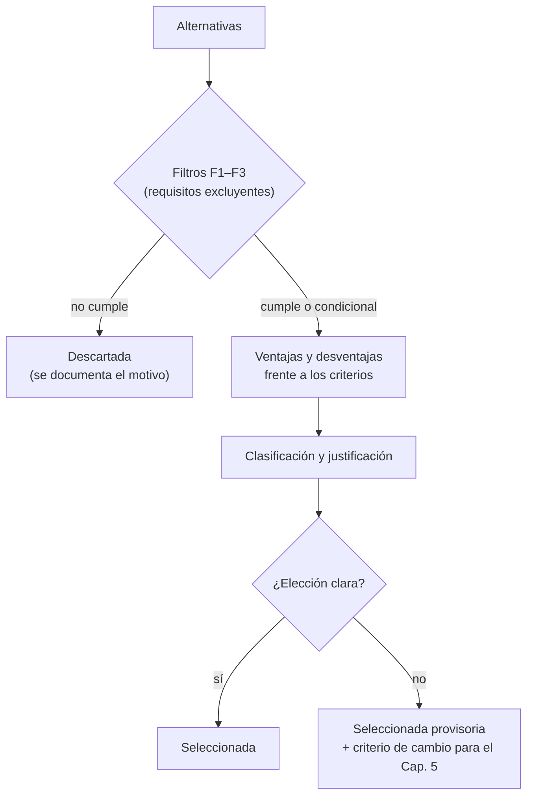

# Capítulo 4. Ingeniería conceptual: alternativas y selección
## 4.1 Objetivo y método
Este capítulo elige la configuración del módulo con criterios explícitos.

Cada decisión se resuelve en dos pasos:
1. **Filtro de requisitos excluyentes.** Una alternativa que no puede cumplir un requisito obligatorio queda afuera, por buenas que sean sus otras cualidades. Los filtros son:
   - **F1:** entregar $P_{cama} \le 174$ W regulada, con el elemento del sustrato a ≤ 60 °C (RT1, RT4).
   - **F2:** cargar la energía diaria en la ventana solar sin superar la temperatura admisible de la arena junto a las vainas (RT6, RM5; supuesto S1 del Cap. 3). Se traduce en (4.1) y (4.9).
   - **F3:** operar en ambiente húmedo sin riesgo eléctrico ni ingreso de agua a la arena (RM1, RM9).
2. **Comparación cualitativa** de las alternativas que pasan, con sus ventajas y desventajas frente a los criterios de 4.1.1. Se ordenan de mejor a peor y se justifica la elección. No se asignan pesos ni puntajes: la elección se apoya en cuál alternativa resuelve mejor los criterios que más condicionan cada decisión y en los cálculos de orden de magnitud de cada sección.

El filtro F2 exige que ningún punto del lecho quede más lejos de una resistencia que lo que avanza el calor durante la carga:
$$
\frac{w}{2} \lesssim \delta_c = \sqrt{\alpha_{ef}\, t_c}
\tag{4.1}
$$
donde $w$ es el paso entre resistencias [m], $\delta_c$ la profundidad de penetración térmica en la carga [m], $\alpha_{ef}$ la difusividad efectiva de la arena [m²/s] ((3.32) del Cap. 3 [19]) y $t_c$ la duración de la ventana de carga [s]. Con 5–6 h, $\delta_c$ ≈ 6–8 cm, así que $w$ ≲ 12–15 cm.

### 4.1.1 Criterios de comparación

| Criterio | Qué se mira | Requerimiento de origen |
|---|---|---|
| Costo | Materiales, fabricación y componentes del módulo | RG1 [17] |
| Pérdidas | Calor perdido por la envolvente, los conductos y los puentes térmicos. Es el problema central del proyecto: en un módulo chico $A/V \propto V^{-1/3}$ y la autodescarga < 1 % diario solo vale para tanques grandes [1], [17] | RM3 |
| Simplicidad y fiabilidad | Cantidad de piezas y de piezas móviles, mantenimiento sin vaciar la arena | RM8 |
| Seguridad | Superficies calientes, ambiente húmedo, riesgo eléctrico | RM1, RM4, RM9 |
| Consumo eléctrico propio | Todo consumo sale del panel y reduce la carga; de noche no hay generación (4.3.3) | RG4 |
| Modularidad | Replicar el módulo para ampliar la superficie | RG2 |
| Fabricabilidad local | Materiales y componentes disponibles en el país | RG5 |
| TRL | Madurez de la tecnología según la evidencia de las fichas | — |

## 4.2 Configuración del lecho
**Alternativas:**
- **L1. Lecho estático con tubos embebidos.** La arena no se mueve; las resistencias y los tubos de extracción quedan enterrados y el fluido nunca toca la arena.
- **L2. Lecho atravesado por aire (termoclina).** El aire circula por los poros [1].
- **L3. Lecho estático con varilla o placas conductoras** que llevan el calor a un intercambiador, como en los equipos con Stirling [7], [8].
- **L4. Híbrido arena-PCM** con cámara separada [1], [15].

| Alternativa | Ventajas                                                                                                                                                                                                                                                                                                                           | Desventajas                                                                                                                                                                                                                                                                                        |
| ----------- | ---------------------------------------------------------------------------------------------------------------------------------------------------------------------------------------------------------------------------------------------------------------------------------------------------------------------------------- | -------------------------------------------------------------------------------------------------------------------------------------------------------------------------------------------------------------------------------------------------------------------------------------------------- |
| **L1**      | Pocas piezas y sin pérdida de carga en el lecho (**simplicidad, consumo**). Con el aire quieto, los tubos aíslan durante la carga y el reposo [2] (**pérdidas**). Admite arena fina y compactada, que conduce mejor [6], [19]. Chapa, tubos y arena común (**costo, fabricabilidad**). El fluido no arrastra arena (**seguridad**) | La extracción queda limitada por la conducción de la arena hacia el tubo. TRL 4–5: solo hay evidencia de laboratorio y simulación [18]                                                                                                                                                             |
| **L2**      | Es la variante más madura: lecho empacado con aire, TRL 8–9 [1]. La mejor transferencia: con arena de 0,5 mm el NTU es de 10³–10⁴ [12]                                                                                                                                                                                             | Arena tamizada de 0,5–2 mm, plenos y distribuidores (**costo, fabricabilidad**). Sellado contra el arrastre de finos y pérdida de carga de Ergun [10], [12] (**simplicidad, consumo, seguridad**). En reposo la termoclina se degrada: la eficiencia de descarga cae de 62 % a 20 % tras 16 h [10] |
| **L3**      | No necesita fluido en el lecho ni bombas [7]                                                                                                                                                                                                                                                                                       | Las barras cruzan la aislación como puentes térmicos: en el prototipo con Stirling el 64,4 % de la energía se perdió por la envolvente y los puentes [8] (**pérdidas**). Cobre o aluminio macizo (**costo**). La varilla de [7] solo está simulada (**TRL**)                                       |
| **L4**      | El PCM de 30–60 °C trabaja justo en el rango de entrega al sustrato y estabiliza la temperatura de salida [15]                                                                                                                                                                                                                     | Segundo medio, partición y material combustible (parafina, IE) (**costo, simplicidad, seguridad**). TRL 3–5 [1]                                                                                                                                                                                    |

**Clasificación:** 1° L1 · 2° L2 · 3° L3 · 4° L4.

**Justificación.** L1 es la única que no tiene una desventaja grave en costo, pérdidas, simplicidad ni seguridad. Su punto débil, la extracción por conducción, se resuelve con el paso de tubos y la entrega forzada (4.3). L2 transfiere mejor y es más madura, pero toda esa ventaja se paga en complejidad, consumo y riesgo de polvo, que en un módulo de 174 W no se justifican. L3 empeora el criterio más crítico, las pérdidas. 
**Selección: L1, lecho estático con tubos embebidos.** L4 queda como mejora futura (cap. 15 del plan).

> [!example] Imagen: lecho fijo y termoclina
> ![[Sand Batteries for Thermal Energy Storage - A Review of Operating Principles, Technologies, Challenges and Future Perspectives-1793684267928.webp]]` y `![[Sand Batteries for Thermal Energy Storage - A Review of Operating Principles, Technologies, Challenges and Future Perspectives-1793684303436.webp]]
> **Descripción:** lecho empacado fijo y lecho con termoclina, de [1]. Ilustran L2. Para L1 se puede usar la geometría con intercambiador de tubos de [2] (Fig. 12): ![[Numerical analysis of the prototype of the high-temperature thermal energy storage based on sand bed-1791516367717.webp]]
## 4.3 Método de extracción y temperatura de entrega
### 4.3.1 Alternativas
- **E1. Aire por tubos con convección natural (termosifón).** Sin ventilador; el caudal sale del tiro.
- **E2. Aire por tubos con ventilador**, en lazo cerrado con la cama y bypass de mezcla. Es la hipótesis inicial del autor.
- **E3. Agua por serpentín en la arena**, con bomba y tubos de agua en el sustrato.
- **E4. Aire a través del lecho** (exige L2), en lazo cerrado.
### 4.3.2 Filtro F1: ¿puede cada una entregar 174 W a ≤ 60 °C?
El problema no está solo en la pila: el calor también tiene que **pasar del fluido al sustrato** sin superar 60 °C. Para aire en tubos enterrados en la cama, con el balance (3.28b) del Cap. 3 [19] aplicado del lado del sustrato:
$$
P_{cama} = \dot m\, c_{p,a}\,(T_{mez} - T_{sus})\left(1 - e^{-L_s/(\dot m\, c_{p,a}\, R'_s)}\right)
\;\;\Rightarrow\;\;
L_s = -\dot m\, c_{p,a}\, R'_s\,\ln\!\left(1 - \frac{P_{cama}}{\dot m\, c_{p,a}\,(T_{mez} - T_{sus})}\right)
\tag{4.2}
$$
donde:
- $L_s$ es el largo total de tubo en la cama [m],
- $\dot m$ el caudal de aire [kg/s],
- $c_{p,a}$ su calor específico [J/(kg·K)],
- $T_{mez}$ la temperatura de impulsión después de la mezcla [K],
- $T_{sus}$ la del sustrato [K],
- $R'_s = R'_{conv} + R'_{sustrato}$ la resistencia por unidad de longitud del tubo enterrado [m·K/W], con $R'_{conv}$ de (3.29) y $R'_{sustrato}$ de (3.31) del Cap. 3.

Hay solución solo si $\dot m\, c_{p,a}\,(T_{mez} - T_{sus}) > P_{cama}$, es decir, con un caudal mínimo:
$$
\dot m_{min} = \frac{P_{cama}}{c_{p,a}\,(T_{mez,max} - T_{sus})}
\tag{4.3}
$$

Con 174 W, 60 °C y un sustrato a 25 °C, $\dot m_{min}$ ≈ 4,9·10⁻³ kg/s ≈ 18 kg/h (cálculo propio; S3, S4).

Tubos de 25 mm y 32 mm en sustrato húmedo ($k$ ≈ 1 W/(m·K) [14]) con paso de 10 cm (cálculo propio):

| $D_s$ [mm] | $\dot m$ [kg/h] | Régimen | $R'_s$ [m·K/W] | $L_s$ necesario [m] | Δp en los tubos de la cama [Pa] |
|---|---|---|---|---|---|
| 25 | 12 | turbulento | 0,64 | no alcanza (máx. 117 W) | — |
| 25 | 18 | turbulento | 0,52 | 11,4 | ~640 |
| 25 | 25 | turbulento | 0,45 | 3,9 | ~380 |
| 32 | 25 | turbulento | 0,47 | 4,0 | ~120 |
| 25 (8 tubos en paralelo) | 25 | laminar ($Re$ ≈ 2250) | 3,3 | ~29 en total | ~6 |

- **E1 no pasa F1.** Para seguir en laminar hacen falta unos 8 tubos en paralelo y ~29 m de tubo en 1 m² de cama, frente a los 8,7 m del cable actual [17]. Además, el tiro disponible es $\Delta p_{tiro} = g H (\rho_{frío} - \rho_{caliente})$ ≈ 0,6 Pa con $H$ = 0,5 m entre 20 y 50 °C (S9), unas 10 veces menos que los ~6 Pa que piden esos tubos. Un termosifón de aire no puede empujar aire por tubos horizontales enterrados en la cama (cálculo propio).
- **E2 pasa F1** con 20–35 kg/h en régimen turbulento y 3–12 m de tubo en la cama, del orden del cable actual.
- **E3 pasa F1 del lado del sustrato** (el agua transfiere con facilidad), **pero no F3**: con la arena por encima de 100 °C el agua hierve en la pared del serpentín y genera presión, y una fuga dentro de la arena produce vapor y humedece el lecho, lo que triplica o quintuplica su conductividad y agrega calor latente [14], [19]. Solo sería viable con $T_{max}$ < 100 °C, que exige mucha más masa (4.7), o con un intercambiador intermedio.
- **E4 pasa F1** del lado del sustrato igual que E2.

> [!warning] Dato faltante D1. Largo de tubo admisible en la cama
> - Hay que confirmar cuántos metros de tubo de 25–32 mm caben bajo el sustrato de una mesa de 1 m² sin impedir el cambio de sustrato (RG3). 
> - Define $L_s$, $\dot m$ y la pérdida de carga del ventilador.
### 4.3.3 Ventajas y desventajas
Consumo del ventilador (IE):
$$
P_{vent} = \frac{\dot m\,\Delta p}{\rho_a\,\eta_v}
\tag{4.4}
$$
donde 
- $P_{vent}$ es la potencia eléctrica [W],
-  $\Delta p$ la pérdida de carga del lazo [Pa],
-  $\rho_a$ la densidad del aire [kg/m³] 
-  $\eta_v$ el rendimiento global del ventilador [–].
Con 18–25 kg/h, 300–600 Pa y $\eta_v$ = 0,2–0,35 (S6) resultan **4–19 W, es decir 0,06–0,27 kWh por noche, 2–11 % de la energía nocturna de peor caso** (cálculo propio).

| Alternativa         | Ventajas                                                                                                                                                                                                                                                                                                                                                                       | Desventajas                                                                                                                                                                                                                       |
| ------------------- | ------------------------------------------------------------------------------------------------------------------------------------------------------------------------------------------------------------------------------------------------------------------------------------------------------------------------------------------------------------------------------ | --------------------------------------------------------------------------------------------------------------------------------------------------------------------------------------------------------------------------------- |
| **E1 Natural**      | Sin ventilador: **consumo propio nulo** y sin piezas móviles (**costo, simplicidad, fabricabilidad**)                                                                                                                                                                                                                                                                          | **No pasa F1.** Mientras la arena está caliente el tiro mueve aire y descarga la pila también de día, salvo que una compuerta lo corte (**pérdidas**). Regulación pobre. Sin antecedentes en las fichas (**TRL**)                 |
| **E2 Forzado**      | - Pasa F1 con un caudal moderado y tubos del largo del cable actual.  - Con el ventilador apagado el aire queda quieto y aísla [2] (**pérdidas**). - Regula potencia y temperatura con dos actuadores simples (4.3.4). - Componentes comunes (**fabricabilidad**).  - Antecedente directo en [2]: aire forzado por tubos helicoidales en 300 kg de arena (**TRL**) | Consumo nocturno de 4–19 W (**consumo propio**, D2). El ventilador es una pieza móvil que puede fallar                                                                                                                            |
| **E3 Agua**         | El agua transfiere muy bien en el sustrato y con la bomba apagada no hay pérdidas                                                                                                                                                                                                                                                                                              | **No pasa F3:** ebullición, presión y riesgo de fuga dentro de la arena caliente (**seguridad**). Vaso de expansión, válvula de alivio y tubos aptos para presión (**costo, simplicidad**)                                        |
| **E4 Por el lecho** | La mejor transferencia arena-aire [12]; esquema comercial con TRL 8–9 [1]                                                                                                                                                                                                                                                                                                      | Exige L2, descartada en 4.2. Suma la pérdida de carga del lecho: 0,15–0,6 kPa en el cálculo de [12] para el prototipo anterior (**consumo**). Plenos de gran sección (**pérdidas**), polvo y sellado (**seguridad, simplicidad**) |

**Clasificación:** 1° E2 · 2° E4 · E1 y E3 descartadas por F1 y F3.

**Justificación.** E1 sería la más barata y la de menor consumo, pero no puede mover el caudal que necesita la cama. E3 entrega bien el calor, pero introduce agua junto a arena a más de 100 °C, que es justo el riesgo que RM1 y RM9 quieren evitar. Entre las viables, E4 transfiere mejor, pero arrastra todas las desventajas de L2. E2 cumple los tres filtros con la menor cantidad de desventajas. Su único costo nuevo, el consumo nocturno, es chico frente a la energía entregada. **Selección: E2, aire forzado por tubos en lazo cerrado con bypass de mezcla.** La hipótesis inicial del autor se confirma, **pero solo en modo forzado**.

> [!warning] Dato faltante D2. Energía eléctrica nocturna
> - El ventilador (y el control de la cama) consume **de noche**, cuando el panel no genera. 
> - El objetivo del proyecto excluye las baterías químicas [17], pero el sistema de automatización de la cama ya necesita alimentación continua. 
> - Hay que acordar con el subsistema electrónico de dónde sale esa energía (por ejemplo, un almacenamiento eléctrico chico solo para control y ventilación) e incorporarla a $E_{aux}$.
### 4.3.4 Cómo se limita la temperatura de entrega
Con E2, el aire sale de la pila casi a la temperatura de la arena: muy por encima de 60 °C mientras $T_{arena}$ sea alta [2], [18]. Bajar el caudal no alcanza, porque a menor caudal el aire sale todavía más caliente ((3.28b) del Cap. 3). 
La temperatura se limita **mezclando** con aire de retorno (bypass):
$$
T_{mez} = x\, T_{pila,sal} + (1 - x)\, T_{ret}
\qquad
P_{cama} = \dot m\, c_{p,a}\,(T_{mez} - T_{ret}) = x\,\dot m\, c_{p,a}\,(T_{pila,sal} - T_{ret})
\tag{4.5}
$$
donde $x$ es la fracción del caudal total que pasa por la pila [–], $T_{pila,sal}$ la temperatura del aire a la salida de la pila [K] y $T_{ret}$ la del aire que vuelve de la cama [K]. Dos actuadores controlan dos variables:
- **la compuerta de bypass ($x$)** fija $T_{mez}$ ≤ 60 °C (RT4);
- **el ventilador (PWM, $\dot m$)** fija $P_{cama}$ según la temperatura del sustrato (RT1, RT5).

A medida que la arena se enfría durante la noche, el control abre $x$ hasta 1. Cuando $T_{pila,sal}$ ya no alcanza para entregar $P_{cama}$, la pila llegó a su $T_{min}$ útil, que depende del caudal y del largo de los tubos (Cap. 5).

> [!note] Seguridad de la mezcla
> Ante una falla, la compuerta debe quedar en **bypass total** (posición segura) y un termostato independiente del control debe cortar el aire caliente si $T_{mez}$ supera el límite (RM9). Se detalla en el cap. 10 del plan.

> [!note] Variante para el Cap. 5
> - Si el largo de tubo que admite la cama (D1) resultara insuficiente, una variante es **aire forzado por la pila más un intercambiador aire-agua que alimente tubos de agua en el sustrato**. 
> - El agua nunca entra a la arena, así que esquiva el problema de E3, a cambio de más componentes.
## 4.4 Escala: módulo por mesa o pila centralizada
Con la misma forma, el mismo espesor de aislación y la misma temperatura, el área crece con $V^{2/3}$. **Repartir el volumen total entre $N$ módulos multiplica las pérdidas** (IE):
$$
\frac{\dot Q_{p,N\ \text{módulos}}}{\dot Q_{p,\ \text{central}}} = \frac{N\,(V/N)^{2/3}}{V^{2/3}} = N^{1/3}
\tag{4.6}
$$
donde $\dot Q_p$ es la potencia perdida [W] y $V$ el volumen total de arena [m³]. 
Para las **dos mesas** de la instalación actual [17], dos módulos pierden 1,26 veces lo que una pila central; con 4 mesas, 1,59 veces; con 8, 2,0 veces. A la pila central hay que sumarle las pérdidas de los conductos de distribución, $q'_d L_d$.

| Alternativa | Ventajas | Desventajas |
|---|---|---|
| **S1 Módulo por mesa** | Cumple RG2 de forma directa: cada módulo es igual e independiente (**modularidad**). Control independiente por mesa, necesario porque las dos mesas se usan para **comparar variedades** [17] (RG3). Menos energía por unidad (**seguridad**). Sin conductos de distribución ni balanceo de caudal (**simplicidad**) | Pierde $N^{1/3}$ veces más (**pérdidas**). Duplica resistencias, sensores y ventiladores (**costo, consumo**) |
| **S2 Pila central** | Menos pérdidas por (4.6) y menos componentes (**pérdidas, costo, consumo**) | Conductos de distribución con sus propias pérdidas. Balanceo de caudal entre mesas y control acoplado (**simplicidad**). Punto único de falla. Crecer exige rediseñar la pila (**modularidad**) |

**Clasificación:** 1° S1 · 2° S2, con poca diferencia.

**Justificación.** S2 gana en pérdidas, costo y consumo, y S1 en modularidad, simplicidad, seguridad e independencia experimental. Decide que la modularidad es un **requerimiento** (RG2), no solo una preferencia, y que para 2 mesas la ventaja de S2 (26 % menos pérdidas) se reduce con los conductos. **Selección provisoria: S1, módulo por mesa.**

> [!warning] Criterio de cambio para el Cap. 5
> Si las pérdidas calculadas del módulo superan la demanda nocturna (ver 4.7: el orden de magnitud ya es 50–90 % por día), hay que recalcular S2 para 2 mesas, incluidos los conductos. Es la decisión más sensible del capítulo, como anticipaba el plan [16].
## 4.5 Ubicación: debajo de la mesa o separada
- **U1. Debajo de la mesa**, sobre el piso, bajo la bandeja del sustrato.
- **U2. Junto a la mesa**, fuera del perímetro del cobertor, con conductos cortos aislados.

| Alternativa | Ventajas | Desventajas |
|---|---|---|
| **U1 Debajo** | De noche, parte de las pérdidas calienta la cama desde abajo y deja de ser pérdida (**pérdidas**). Conductos mínimos (**costo, consumo**). No ocupa más superficie que la mesa (**modularidad**) | De día esas mismas pérdidas (orden de 55–90 W, 4.7) pueden llevar el aire confinado por encima de 30 °C (RT5) [16]. Recibe el goteo de la nebulización (RM1). Superficie caliente a la altura de las piernas del operario (RM4) (**seguridad**). Menos accesible para cambiar resistencias (RM8) (**simplicidad**). La altura libre limita la geometría |
| **U2 Junto** | Fuera del goteo y del cobertor; acceso libre para mantenimiento (**seguridad, simplicidad**). La geometría no queda limitada por la altura de la mesa | Conductos más largos, con sus pérdidas y su pérdida de carga (**pérdidas, consumo**). Ocupa superficie de invernadero (**modularidad**). Estructura de apoyo propia (**costo**) |

**Clasificación:** 1° U1 (condicional) · 2° U2.

**Justificación.** U1 aprovecha de noche parte de las pérdidas, que son el problema central del módulo, y ahorra conductos. Pero todas sus desventajas son de seguridad o de cumplimiento de RT5, y no se pueden verificar sin cálculo. U2 es la opción segura si U1 falla. **Selección provisoria: U1, debajo de la mesa**, condicionada a RT5 y a la altura libre.

> [!warning] Dato faltante D3. Espacio y acoplamiento térmico bajo la mesa
> - Faltan la altura libre bajo la mesa, la carga admisible del piso o la estructura (RM2, RM6) y qué fracción de las pérdidas diurnas llega al aire confinado. 
> - Si la simulación muestra aire confinado por encima de 30 °C en un día de invierno, o si el módulo aislado no entra, se pasa a U2. 
> - En U1 hace falta una bandeja que proteja el módulo del goteo y una separación ventilada respecto de la cama (S7).
## 4.6 Geometría del contenedor
El área por unidad de volumen se minimiza con una relación de aspecto cercana a 1 (IE). Para un prisma de base cuadrada de lado $a$ y altura $H = \lambda a$, y para un cilindro de diámetro $D$ y altura $H = \lambda D$:
$$
\frac{A}{V^{2/3}}\bigg|_{prisma} = \frac{2 + 4\lambda}{\lambda^{2/3}},
\qquad
\frac{A}{V^{2/3}}\bigg|_{cilindro} = \frac{\pi/2 + \pi\lambda}{(\pi\lambda/4)^{2/3}}
\tag{4.7}
$$

donde $A$ es el área exterior del lecho [m²], $V$ su volumen [m³] y $\lambda$ la relación de aspecto [–].

| $\lambda$ | 0,25 | 0,5 | 1 | 1,5 | 2 | 3 |
|---|---|---|---|---|---|---|
| Prisma | 7,56 | 6,35 | **6,00** | 6,11 | 6,30 | 6,73 |
| Cilindro | 6,97 | 5,86 | **5,54** | 5,63 | 5,81 | 6,21 |

El cilindro tiene 7,7 % menos área que el cubo. Un prisma bajo ($\lambda$ = 0,25), como el que cabría debajo de una mesa baja, tiene 26 % más área que el cubo. Entre $\lambda$ = 0,7 y 1,5 la penalización es menor al 2 % (cálculo propio).

| Alternativa | Ventajas | Desventajas |
|---|---|---|
| **G1 Cilindro, $H/D$ ≈ 1** | Mínima área (**pérdidas**). Resiste mejor la presión del material granular, sin aristas que pandear (**seguridad**); por eso los lechos empacados suelen ser cilíndricos [11], y el prototipo de [2] es cilíndrico (**TRL**) | La grilla cuadrada de tubos y resistencias se adapta peor a un círculo. La aislación en placas y las tapas son más difíciles de resolver (**simplicidad, costo**). Hay que rolar la chapa (**fabricabilidad**). Encaja peor bajo la mesa y entre módulos |
| **G2 Prisma, $H/a$ ≈ 1** | Chapa plegada y soldada, aislación en placas, grilla regular de tubos y resistencias (**costo, simplicidad, fabricabilidad**). Aprovecha mejor el espacio bajo la mesa y se repite fácilmente (**modularidad**) | 8 % más área que el cilindro (**pérdidas**). Las paredes planas necesitan rigidizadores contra la presión lateral (Janssen, Cap. 5) |
| **G3 Prisma bajo, $H/a$ < 0,5** | Cabe bajo mesas bajas | 6–26 % más área que el cubo (**pérdidas**), y el criterio que más pesa es justamente ese |

**Clasificación:** 1° G2 · 2° G1 · 3° G3.

**Justificación.** La ventaja de área del cilindro (8 %) es chica frente a lo que simplifica el prisma en fabricación, aislación, disposición de la grilla y ubicación bajo la mesa. G3 solo se justifica si la altura libre obliga. 
**Selección: G2, prisma de base cuadrada con $H/a$ entre 0,7 y 1,5** (preferido ≈ 1). Si la altura bajo la mesa obliga a $\lambda$ < 0,7, el aumento de área se compara contra la opción U2.

> [!note] Relación de aspecto si el aire atravesara el lecho
> Solo en ese caso (L2/E4) importa la estratificación: $H/D$ mayor que 2 no mejora mucho [11], con $H/D$ ≲ 3 y $\varepsilon$ entre 35 y 50 % [13]. En el lecho estático elegido (L1) no hay termoclina que preservar, y el criterio es solo el área mínima.
## 4.7 Rango de temperatura máxima
- **R1. Bajo:** $T_{max}$ < 250 °C.
- **R2. Medio:** $T_{max}$ entre 300 y 450 °C.
- **R3. Alto:** $T_{max}$ entre 450 y 550 °C, por debajo de la inversión de 573 °C.

El valor final sale del estudio de $T_{max}$ del Cap. 5. Acá se elige el rango con tres órdenes de magnitud, todos cálculo propio con la energía nocturna de peor caso (8,77 MJ, $\bar f$ = 1 [17]) y $c_p(T)$ del Cap. 3.

**(a) Masa y tamaño.** Con (3.4) del Cap. 3, la masa sin pérdidas y el lado de un cubo de arena con $\rho_b$ = 1586 kg/m³ [4] son:

| $T_{min}$ → $T_{max}$ [°C] | 60 → 200 | 60 → 300 | 60 → 400 | 60 → 500 | 100 → 200 | 100 → 400 |
|---|---|---|---|---|---|---|
| Masa [kg] | 76 | 42 | 28 | 20 | 103 | 31 |
| Lado del cubo $a$ [cm] | 36 | 30 | 26 | 23 | 40 | 27 |

**(b) Pérdidas.** Índice de pérdidas medias con un cubo, aislación de espesor $t$, $k_{ais}$ = 0,06 W/(m·K) y $h_{ext}$ = 10 W/(m²·K) (S5):
$$
\dot Q_p = \frac{\bar T - T_{inv}}{\dfrac{t}{k_{ais}\sqrt{A_i A_o}} + \dfrac{1}{h_{ext} A_o}}
\tag{4.8}
$$

donde:  
- $\bar T = (T_{max} + T_{min})/2$ es la temperatura media de la arena en el ciclo [K], 
- $T_{inv}$ la del invernadero [K], 
- $A_i = 6a^2$ y $A_o = 6(a + 2t)^2$ las áreas interior y exterior de la aislación [m²] y $\sqrt{A_i A_o}$ un área media para la capa gruesa.

| $T_{max}$ [°C] ($T_{min}$ = 60) | 200 | 300 | 400 | 500 |
|---|---|---|---|---|
| $\dot Q_p$ con $t$ = 0,10 m [W] | 78 | 82 | 87 | 92 |
| Pérdida diaria / $E_{noche}$, $t$ = 0,10 m | 77 % | 81 % | 86 % | 91 % |
| $\dot Q_p$ con $t$ = 0,20 m [W] | 54 | 59 | 64 | 69 |
| Pérdida diaria / $E_{noche}$, $t$ = 0,20 m | 53 % | 58 % | 63 % | 68 % |

Con $T_{min}$ fija, las pérdidas crecen poco con $T_{max}$: al subirla crece la diferencia de temperatura, pero la masa y el área bajan en proporción parecida. En cualquier caso son grandes: entre la mitad y casi el total de la energía nocturna por día, coherente con la estimación del plan [16]. Esto refuerza las advertencias de 4.4 y 4.5.

> [!note] Ajuste del Cap. 5
> Con la $T_{min}$ real, que sube con $T_{max}$ al achicarse el intercambiador, el Cap. 5 encontró que las pérdidas sí crecen con $T_{max}$ (52 → 116 W) y recomendó $T_{max}$ = 300 °C, el límite inferior del rango elegido acá.

**(c) Límite de las resistencias.** La arena junto a la vaina no debe superar la temperatura admisible $T_{lim}$ (573 °C local, supuesto S1 del Cap. 3) cuando el lecho ya está cerca de $T_{max}$. Con conducción cuasi estacionaria alrededor de la vaina (IE):
$$
q'_{adm} = \frac{2\pi\, k_{ef}\,(T_{lim} - T_{max})}{\ln(r_2/r_1)},
\qquad
L_{res} \ge \frac{P_{carga}}{q'_{adm}}
\tag{4.9}
$$
donde: 
- $q'_{adm}$ es la potencia admisible por metro de resistencia [W/m]
-  $k_{ef}$ la conductividad efectiva de la arena [W/(m·K)]
-  $r_1$ el radio de la vaina [m]
-  $r_2$ el radio de influencia (≈ medio paso de la grilla) [m]
-  $L_{res}$ el largo total de resistencia [m]
-  $P_{carga}$ la potencia de carga [W]. 
Con $k_{ef}$ = 0,25–0,35 W/(m·K), vaina de Ø10 mm y $r_2$ = 5–7,5 cm (S8):

| $T_{max}$ [°C] | 300 | 400 | 500 |
|---|---|---|---|
| $q'_{adm}$ [W/m] | 160–260 | 100–165 | 40–70 |
| Carga superficial en la vaina [W/cm²] | 0,5–0,8 | 0,3–0,5 | 0,13–0,22 |
| $L_{res}$ para $P_{carga}$ = 1 kW [m] | 4–6 | 6–10 | 14–25 |

En R3 harían falta decenas de metros de resistencia dentro de un lecho de ~23 cm de lado: no es viable.

| Alternativa | Ventajas | Desventajas |
|---|---|---|
| **R1 Bajo** | Acero al carbono y lana mineral (**costo, fabricabilidad**). Margen amplio para las vainas y lejos de la inversión del cuarzo (**seguridad, simplicidad**) | 2,5–3,5 veces la masa de R2 (76–103 kg) y más área de contenedor y aislación (**costo, modularidad**). Salto útil chico si $T_{min}$ debe ser alta para extraer (4.3.4). Difícil de ubicar bajo la mesa |
| **R2 Medio** | Masa intermedia (28–49 kg) y resistencias de largo manejable con (4.9). Materiales intermedios. Antecedentes en este rango: [2] trabajó hasta ~650 K y [9] hasta 353 °C (**TRL**) | Requiere manta cerámica o lana de roca de alta densidad en la capa caliente. Las resistencias ya necesitan un largo considerable (4–10 m por kW) |
| **R3 Alto** | Módulo compacto (~20 kg de arena) (**modularidad**). Rango de los sistemas comerciales (500–600 °C [1]) | **No pasa F2:** resistencias inviables por (4.9). En el borde de la inversión del cuarzo. Aceros ferríticos (EN 1.4713/1.4724 [16]), manta cerámica y vainas de Incoloy (**costo, seguridad, fabricabilidad**) |

**Clasificación:** 1° R2 · 2° R1 · R3 descartada por F2.

**Justificación.** R3 queda afuera por la carga. Entre R1 y R2 la diferencia es de compromiso: R1 es más segura y simple, pero casi triplica la masa y el volumen, lo que empeora el costo del contenedor y la aislación y complica la ubicación bajo la mesa. R2 mantiene la masa y el tamaño en valores razonables sin salir de materiales y resistencias manejables. 
**Selección: R2, con preferencia por la mitad baja (300–400 °C).** Lo cierra el estudio de $T_{max}$ del Cap. 5.

> [!warning] Dato faltante D4. Potencia y ventana de carga
> $P_{carga}$ y la duración de la ventana solar dependen del panel FV y del sitio, que son datos de entrada todavía no definidos [16], [17]. Con ellos se cierra (4.9) y el largo de resistencias.
## 4.8 Mejora de conductividad
- **M0.** Arena pura, fina, seca y compactada.
- **M1.** Virutas de aluminio al 20 % en volumen, mezcla uniforme en todo el lecho [3].
- **M2.** Virutas solo en un anillo alrededor de los tubos de extracción, lejos de las resistencias.
- **M3.** Aletas radiales en los tubos de extracción [6].
- **M4.** Varilla o placas conductoras [7], [8].

| Alternativa | Ventajas | Desventajas |
|---|---|---|
| **M0 Arena pura** | Lo más barato y simple; sin puentes térmicos ni riesgo de fusión (**costo, simplicidad, seguridad, fabricabilidad**). La arena pura retiene más energía que las mezclas con cobre [5] | No mejora la extracción: queda limitada por la conducción de la arena |
| **M1 Virutas Al uniforme** | Tasa de calentamiento ×1,70 con 20 % en volumen [3]. Residuo de taller, barato y local (**costo, fabricabilidad**) | El aluminio funde a 660 °C [3] y las vainas pueden superar esa temperatura (1240 K en la mejor variante de [2]) (**seguridad**). Con más $k$ el lecho se enfría más rápido [5] (**pérdidas**). Por debajo de ~20 % no hay red conductora (percolación) [3] |
| **M2 Virutas junto a los tubos** | Mejora la conducción donde se extrae, lejos de las resistencias | Colocación y control de la mezcla más difíciles (**simplicidad**). Sin antecedentes con esta disposición (**TRL**) |
| **M3 Aletas en los tubos** | Con 8 aletas radiales el tiempo de descarga bajó 78,5 % [6]. Permite bajar el caudal para la misma potencia (**consumo**) | Fabricación y soldadura de aletas (**costo, simplicidad**). Ensayado solo a ≤ 70 °C [6] |
| **M4 Varilla o placas** | Distribuye el calor en la carga y lo concentra en la descarga [7] | Puentes térmicos si cruzan la aislación [8] (**pérdidas**). Metal macizo (**costo**). Solo simulado o en un prototipo [7], [8] (**TRL**) |

**Clasificación:** 1° M0 · 2° M3 · 3° M2 · 4° M1 · 5° M4.

**Justificación.** M0 no tiene desventajas frente a los criterios. Su única limitación, la transferencia, se ataca primero con el paso de la grilla y el caudal. Si después hace falta más, la mejora que actúa donde está el cuello de botella sin riesgo de fusión ni puentes térmicos es M3: con flujo turbulento la arena pasa a ser la resistencia dominante (Cap. 3, 3.9.4). 
**Selección: M0 como base, con M3 (aletas en los tubos) como provisión** si el cálculo de extracción lo pide. No se usan virutas de aluminio junto a las resistencias.

> [!example] Imagen: aletas en arena de sílice
> ![[Experimental Study of a Silica Sand Sensible Heat Storage System Enhanced by Fins-1792542410270.webp]]
> **Descripción:** sistema de tubo central con aletas anulares y radiales de [6]. Referencia para la provisión M3.
## 4.9 Cargas: tipo y distribución de resistencias
### 4.9.1 Tipo de resistencia
- **C1. Tubular blindada:** hilo resistivo en MgO compactado dentro de una vaina de Incoloy 800 o acero inoxidable refractario [16]. Se puede doblar en U o en serpentín.
- **C2. Cartucho de alta densidad:** corto y de alta carga superficial.
- **C3. Hilo desnudo** (aleación FeCrAl o NiCr) sobre o dentro de un tubo cerámico.
- **C4. Cable calefactor de aislación mineral (MI):** largo y flexible.

| Alternativa | Ventajas | Desventajas |
|---|---|---|
| **C1 Tubular blindada** | Vaina metálica puesta a tierra y conductor aislado, apta para ambiente húmedo (RM9) (**seguridad**). Es el tipo que usan los prototipos de arena [2], [8] (**TRL**). Se fabrica a medida en largo y forma, lo que permite cumplir (4.9) (**fabricabilidad**) | Hay que elegir bien la carga superficial y la forma (U o serpentín) para llegar al largo necesario |
| **C2 Cartucho** | Compacto y común | Alta carga superficial: choca con el límite (4.9), que pide 0,3–0,8 W/cm² en R2 (**no pasa F2** en la práctica) |
| **C3 Hilo desnudo** | Lo más barato; alcanza la mayor temperatura (**costo**) | Partes energizadas expuestas en ambiente húmedo (**no pasa F3**). Soportes cerámicos frágiles (**simplicidad**) |
| **C4 Cable MI** | Gran largo con baja carga lineal: encaja muy bien con (4.9) | Menos común en el mercado local y terminaciones delicadas (**fabricabilidad, costo**) |

**Clasificación:** 1° C1 · 2° C4 · C2 y C3 descartadas por F2 y F3.

**Justificación.** C1 combina la seguridad eléctrica que pide el ambiente húmedo con la libertad de forma y largo que pide la baja carga superficial, y es lo que usan los prototipos de las fichas. C4 resuelve el largo todavía mejor, pero es más difícil de conseguir y terminar. Queda como alternativa si C1 no alcanza el largo necesario. **Selección: C1, resistencias tubulares blindadas de baja carga superficial**, montadas dentro de **vainas guía** (tubos ciegos soldados a la tapa) para poder extraerlas sin vaciar la arena (RM8). La vaina guía agrega una resistencia de contacto que se considera en el Cap. 5.
> [!warning] definir que tipo de resistencias 
### 4.9.2 Distribución
- **D1.** Una sola resistencia central.
- **D2.** Varias agrupadas cerca del eje, sin tocarse (mejor variante de [2]).
- **D3.** Grilla uniforme intercalada con los tubos de extracción, paso $w$ [9].
- **D4.** Junto a las paredes.

| Alternativa | Ventajas | Desventajas |
|---|---|---|
| **D1 Central** | Mínimas pérdidas (el calor queda en el núcleo) y un solo pasamuros (**pérdidas, simplicidad, costo**) | **No pasa F2:** con (4.1), el calor no llega a los bordes en la ventana de carga, y todo $L_{res}$ en un elemento da un $q'$ muy superior a (4.9) (**seguridad**) |
| **D2 Cerca del eje** | Mayor SR y menor temperatura de vaina entre las variantes de [2]; el calor queda rodeado de arena y escapa menos a las paredes (**pérdidas, TRL**) | Si se agrupan demasiado, se sobrecalientan [2] |
| **D3 Grilla intercalada** | Cumple (4.1) en todo el lecho y reparte $L_{res}$ en muchos elementos de baja carga (**seguridad**). Se intercala con la grilla de tubos de extracción. Disposición equidistante como la de [9] | Más elementos y pasamuros (**costo, simplicidad**); los de la periferia pierden algo más (**pérdidas**) |
| **D4 Junto a las paredes** | Fácil de montar | Aumenta las pérdidas [2] (**pérdidas**), que es el criterio más crítico |

**Clasificación:** 1° D3/D2 · 3° D4 · D1 descartada por F2.

**Justificación.** **En un lecho de 25–35 cm de lado, D2 y D3 coinciden**: una grilla de 2 × 2 o 3 × 3 resistencias con paso de 10–15 cm queda "cerca del eje sin juntarse", y los elementos quedan a por lo menos $w/2$ de las paredes. Así se toma lo mejor de las dos: la uniformidad y la baja temperatura de vaina de D3, y las menores pérdidas de D2. 
**Selección: D3/D2, grilla intercalada con los tubos y retirada de las paredes.** Las resistencias se agrupan en 2 o 3 escalones de potencia para seguir la potencia del panel, con control por histéresis y temperatura de reinicio baja, para no ciclar los contactores [2].

> [!warning] Supuesto crítico S10. Largo de resistencias
> Por (4.9), con $P_{carga}$ ≈ 1 kW y R2 hacen falta 4–10 m de resistencia. Rectas de ~0,25 m, serían 16–40 elementos. **El croquis muestra resistencias rectas solo de forma esquemática**: en el Cap. 5 se define si son en U, en serpentín horizontal en 2–3 niveles o de cable MI (C4), y si conviene aletearlas. Es la principal restricción de diseño que deja este capítulo, como anticipaba el Cap. 2: el cuello de botella es la carga [18].

> [!example] Imagen: distribución de resistencias en [2]
> ![[Numerical analysis of the prototype of the high-temperature thermal energy storage based on sand bed-1791518113571.webp]]
> **Descripción:** las siete variantes de distribución de resistencias estudiadas en [2] (uniforme, cerca del eje, cerca de las paredes y mixtas). La variante 2 (cerca del eje) obtuvo el mayor SR y la menor temperatura de vaina.

## 4.10 Configuración seleccionada

| Decisión | Selección | Estado | Se cierra en |
|---|---|---|---|
| Lecho | L1: arena de cuarzo fina, seca, compactada y estática, en contenedor estanco con venteo para el primer secado | Firme | — |
| Extracción | E2: aire forzado en lazo cerrado; ventilador en la rama fría; tubos verticales entre colectores inferior y superior; bypass y caja de mezcla | Firme | Cap. 5 (caudal, $L_s$, $D$) |
| Entrega | Tubos de aire bajo el sustrato (3–12 m, Ø25–32 mm); $T_{mez}$ ≤ 60 °C por mezcla; potencia por PWM del ventilador | Firme | Cap. 5 y cap. 10 del plan |
| Escala | S1: un módulo por mesa | Provisoria | Cap. 5 (pérdidas) |
| Ubicación | U1: debajo de la mesa, con bandeja contra goteo y separación ventilada | Provisoria (RT5) | Caps. 5 y 6 |
| Geometría | G2: prisma de base cuadrada, $H/a$ ≈ 1; tapa superior desmontable con pasamuros | Firme | Cap. 5 |
| $T_{max}$ | R2: 300–400 °C preferido | Rango | Cap. 5 |
| Aislación | Multicapa: manta cerámica (caliente) + lana de roca (fría) + chapa exterior de baja emisividad | Firme (materiales) | Cap. 5 (espesor) |
| Conductividad | M0 + provisión M3 (aletas radiales en los tubos) | Firme / opcional | Cap. 5 |
| Resistencias | C1: tubulares blindadas de baja carga superficial, en vainas guía extraíbles | Firme | Cap. 5 (forma y largo, S10) |
| Distribución | D3/D2: grilla intercalada con los tubos, paso 10–15 cm, a ≥ $w/2$ de las paredes, 2–3 escalones de potencia | Firme | Cap. 5 |

![[croquis_pila_cap4.png]]
*Figura 4.1. Croquis descriptivo de la configuración seleccionada (corte vertical, sin escala). Las cotas $a$, $H$, $w$, $t_{ais}$, $L_s$ y $D_s$ se dimensionan en el Cap. 5.*

**Descripción del croquis.** El módulo es un prisma de acero de base cuadrada apoyado en el piso bajo la mesa. El lecho de arena está rodeado por una capa caliente de manta cerámica, una capa fría de lana de roca y una chapa exterior de baja emisividad. Las resistencias tubulares bajan desde la tapa dentro de vainas guía y se intercalan en grilla con los tubos verticales de aire, que unen un colector inferior (entrada fría) con uno superior (salida caliente). El ventilador, en la rama fría del retorno de la cama, impulsa el aire hacia el colector inferior y hacia el bypass. En la caja de mezcla, la compuerta combina el aire caliente de la pila con el de bypass para impulsar a la cama a $T_{mez}$ ≤ 60 °C. El aire recorre los tubos bajo el sustrato y vuelve al ventilador. Hay termocuplas en la arena ($T_{ar}$), en la mezcla ($T_{mez}$) y en el sustrato.

> [!note] Qué ajustó después el Cap. 5
> - $T_{max}$ recomendada: **300 °C**, el límite inferior del rango R2.
> - Resistencias: **9 elementos de ~105 W en vainas guía aleteadas horizontales** (3 niveles × 3), en 3 escalones. Reemplaza a las resistencias verticales esquemáticas del croquis (S10).
> - Escala: las pérdidas diarias son el 73 % de la energía nocturna, por debajo del criterio de cambio de 4.4, así que se mantiene S1.
> - Ubicación: el módulo exterior es un cubo de ~0,78 m; si la altura libre bajo la mesa es menor a ~0,9 m, U1 no es viable con $H/a$ = 1.
## 4.12 Cierre del capítulo
### 4.12.1 Supuestos usados

| ID | Supuesto | Justificación |
|---|---|---|
| S1 | Los requerimientos del Cap. 1 y los datos del plan reemplazan a los capítulos de Requerimientos y Demanda térmica del plan, todavía no redactados | Decisión del autor; los valores se marcan "a confirmar" |
| S2 | Las ventajas, desventajas y clasificaciones son juicio de ingeniería basado en la evidencia citada y en los cálculos de orden de magnitud de cada sección | Comparación cualitativa sin ponderación, a pedido del autor |
| S3 | Sustrato a 25 °C, $T_{mez,max}$ = 60 °C, sustrato húmedo con $k$ ≈ 1 W/(m·K) y paso de 10 cm entre tubos de la cama | Rango 20–30 °C [17]; $k$ de arena húmeda [14] |
| S4 | $P_{cama}$ = 174 W ($\bar f$ = 1) | Cota superior de la demanda [17] |
| S5 | Índice de pérdidas: cubo, $k_{ais}$ = 0,06 W/(m·K) a temperatura media, $h_{ext}$ = 10 W/(m²·K), $T_{inv}$ = 20 °C, $\bar T$ = media de $T_{max}$ y $T_{min}$ | Valores de la estimación del plan [16]; $h_{ext}$ ≈ convección (~5 [3]) + radiación (~5,5, Cap. 3) |
| S6 | Ventilador con Δp = 300–600 Pa y $\eta_v$ = 0,2–0,35 | Pérdida de carga de los tubos de la cama de 4.3.2 más la pila; rendimientos típicos de ventiladores chicos (IE) |
| S7 | Hay altura libre bajo la mesa para un módulo aislado de 0,5–0,8 m de lado | Sin dato (D3) |
| S8 | En (4.9): $T_{lim}$ = 573 °C local, vaina de Ø10 mm, $r_2$ = medio paso | Supuesto S1 del Cap. 3 |
| S9 | Altura de tiro de 0,5 m para el termosifón | Orden de la altura de un módulo bajo la mesa |
| S10 | $P_{carga}$ ≈ 1 kW como valor ilustrativo en (4.9) | Orden de magnitud del plan (3–5 kWh/día en una ventana de ~4,5 h) [16] |
### 4.12.2 Datos faltantes

| ID | Dato | Necesario para |
|---|---|---|
| D1 | Largo y diámetro de tubo que admite la cama sin impedir el cambio de sustrato | $L_s$, caudal, ventilador (4.3) |
| D2 | Fuente de energía eléctrica nocturna para ventilador y control | Viabilidad de E2; $E_{aux}$ |
| D3 | Altura libre y carga admisible bajo la mesa; acoplamiento térmico de las pérdidas con el aire confinado | U1 frente a U2; geometría |
| D4 | Potencia del panel, sitio y ventana de carga | $P_{carga}$, largo de resistencias (4.9) |
| D5 | Factor de uso real $\bar f$ de la cama | Masa, caudal, pérdidas relativas |
| D6 | Límite de costo del organismo de financiación | Comparar las alternativas en costo con valores, no solo cualitativamente |
| D7 | Disponibilidad local de resistencias tubulares a medida, cable MI, manta cerámica y aceros ferríticos | Fabricabilidad (C1, C4, R2) |
| D8 | Temperatura superficial exterior admisible (RM4) | Aislación y ubicación |

## Referencias del capítulo
1. *Sand Batteries for Thermal Energy Storage - A Review of Operating Principles, Technologies, Challenges and Future Perspectives* (2026). [[Sand Batteries for Thermal Energy Storage - A Review of Operating Principles, Technologies, Challenges and Future Perspectives]]
2. *Numerical analysis of the prototype of the high-temperature thermal energy storage based on sand bed* (2025). [[Numerical analysis of the prototype of the high-temperature thermal energy storage based on sand bed]]
3. *Improved effective thermal conductivity of sand bed in thermal energy storage systems* (2024). [[Improved effective thermal conductivity of sand bed in thermal energy storage systems]]
4. *Properties of granular materials as heat transfer and storage medium in CSP application* (2015). [[Properties of granular materials as heat transfer and storage medium in CSP application]]
5. *Evaluation of sand and sand-copper mixtures for efficient thermal energy storage* (2025). [[Evaluation of sand and sand-copper mixtures for efficient thermal energy storage]]
6. *Experimental Study of a Silica Sand Sensible Heat Storage System Enhanced by Fins* (2024). [[Experimental Study of a Silica Sand Sensible Heat Storage System Enhanced by Fins]]
7. *Cost-effective Electro-Thermal Energy Storage to balance small scale renewable energy systems* (2021). [[Cost-effective Electro-Thermal Energy Storage to balance small scale renewable energy systems]]
8. *Stirling engine-based Carnot battery with sand as heat storage medium - 1 kWe prototype* (2026). [[Stirling engine-based Carnot battery with sand as heat storage medium - 1 kWe prototype]]
9. *Viabilidad técnica y económica del uso de baterías de arena para el almacenamiento térmico en el autoabastecimiento energético residencial* (2026). [[Viabilidad tecnica y economica del uso de baterias de arena para el almacenamiento termico en el autoabastecimiento energetico residencial]]
10. *Comprehensive review of dynamical simulation models of packed-bed systems for thermal energy storage applications in renewable power production* (2025). [[Comprehensive review of dynamical simulation models of packed-bed systems for thermal energy storage applications in renewable power production]]
11. *Review on modeling approaches for packed-bed thermal storage systems* (2021). [[Review on modeling approaches for packed-bed thermal storage systems]]
12. *Parametric Optimization of Sensible Thermocline Packed Bed Thermal Energy Storage Systems - A Computation Fluid Dynamics Study* (2026). [[Parametric Optimization of Sensible Thermocline Packed Bed Thermal Energy Storage Systems - A Computation Fluid Dynamics Study]]
13. *Numerical analysis of the impact of various parameters on the axial temperature distribution in a packed bed for thermocline energy storage* (2025). [[Numerical analysis of the impact of various parameters on the axial temperature distribution in a packed bed for thermocline energy storage]]
14. *Experimental determination and finite element modeling of thermal conductivity in moist sand* (2026). [[Experimental determination and finite element modeling of thermal conductivity in moist sand]]
15. *Hybrid sand-PCM thermal energy storage driven with a solar parabolic trough concentrator for enhanced charging - discharging performance* (2026). [[Hybrid sand-PCM thermal energy storage driven with a solar parabolic trough concentrator for enhanced charging - discharging performance]]
16. *Plan del informe de ingeniería conceptual y básica de la pila de arena* (nota del proyecto). [[Cap 0 - Plan informe ingenieria conceptual y basica]]
17. *Capítulo 1. Introducción, objetivo y alcance* (este informe). [[Cap 1 - Introduccion, objetivo y alcance]]
18. *Capítulo 2. Estado del arte y matriz comparativa* (este informe). [[Cap 2 - Estado del arte y matriz comparativa]]
19. *Capítulo 3. Fundamentos físicos, propiedades y modelos matemáticos* (este informe). [[Cap 3 - Fundamentos físicos, propiedades y modelos matemáticos]]
