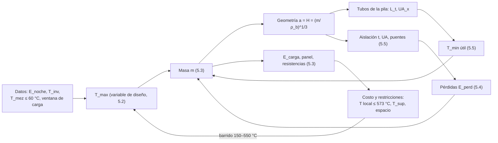

# Capítulo 5. Ingeniería básica: predimensionamiento

## 5.0 Objetivo, método y premisas
Este capítulo dimensiona con cálculos analíticos la configuración elegida en el Cap. 4 [13]: lecho estático de arena con tubos embebidos (L1), aire forzado en lazo cerrado con bypass de mezcla (E2), un módulo por mesa (S1) debajo de ella (U1), prisma de base cuadrada con $H/a \approx 1$ (G2), $T_{max}$ en el rango medio (R2), arena pura (M0) y resistencias tubulares blindadas en grilla (C1, D3). 

El problema está acoplado: la masa depende de las pérdidas y de la temperatura mínima útil; las pérdidas dependen del tamaño y de la aislación; la temperatura mínima depende del intercambiador, que depende del tamaño. Se resuel
ve como un lazo iterativo (script `predimensionamiento_cap5.py`, carpeta Desarrollo):

**Premisas de cálculo:**
1. **Modelo concentrado** para los balances: la arena se representa con una temperatura media $T_s(t)$. Las diferencias locales (arena junto a las vainas y junto a los tubos) se tratan con resistencias cuasi estacionarias (3.27)–(3.31) del Cap. 3 [12] y con un factor de utilización $\varphi_u$.
2. **Régimen periódico de 24 h**: la energía interna de la arena vuelve al mismo valor cada día (Cap. 1 [11]).
3. Propiedades función de $T$: $c_p(T)$ de (3.1) y $k_{ef}(T)$ en banda (ZBS con radiación como límite inferior y ajuste lineal de [1] como superior), Cap. 3 [12].
4. **Caso de diseño:** noche de invierno con la cota superior de la demanda ($\bar f = 1$) y sensibilidad para $\bar f$ = 0,5 y 0,75.
5. Los resultados son de **predimensionamiento**: se verifican con la simulación transitoria (cap. 9 del plan) y luego con ensayos.
> [!note] Convenciones
> - **(IE)**: ecuación de ingeniería estándar que no proviene de las notas. 
> - **(cálculo propio)**: resultado del script con datos de las notas. Las temperaturas van en K dentro de las ecuaciones y se informan en °C. Los supuestos se numeran S1…S21 y se listan en 5.8.1.
### 5.0.1 Datos de entrada

| Dato | Valor | Fuente |
|---|---|---|
| Potencia nominal de la cama | $P_{nom}$ = 174 W por m² (20 W/m × 8,7 m) | [10], [11] |
| Duración de la noche | $t_n$ = 14 h | [10] |
| Temperatura máxima de impulsión al sustrato | $T_{mez}$ ≤ 60 °C | RT4 [11] |
| Sustrato | 20–30 °C (se usa 25 °C) | RT5 [11]; S20 |
| Invernadero | 10–35 °C | [11] |
| Arena | $\rho_b$ = 1586 kg/m³; $c_p(T) = T + 427$; $k_{ef}(T)$ en banda | [6], [1], [12] |
| Límite local de la arena | 573 °C junto a las vainas | S1 del Cap. 3 [12] |
| Lazo de aire | ṁ = 25 kg/h; tubo bajo el sustrato Ø32 mm, $L_s$ ≈ 4,0 m, Δp ≈ 120 Pa | Cap. 4, 4.3.2 [13] |
| Ventana de carga solar de invierno | 5–6 h | [1] |

> [!warning] Supuesto crítico S3. Temperatura del invernadero
> Las pérdidas se calculan con $T_{inv}$ = 10 °C durante todo el ciclo (mínimo garantizado del invernadero [11]). Es conservador para la noche de invierno. Con el sitio definido (D1) se puede usar un perfil horario.
## 5.1 Balance energético y masa de arena
### 5.1.1 Energía nocturna y balance del ciclo
La energía que pide la cama en la noche de diseño es (ec. (1.5) del Cap. 1 [11]):
$$
E_{noche} = \bar f\, P_{nom}\, t_n
\tag{5.1}
$$
donde:
- $\bar f$ es el factor de uso medio [–]
-  $P_{nom}$ la potencia nominal [W] 
-  $t_n$ la duración de la noche [s]. 
Con $\bar f$ = 1 (S1), $E_{noche}$ = 8,77 MJ = 2,44 kWh.

El día se divide en cuatro tramos (S2): descarga $t_n$ = 14 h; reposo matinal $t_{r1}$ = 2 h con la arena cerca de $T_{min}$; carga $t_c$ = 5,5 h; y reposo vespertino $t_{r2}$ = 2,5 h con la arena cerca de $T_{max}$. Con el modelo concentrado y una conductancia total de pérdidas $UA$ [W/K] (sección 5.5), las pérdidas son (IE):
$$
E_{perd,n} = UA\,(\bar T - T_{inv})\,t_n,
\qquad
E_{perd,r2} = UA\,(T_{max} - T_{inv})\,t_{r2}
\tag{5.2}
$$
$$
E_{perd,24h} = UA\left[(\bar T - T_{inv})(t_n + t_c) + (T_{min} - T_{inv})\,t_{r1} + (T_{max} - T_{inv})\,t_{r2}\right]
\tag{5.3}
$$
donde:
- $\bar T = (T_{max} + T_{min})/2$ es la temperatura media de la arena durante la descarga y la carga [K],
-  $T_{inv}$ la del invernadero [K] 
-  $t_{r1}$, $t_c$, $t_{r2}$ las duraciones de los tramos [s]. 
En régimen periódico, la energía eléctrica que entra a la arena cada día es:
$$
E_{carga} = E_{noche} + E_{perd,24h},
\qquad
\eta_{alm} = \frac{E_{noche}}{E_{carga}}
\tag{5.4}
$$
### 5.1.2 Temperatura mínima útil
La arena deja de ser útil cuando, con toda la corriente de aire pasando por la pila ($x$ = 1, sin bypass), ya no puede entregar $P_{cama}$. Con el balance del lado del sustrato (4.2) del Cap. 4 [13], el aire vuelve de la cama a $T_{ret} = T_{mez} - P_{cama}/(\dot m\,c_{p,a})$. Con (3.28b) del Cap. 3 [12] del lado de la pila (IE):
$$
T_{min} = T_{ret} + \frac{P_{cama}}{\dot m\, c_{p,a}\left(1 - e^{-UA_x/(\dot m\, c_{p,a})}\right)},
\qquad
UA_x = \frac{L_t}{R'_{tot}}
\tag{5.5}
$$

donde $T_{min}$ es la temperatura media mínima útil de la arena [K], $T_{ret}$ la del aire que vuelve de la cama [K], $\dot m$ el caudal de aire [kg/s], $c_{p,a}$ su calor específico [J/(kg·K)], $UA_x$ la conductancia arena–aire del intercambiador [W/K], $L_t$ el largo total de tubo dentro de la arena [m] y $R'_{tot}$ la resistencia por metro (3.27) [m·K/W].

Con $\dot m$ = 25 kg/h, $T_{mez}$ = 60 °C y $P_{cama}$ = 174 W resulta $T_{ret}$ ≈ 35 °C. La resistencia por metro en el caso base es (cálculo propio, $k_{ef}$ de banda inferior a $T_{min}$, S19):

| Término | $R'$ [m·K/W] | Comentario |
|---|---|---|
| Arena, (3.31), paso 10 cm | 1,05 | domina |
| Contacto arena–tubo (huelgo de 0,5 mm, S11) | 0,15 | dato faltante D6 |
| Pared de acero 32 × 1,5 mm | 0,001 | despreciable |
| Convección interna, Gnielinski, $Re$ ≈ 14 800 | 0,26 | serpentina única, 10,4 m/s |
| **Total** | **1,47** | |

$T_{min}$ depende sobre todo del largo de tubo que entra en el lecho (cálculo propio, lecho de 37,7 cm):

| $L_t$ [m] | $UA_x$ [W/K] | $T_{min}$ [°C] |
|---|---|---|
| 2,25 | 1,65 | 153 |
| **4,50** (paso de 10 cm) | **3,06** | **105** |
| 6,75 | 4,47 | 88 |
| 9,00 | 5,87 | 79 |

> [!note] Lectura
> - $T_{min}$ queda entre 100 y 110 °C con un paso de tubos de 10 cm. Esto es muy superior a los 60 °C de la entrega: la diferencia es el salto que necesita la cadena arena → tubo → aire para mover 174 W a través de una conductancia de ~3 W/K.
> - El caudal casi no la mueve (103–106 °C entre 12 y 35 kg/h, ver 5.4): cuando $NTU_x$ es chico, $P \approx UA_x\,(T_{min} - T_{ret})$.
> - Duplicar el tubo baja $T_{min}$ a ~80 °C, pero el lecho no tiene lugar para más de una grilla de ~9–10 cm junto con las resistencias (5.3). Las aletas en los tubos (M3) son la palanca para bajarla si hiciera falta.

### 5.1.3 Masa, volumen y energía no extraíble
La energía útil entre $T_{min}$ y $T_{max}$ tiene que cubrir la noche y las pérdidas desde el final de la carga hasta el final de la descarga:
$$
m = \frac{E_{noche} + E_{perd,n} + E_{perd,r2}}{\varphi_u\,\Delta h(T_{min}, T_{max})},
\qquad
V = \frac{m}{\rho_b},
\qquad
a = H = V^{1/3}
\tag{5.6}
$$

donde $m$ es la masa de arena [kg], $\Delta h$ la energía específica de (3.4) [J/kg], $\varphi_u$ el factor de utilización del lecho [–], $V$ el volumen [m³] y $a$, $H$ el lado y la altura del lecho cúbico [m]. $\varphi_u$ = 0,90 (S4) cubre la arena que al final de la noche queda por encima de la media (esquinas lejos de los tubos, zona bajo los colectores).

La arena por debajo de $T_{min}$ no se extrae nunca, pero hay que calentarla una vez:
$$
E_{muerta} = m\left[\bar c_{p,0}\,(50\ ^\circ\text{C} - T_{inv}) + \Delta h(50\ ^\circ\text{C}, T_{min})\right],
\qquad
E_{arranque} = E_{muerta} + m\,\Delta h(T_{min}, T_{max})
\tag{5.7}
$$
donde $\bar c_{p,0}$ = 800 J/(kg·K) (S5) reemplaza a (3.1), que no vale por debajo de 323 K [1].

**Resultados del caso base** ($T_{max}$ = 300 °C, recomendado en 5.2; aislación de 0,20 m de lana de roca, 5.5; cálculo propio):

| Magnitud | Valor |
|---|---|
| $T_{min}$ | 105 °C |
| $\Delta h(T_{min}, T_{max})$ | 175,8 kJ/kg |
| **Masa de arena $m$** | **85 kg** |
| Volumen $V$ / lado $a = H$ | 53,5 L / 37,7 cm |
| $UA$ total (paredes 0,291 + puentes 0,087) | 0,378 W/K |
| Pérdida media | 73 W |
| $E_{perd,n}$ / $E_{perd,r2}$ / $E_{perd,24h}$ | 3,67 / 0,99 / 6,36 MJ (1,77 kWh) |
| **Energía diaria de carga $E_{carga}$** | **15,1 MJ = 4,20 kWh/día** |
| $\eta_{alm}$ | 58 % |
| $E_{muerta}$ / primera carga $E_{arranque}$ | 6,4 MJ / 21,3 MJ (5,9 kWh) |

**Sensibilidad a la demanda real** (cálculo propio, mismo $T_{max}$ y aislación):

| $\bar f$ | $E_{noche}$ [kWh] | $m$ [kg] | $a$ [cm] | $T_{min}$ [°C] | $E_{perd,24h}$ [kWh] | $E_{carga}$ [kWh] | $\eta_{alm}$ |
|---|---|---|---|---|---|---|---|
| 0,50 | 1,22 | 61 | 33,7 | 126 | 1,65 | 2,87 | 43 % |
| 0,75 | 1,83 | 73 | 35,8 | 114 | 1,71 | 3,53 | 52 % |
| 1,00 | 2,44 | 85 | 37,7 | 105 | 1,77 | 4,20 | 58 % |

> [!note] Qué implican estos números
> - **Las pérdidas casi no dependen de la demanda**: bajan solo un 7 % al pasar de $\bar f$ = 1 a 0,5, porque el área cambia con $m^{2/3}$. Con una demanda real baja, la pila pierde por día más de lo que entrega ($\eta_{alm}$ = 43 %). Definir $\bar f$ (D7) es el dato que más cambia el diseño.
> - Con $\eta_{alm}$ = 58 %, la pila le pide al panel 1,7 veces la energía nocturna, contra ~1,1 veces de una batería de litio con $\eta_{rt}$ ≈ 90 % [11]. Como anticipaba el Cap. 1, la arena no gana por eficiencia.
> - En la ubicación U1, parte de las pérdidas nocturnas (~3,7 MJ) calienta la cama desde abajo. No se descuenta acá: queda del lado de la seguridad y lo cuantifica la simulación (cap. 9 del plan).
> - La primera carga lleva ~5,9 kWh más el secado de la arena (3.2 del Cap. 3): unos **dos días de sol** antes de entrar en régimen.

> [!warning] Dato faltante D7. Factor de uso real $\bar f$
> Con $\bar f$ = 1 todo queda sobredimensionado. Hace falta el registro de potencia de la resistencia actual de la cama en invierno, o el balance de la cama (cap. 3 del plan, todavía no redactado).
## 5.2 Estudio de la temperatura máxima
### 5.2.1 Planteo
Se barre $T_{max}$ entre 150 y 550 °C. Para cada valor el script cierra el lazo de 5.0 (masa ↔ $T_{min}$ ↔ pérdidas) con la densidad de tubos fija (un paso vertical cada 10 × 10 cm, S10), y calcula:
- masa, volumen y lado exterior $a_{ext} = a + 2t$;
- pérdidas, $\eta_{alm}$ y energía diaria de carga (5.3)–(5.4);
- potencia FV y largo mínimo de resistencia (sección 5.3);
- costo de referencia con precios supuestos (S16), con el espesor fijo de 0,20 m y con el espesor óptimo por costo:
$$
C_{tot} = c_{ar}\,m + c_{ch}\,m_{ch} + c_{ais}\,V_{ais} + c_{ext}\,m_{ext} + c_{res}\,N_{el} + c_{Wp}\,P_{FV,p}
\tag{5.8}
$$

donde $c_{ar}$ [USD/kg] es el precio de la arena, $m_{ch}$ y $m_{ext}$ [kg] las masas de la chapa interior (2 mm) y exterior (0,8 mm), $c_{ais}$ [USD/m³] el precio del aislante, $V_{ais}$ [m³] su volumen, $c_{res}$ [USD] el precio de cada elemento calefactor con su vaina guía, $N_{el}$ el número de elementos, $c_{Wp}$ [USD/Wp] el precio del panel instalado y $P_{FV,p}$ [Wp] la potencia pico necesaria (5.9). El término del panel es el "costo de la energía perdida": cada watt de pérdida continua exige unos 6,7 Wp de panel ($24\ \text{h}/(HSP \cdot PR)$).

> [!warning] Supuesto crítico S16. Precios de referencia
> Arena 0,25 USD/kg (valor de [4]); lana de roca 250 USD/m³; manta AES 1200 USD/m³; acero al carbono 2 USD/kg, AISI 304 o 1.4713 6 USD/kg, 1.4724 8 USD/kg; chapa galvanizada 3 USD/kg; elemento calefactor con vaina guía aleteada 35 USD; panel instalado 0,80 USD/Wp. **Son valores para comparar alternativas, no un presupuesto: hay que cotizarlos (D4).** Están como parámetros al comienzo del script.
### 5.2.2 Resultados
![[cap5_estudio_Tmax.png]]
*Figura 5.1. Estudio de $T_{max}$ para un módulo de 1 m² ($\bar f$ = 1, $t$ = 0,20 m de lana de roca salvo el panel del espesor óptimo). Generada por el script.*

| $T_{max}$ [°C] | $T_{min}$ [°C] | $m$ [kg] | $V$ [L] | $a$ / $a_{ext}$ [cm] | Pérdida media [W] | $\eta_{alm}$ | $E_{carga}$ [kWh/día] | $P_{FV,p}$ [Wp] | $L_{res,min}$ [m] | $C_{tot}$ [USD] | $t_{opt}$ [cm] |
|---|---|---|---|---|---|---|---|---|---|---|---|
| 150 | 73 | 213 | 134 | 51 / 91 | 52 | 66 % | 3,70 | 1028 | 1,1 | 1351 | 21 |
| 200 | 83 | 141 | 89 | 45 / 85 | 58 | 63 % | 3,85 | 1068 | 1,3 | 1313 | 19 |
| 250 | 94 | 106 | 67 | 41 / 81 | 65 | 61 % | 4,02 | 1116 | 1,5 | 1348 | 26 |
| **300** | **105** | **85** | **54** | **38 / 78** | **73** | **58 %** | **4,20** | **1167** | **1,8** | **1399** | **25** |
| 350 | 116 | 71 | 45 | 36 / 75 | 81 | 55 % | 4,40 | 1221 | 2,2 | 1459 | 22 |
| 400 | 126 | 61 | 39 | 34 / 74 | 89 | 53 % | 4,60 | 1277 | 2,9 | 1596 | 23 |
| 450 | 136 | 54 | 34 | 32 / 72 | 98 | 51 % | 4,81 | 1336 | 4,1 | 1812 | 30 |
| 500 | 146 | 48 | 30 | 31 / 71 | 107 | 49 % | 5,03 | 1397 | 6,9 | 2199 | 30 |
| 550 | 156 | 44 | 27 | 30 / 70 | 116 | 46 % | 5,26 | 1460 | 22,2 | 3466 | 25 |

*$L_{res,min}$ con vainas guía aleteadas (sección 5.3). Cálculo propio; la tabla completa está en `cap5_estudio_Tmax.csv`.*

**Límites de materiales y riesgo** (de las notas y de 5.3–5.6):

| $T_{max}$ [°C] | Chapa interior | Aislación caliente | Resistencias | Riesgo |
|---|---|---|---|---|
| ≤ 300 | acero al carbono | lana de roca sola | holgada (1,8 m) | bajo |
| 300–400 | acero al carbono o AISI 304 | lana de roca; manta opcional | 2–3 m, vainas aleteadas | medio |
| 400–550 | ferrítico 1.4713/1.4724 (aptos 550–858 °C [4]) | manta AES/cerámica tipo Superwool 607 HT [4] + lana | 4–22 m: inviable en un lecho de ~30 cm | alto: arena local junto a las vainas por encima de 573 °C [12] |

### 5.2.3 Lectura y recomendación
- **La masa baja con $T_{max}$, pero el volumen exterior casi no.** Entre 250 y 550 °C el lecho pasa de 41 a 30 cm de lado, pero con 20 cm de aislación el exterior solo pasa de 81 a 70 cm. En un módulo chico la aislación domina el tamaño.
- **Las pérdidas crecen con $T_{max}$** (52 → 116 W) y $\eta_{alm}$ baja de 66 a 46 %. En el Cap. 4 (4.7) parecían casi independientes porque se usó $T_{min}$ = 60 °C fijo. Con la $T_{min}$ real (5.5), que también sube con $T_{max}$ al achicarse el intercambiador, el salto útil crece menos que la diferencia de temperatura con el ambiente.
- **El costo de referencia es casi plano entre 150 y 300 °C** (1313–1399 USD) y sube después, sobre todo por las resistencias (límite local de 573 °C) y por el panel extra para cubrir las pérdidas. Hasta 400 °C el panel representa ~2/3 del costo.
- **Por encima de 400 °C la carga es inviable** con resistencias en un lecho de este tamaño. Confirma lo que ya señalaba el Cap. 4 (S10) [13]: el cuello de botella es la carga.

**Recomendación: $T_{max}$ = 300 °C.** Es el valor más compacto y liviano dentro de la zona de costo mínimo, con $\eta_{alm}$ ≥ 58 %, acero al carbono, lana de roca sola y 270 K de margen respecto de la inversión del cuarzo. Ajusta la preferencia del Cap. 4 (300–400 °C) hacia su límite inferior.

> [!note] Alternativa a 250 °C
> Si el espacio y el peso lo permiten, $T_{max}$ = 250 °C cuesta ~4 % menos, mejora $\eta_{alm}$ a 61 % y solo agranda el exterior 3 cm por lado, a cambio de +21 kg de arena. Se decide con D3 (espacio y carga admisible bajo la mesa). En operación, con $\bar f$ < 1 el mismo módulo puede trabajar con una consigna menor que $T_{max}$, lo que reduce las pérdidas.

---
## 5.3 Sistema de carga

### 5.3.1 Energía diaria y potencia del panel (dato de salida)
La energía diaria que el panel tiene que entregar a la pila, y la potencia pico asociada, son (IE):

$$
E_{FV,req} = E_{carga} + \frac{E_{aux,pila}}{\eta_{bat}},
\qquad
P_{FV,p} = \frac{E_{FV,req}}{HSP \cdot PR},
\qquad
P_{inst} = PR \cdot P_{FV,p}
\tag{5.9}
$$

donde $E_{aux,pila}$ [kWh] es el consumo propio de la pila (ventilador de noche y control), $\eta_{bat}$ el rendimiento del almacenamiento eléctrico que lo alimenta de noche (0,85, ver D2), $HSP$ las horas solares pico de invierno [h/día], $PR$ el rendimiento global de la cadena FV → resistencias [–] y $P_{inst}$ la potencia eléctrica máxima que llega a las resistencias con 1000 W/m² [W]. Con $HSP$ = 4,5 h y $PR$ = 0,80 (S6):

| Concepto | Energía [kWh/día] | Potencia pico FV [Wp] |
|---|---|---|
| $E_{carga}$ (5.1) | 4,20 | 1167 |
| $E_{aux,pila}$: ventilador 7,4 W × 14 h + control 3 W × 24 h, ÷ 0,85 | 0,21 | 58 |
| **Total que pide la pila** | **4,41** | **≈ 1,23 kWp** |
| Nebulización y control de la cama | dato faltante (D2) | — |

**Dato de salida para elegir el panel:** cada módulo necesita **≈ 4,4 kWh/día en invierno, unos 1,2 kWp** (por ejemplo, dos o tres paneles de 450–550 Wp), más la energía de nebulización. Coincide con la advertencia del plan [10] de que hará falta más de un panel por módulo. La potencia que llega a las resistencias es $P_{inst}$ ≈ **0,93 kW**.

> [!warning] Dato faltante D1. Sitio y horas solares pico
> $HSP$ = 4,5 h es el valor genérico del plan, no del sitio. $P_{FV,p}$ es inversamente proporcional a $HSP$: con 3,5 h subiría a ~1,6 kWp.

### 5.3.2 Tipo de resistencia
Se mantiene la selección C1 del Cap. 4: **calefactor tubular blindado de un solo extremo**, Ø10 mm, vaina de **Incoloy 800** y núcleo de MgO compactado, dentro de una **vaina guía** (tubo ciego AISI 304 de 16 × 1 mm) para poder reemplazarlo sin vaciar la arena (RM8). La vaina guía lleva **4 aletas radiales de 15 mm** soldadas por fuera, que agrandan el radio efectivo de contacto con la arena. Es el mismo tipo de calefactor (vaina Incoloy 800 con MgO enterrada en arena) que usa el prototipo con Stirling [2].

### 5.3.3 Carga lineal admisible y temperatura de vaina
La arena junto a la vaina no puede superar $T_{lim}$ = 573 °C cuando el lecho ya llegó a $T_{max}$ (S1 del Cap. 3 [12]). Con conducción cuasi estacionaria alrededor del elemento (forma (4.9) del Cap. 4 [13], con aletas):

$$
q'_{adm} = \frac{2\pi\,k_{ef}\,(T_{lim} - T_{max})}{\ln(r_2/r_{eq})},
\qquad
r_{eq} = F_a\,(r_g + h_a),
\qquad
L_{res} \ge \frac{P_{inst}}{q'_{adm}}
\tag{5.10}
$$

donde $q'_{adm}$ es la potencia por metro admisible [W/m], $k_{ef}$ la conductividad de la arena a $(T_{max}+T_{lim})/2$ (banda inferior) [W/(m·K)], $r_2$ = 4,5 cm el radio de influencia de cada elemento (S7), $r_{eq}$ el radio equivalente de la vaina aleteada [m], $r_g$ = 8 mm el radio de la vaina guía, $h_a$ = 15 mm la altura de las aletas, $F_a$ = 0,7 un factor de forma de las aletas (S8) y $L_{res}$ el largo calefactado total [m].

Entre la resistencia y la vaina guía queda un huelgo de 2 mm de aire, con conducción y radiación en paralelo (IE):

$$
R'_h = \left[\frac{2\pi k_a}{\ln(r_{gi}/r_r)} + \frac{\pi D_r\,\sigma\,4T^3}{1/\varepsilon + (r_r/r_{gi})(1/\varepsilon - 1)}\right]^{-1},
\qquad
T_{vaina} = T_{ar,loc} + q'\,R'_h
\tag{5.11}
$$

donde $R'_h$ es la resistencia por metro del huelgo [m·K/W], $k_a$ la conductividad del aire [W/(m·K)], $r_r$ = 5 mm y $r_{gi}$ = 7 mm los radios de la resistencia y de la cara interior de la vaina guía [m], $D_r$ el diámetro de la resistencia [m], $\varepsilon$ = 0,7 la emisividad de superficies oxidadas, $T$ la temperatura media del huelgo [K] y $T_{ar,loc}$ la temperatura de la arena junto a la vaina [K]. Resulta $R'_h$ ≈ 0,27 m·K/W, dominado por la radiación (cálculo propio).

| $T_{max}$ [°C] | $q'_{adm}$ sin aletas [W/m] | $q'_{adm}$ con aletas [W/m] | Ídem, banda superior de $k$ | Largo para 0,93 kW [m] | Largo para 2 kW [m] |
|---|---|---|---|---|---|
| **300** | 313 | **525** | 694 | **1,8** | 3,8 |
| 350 | 265 | 445 | 587 | 2,1 | 4,5 |
| 400 | 213 | 357 | 471 | 2,6 | 5,6 |
| 450 | 156 | 263 | 346 | 3,6 | 7,6 |
| 500 | 96 | 162 | 212 | 5,8 | 12,4 |

### 5.3.4 Número de elementos, carga de superficie y verificación de 2 × 1 kW
Con elementos de 0,28 m calefactados (el largo que entra en un lecho de ~38 cm) y $P_{inst}$ = 934 W (cálculo propio):

| $N_{el}$ | W por elemento | $q'$ [W/m] | Carga de superficie en la resistencia Ø10 [W/cm²] | $T_{vaina}$ con arena local a 573 °C [°C] | $T_{max}$ compatible [°C] |
|---|---|---|---|---|---|
| 4 | 233 | 834 | 2,65 | 796 | 184 |
| 6 | 156 | 556 | 1,77 | 721 | 313 |
| 8 | 117 | 417 | 1,33 | 684 | 378 |
| **9** | **104** | **371** | **1,18** | **672** | **400** |
| 10 | 93 | 334 | 1,06 | 662 | 417 |

**Selección: 9 elementos de ~105 W** (Ø10 × 280 mm calefactados, Incoloy 800), en 9 vainas guía aleteadas horizontales, 3 niveles × 3 (5.4.4). Agrupados en **3 escalones de ~310 W**, cada uno con un elemento por nivel para repartir el calor en altura, siguiendo la potencia del panel (Cap. 4, 4.9.2). Con $T_{max}$ = 300 °C la arena junto a la vaina llega a ~490 °C y la vaina a ~620 °C (cálculo propio): quedan 80 K de margen respecto de la inversión del cuarzo y el diseño tolera subir la consigna hasta ~400 °C.

La carga de superficie de 1,2 W/cm² es unas cuatro veces menor que la de los prototipos de las notas: 1400 W sobre 2,93·10⁻² m² = 4,8 W/cm² en [1], con vainas que llegaron a 1240 K, y 600 W en Ø10 × 400 mm = 4,8 W/cm² en [3] (cálculo propio con sus datos).

**Verificación de la opción 2 × 1 kW** (cálculo propio, arena media a 300 °C):

| Variante | $q'$ [W/m] | Arena junto a la vaina [°C] | Vaina [°C] | ¿Cumple? |
|---|---|---|---|---|
| 2 elementos rectos de 1 kW | 3571 | ~2100 | > 3000 | No: físicamente imposible |
| 2 kW repartidos en 9 elementos | 794 | ~700 | ~920 | No: supera 573 °C en la arena y el límite de la vaina |
| 1 kW repartido en 9 elementos | 397 | ~500 | ~610 | Sí, equivale a la selección |

Además, 2 kW durante la ventana de 5,5 h serían 11 kWh, 2,6 veces la $E_{carga}$ necesaria, y harían falta ~2,5 kWp de panel por módulo para alimentarlos. **La opción 2 × 1 kW no cumple.** Lo que sí se mantiene de esa idea es tener **varios circuitos conmutables** (escalones), aunque con ~0,3 kW cada uno.

> [!warning] Interfaz con el subsistema electrónico: la potencia de una resistencia depende de la tensión
> Una resistencia "de 1 kW" lo es solo a su tensión nominal ($P = V^2/R$). Conectada a un panel sin conversión, trabaja en el punto donde la curva I-V del panel corta la recta $V/R$, lejos del punto de máxima potencia si $R$ no está adaptada ($R_{opt} = V_{mp}^2/P_{mp}$). Hay que definir con electrónica si las resistencias se alimentan en 230 V CA (inversor), en CC con un regulador MPPT/PWM, o directo con conmutación de escalones, y especificar $R$ de cada elemento en consecuencia (D2).

> [!example] Imagen a insertar 1: distribución de resistencias en [1]
> `![[Numerical analysis of the prototype of the high-temperature thermal energy storage based on sand bed-1791518113571.webp]]`
> **Descripción:** las siete variantes de distribución de resistencias de [1]. La variante 2 (cerca del eje, sin juntarse) dio el mayor SR y la menor temperatura de vaina; la grilla propuesta acá sigue ese criterio y además se retira de las paredes.

> [!example] Imagen a insertar 2: distribución equidistante en [3]
> `![[Viabilidad tecnica y economica del uso de baterias de arena para el almacenamiento termico en el autoabastecimiento energetico residencial-1793780357631.webp]]`
> **Descripción:** vista superior con seis resistencias en hexágono alrededor del intercambiador central, de [3]. Sirve para comparar con una disposición de carga en la que todas las resistencias están a la misma distancia del intercambiador.

### 5.3.5 Distribución y tiempo de carga
En la ventana de 5,5 h el calor penetra $\delta = \sqrt{\alpha_{ef}\,t_c}$ ≈ 5,8 cm desde cada elemento ((3.32) del Cap. 3, $k_{ef}$ a 400 °C; cálculo propio). Con vainas cada ~9,4 cm en planta y ~9,4 cm en altura, ningún punto del lecho queda a más de ~6–7 cm de una resistencia, lo que cumple el filtro F2 del Cap. 4 [13]. Las vainas quedan a ≥ 4,7 cm de las paredes, en línea con la recomendación de [1] de no ubicarlas junto a las paredes. El control es On/Off por escalón con histéresis y temperatura de reinicio baja para no ciclar los contactores, como en [1] (se detalla en el cap. 10 del plan).

> [!warning] Supuestos críticos S7 y S8. Aletas y radio de influencia
> $r_2$ = 4,5 cm y $F_a$ = 0,7 son estimaciones geométricas; definen $q'_{adm}$ a través de un logaritmo. Hay que verificarlas con la simulación de un elemento aleteado (cap. 9 del plan) antes de comprar los calefactores.

---
## 5.4 Sistema de extracción y regulación

### 5.4.1 Convección natural frente a forzada
El tiro de un termosifón (3.29b) del Cap. 3 [12], con el aire caliente a $T_{min}$ y una altura de 0,4–0,8 m, es $\Delta p_{tiro} = gH(\rho_{frío} - \rho_{caliente})$ ≈ **0,8–1,7 Pa**, frente a ~370–940 Pa que pide el lazo (cálculo propio). Confirma con números de la pila lo que el Cap. 4 (4.3.2) encontró para la cama: **la convección natural no puede mover el aire por este circuito** y se usa ventilador.

### 5.4.2 Caudal
La potencia del ventilador es (4.4) del Cap. 4 [13], $P_{vent} = \dot V\,\Delta p/\eta_v$, con $\dot V$ el caudal volumétrico [m³/s], $\Delta p$ la pérdida de carga del lazo [Pa] y $\eta_v$ = 0,30 (S13). La pérdida de carga en los tubos es (IE):

$$
\Delta p_{pila} = \left(f\,\frac{L_c}{D_i} + N_{c}\,K_c\right)\frac{\rho_a\,u^2}{2}
\tag{5.12}
$$

donde $f$ es el factor de fricción de Darcy, $L_c$ el largo de un circuito [m], $D_i$ el diámetro interior [m], $N_c$ el número de curvas de 180° y $K_c$ = 0,6 su coeficiente (S12).

Serpentina única Ø32 × 1,5 mm de 4,5 m en el lecho del caso base (cálculo propio):

| ṁ [kg/h] | $u$ [m/s] | $Re$ | $R'_{conv}$ [m·K/W] | $R'_{tot}$ [m·K/W] | Δp en la pila [Pa] | $T_{min}$ [°C] |
|---|---|---|---|---|---|---|
| 12 | 5,0 | 7 100 | 0,48 | 1,68 | 167 | 103 |
| 18 | 7,5 | 10 600 | 0,34 | 1,55 | 360 | 104 |
| **25** | 10,4 | 14 800 | 0,26 | 1,47 | 671 | 105 |
| 35 | 14,5 | 20 700 | 0,20 | 1,41 | 1276 | 106 |

Del lado de la pila el caudal casi no cambia $T_{min}$: la resistencia de la arena domina (Cap. 3, 3.9.4 [12]). Lo que fija el caudal es **el lado del sustrato**: con 18 kg/h el aire vuelve de la cama a ~25 °C, casi igual que el sustrato, y harían falta más de 11 m de tubo en la cama (Cap. 4, 4.3.2). **Se mantiene ṁ = 25 kg/h** como caudal máximo de diseño. Es un caudal "moderado": coherente con [1], donde las velocidades bajas dieron una descarga más estable y prolongada, mientras que a 5 m/s la potencia inicial era alta pero caía rápido porque se enfriaba la arena junto a los tubos.

### 5.4.3 Disposición de los tubos
La densidad de tubo de 5.1 (un paso cada 10 × 10 cm) se materializa con una **grilla de 4 × 4 pasos verticales con paso de 9,4 cm**, lo que da $L_t$ = 5,1 m. Se comparan uno y dos circuitos en paralelo (cálculo propio):

| Disposición | $u$ [m/s] | $Re$ | $R'_{tot}$ [m·K/W] | $UA_x$ [W/K] | $T_{min}$ [°C] | Δp pila / lazo [Pa] | $P_{vent}$ [W] |
|---|---|---|---|---|---|---|---|
| 1 serpentina de 16 pasos | 10,3 | 14 900 | 1,48 | 3,42 | 99 | 754 / 1024 | 20,7 |
| **2 serpentinas de 8 pasos** | 5,2 | 7 400 | 1,66 | 3,05 | **106** | **98 / 368** | **7,4** |

**Selección: 2 circuitos en paralelo de 8 pasos cada uno**, Ø32 × 1,5 mm AISI 304, curvas de radio ≥ 1,5 D. Se pierden 7 K de $T_{min}$ (equivale al caso base de 5.1) y se reduce el ventilador a un tercio. Entrada fría y salida caliente por la tapa, a colectores exteriores.

> [!warning] Dato faltante D6. Resistencia de contacto arena–tubo
> $R'_c$ = 0,15 m·K/W sale de suponer un huelgo equivalente de 0,5 mm de aire (S11). Es el 10 % de $R'_{tot}$. Con la dilatación de los tubos y el asentamiento de la arena puede crecer. Hace falta un dato de literatura o un ensayo.

### 5.4.4 Potencia extraíble en el tiempo y regulación
La regulación sigue el esquema del Cap. 4 (4.3.4): el **ventilador por PWM** fija la potencia según la temperatura del sustrato y la **compuerta de bypass** fija la fracción $x$ que pasa por la pila para que $T_{mez}$ no supere 60 °C ((4.5) del Cap. 4 [13]). En cada instante, $x$ sale de:

$$
P_{cama} = x\,\dot m\, c_{p,a}\,\big(T_{pila,sal}(x) - T_{ret}\big),
\qquad
T_{pila,sal}(x) = T_s - (T_s - T_{ret})\,e^{-UA_x/(x\,\dot m\, c_{p,a})}
\tag{5.13}
$$

y la arena evoluciona según el modelo concentrado (IE):

$$
\varphi_u\, m\, c_p(T_s)\,\frac{dT_s}{dt} = -P_{cama} - UA\,(T_s - T_{inv})
\tag{5.14}
$$

![[cap5_descarga.png]]
*Figura 5.2. Descarga nocturna del caso base con regulación por mezcla: temperatura media de la arena, temperatura de salida de la pila, potencia a la cama, fracción $x$ y pérdidas. Generada por el script.*

| Hora | $T_s$ [°C] | $x$ | $P_{cama}$ [W] | $T_{pila,sal}$ [°C] | Pérdidas [W] |
|---|---|---|---|---|---|
| 0 | 287 | 0,13 | 174 | 230 | 105 |
| 2 | 261 | 0,16 | 174 | 190 | 95 |
| 4 | 234 | 0,18 | 174 | 171 | 85 |
| 6 | 208 | 0,20 | 174 | 162 | 75 |
| 8 | 183 | 0,22 | 174 | 147 | 65 |
| 10 | 157 | 0,29 | 174 | 121 | 56 |
| 12 | 132 | 0,44 | 174 | 92 | 46 |
| 14 | 107 | 0,91 | 174 | 63 | 37 |
| 15 | 96 | 1,00 | 149 | 56 | 32 |

- **La pila entrega 174 W durante las 14 h** y recién después cae la potencia: el balance de 5.1 cierra (cálculo propio).
- **El aire sale de la pila a más de 200 °C al comienzo de la noche**, con solo 13 % del caudal por la pila. La caja de mezcla, la compuerta y el primer tramo de conducto tienen que soportar ~250 °C (y hasta $T_{max}$ ante una falla con la compuerta abierta). El ventilador queda en la rama fría (≤ 40 °C).
- Las pérdidas nocturnas (37–105 W) equivalen al 20–60 % de la entrega; en U1 parte de ellas llega a la cama.

### 5.4.5 Entrega al sustrato
Se mantiene la solución del Cap. 4: tubos de aire Ø32 mm bajo el sustrato, ~4 m por mesa con 25 kg/h, impulsión a ≤ 60 °C por mezcla y retorno a ~35 °C. El largo y el trazado dependen de D1 del Cap. 4 (espacio bajo el sustrato) y se cierran en la ingeniería de detalle.

> [!example] Imagen a insertar 3: potencia de descarga según la velocidad del aire en [1]
> `![[Numerical analysis of the prototype of the high-temperature thermal energy storage based on sand bed-1791787438164.webp]]`
> **Descripción:** potencia de descarga en el tiempo para velocidades de 0,5 a 5 m/s en el intercambiador de tubos de [1]. Justifica el caudal moderado y la regulación por mezcla.

> [!example] Imagen a insertar 4: aletas en tubos dentro de arena de sílice
> `![[Experimental Study of a Silica Sand Sensible Heat Storage System Enhanced by Fins-1792542410270.webp]]`
> **Descripción:** configuraciones de aletas anulares y radiales de [8]. Las 8 aletas radiales redujeron el tiempo de descarga un 78,5 %. Es la provisión M3 si se quiere bajar $T_{min}$ o el largo de tubo.

---
## 5.5 Aislación

### 5.5.1 Envolvente y materiales
La envolvente es: chapa interior de acero (2 mm, contiene la arena) → aislación → chapa exterior galvanizada de 0,8 mm, con la **aislación por fuera de la chapa que contiene la arena y por dentro de la carcasa exterior**, que así queda fría (criterio de [4], que coloca la manta Superwool 607 HT del lado interior del tanque para proteger el acero).

Se comparan dos opciones:

- **A:** 25 mm de manta AES/cerámica tipo Superwool 607 HT (hasta 1300 °C [4]) como capa caliente + lana de roca de alta densidad.
- **B:** solo lana de roca de alta densidad (λ ≈ 0,040 W/(m·K) a temperatura ambiente según el plan [10]).

Para $k(T)$ se usan valores típicos de catálogo (S9): lana de roca 0,037 / 0,054 / 0,071 / 0,093 W/(m·K) a 50 / 200 / 300 / 400 °C; manta AES 0,048 / 0,075 / 0,115 W/(m·K) a 200 / 400 / 600 °C, ajustados con un polinomio de grado 2.

> [!warning] Dato faltante D4. Fichas de los aislantes
> Las curvas $k(T)$ son de referencia y no salen de las notas: hay que reemplazarlas por las de la ficha del producto que se compre (densidad, temperatura máxima de servicio, resistencia a la compresión). Esto también resuelve el supuesto S9.

### 5.5.2 Cálculo de las pérdidas por las paredes
Con aislación gruesa respecto del lado del lecho (20 cm frente a 38 cm), no vale la pared plana. Se usa el factor de forma de conducción de una caja hueca: seis paredes, doce aristas y ocho vértices (IE):

$$
S_i = \frac{6\,a_i^2}{t_i} + 12 \cdot 0{,}54\,a_i + 8 \cdot 0{,}15\,t_i,
\qquad
UA_w = \left[\sum_i \frac{1}{k_i(\bar T_i)\,S_i} + \frac{1}{\sum_j h_j A_j}\right]^{-1}
\tag{5.15}
$$

donde $S_i$ es el factor de forma de la capa $i$ [m], $a_i$ su lado interior [m], $t_i$ su espesor [m], $k_i(\bar T_i)$ su conductividad a la temperatura media de la capa [W/(m·K)], $h_j$ el coeficiente exterior de cada cara [W/(m²·K)] y $A_j$ su área [m²]. $h_j$ suma la convección natural de las correlaciones por cara de [1] (superior, lateral de Churchill-Chu e inferior) y la radiación (3.37) del Cap. 3 [12], con $\varepsilon_{ext}$ = 0,9 (S14). Como $k_i$ y la temperatura exterior dependen de las temperaturas de interfaz, se itera. Como control, una esfera equivalente de igual área interior da factores de forma 6–9 % mayores (cálculo propio): los dos métodos coinciden en el orden.

El radio crítico de aislación es $r_c = k/h$ ≈ 0,04/7 ≈ 6 mm (IE), mucho menor que el lecho: **agregar aislación siempre baja las pérdidas** (Cap. 3, 3.9.5). El espesor "óptimo" de 0,403 m de [1] no se traslada; acá el óptimo sale de costo frente a energía perdida.

### 5.5.3 Pérdidas frente al espesor y espesor óptimo

![[cap5_aislacion.png]]
*Figura 5.3. Pérdida media y costo de referencia en función del espesor total de aislación, opciones A y B, $T_{max}$ = 300 °C. Generada por el script.*

Opción B, $T_{max}$ = 300 °C, la masa se recalcula para cada espesor (cálculo propio):

| $t$ [cm] | $m$ [kg] | $a_{ext}$ [cm] | $UA$ paredes + puentes [W/K] | Pérdida media [W] | $E_{perd,24h}$ [kWh] | $\eta_{alm}$ | $\tau$ [h] | $C_{tot}$ [USD] |
|---|---|---|---|---|---|---|---|---|
| 10 | 103 | 60 | 0,510 + 0,174 | 129 | 3,12 | 44 % | 38 | 1685 |
| 15 | 91 | 69 | 0,358 + 0,116 | 91 | 2,20 | 53 % | 48 | 1480 |
| **20** | **85** | **78** | **0,291 + 0,087** | **73** | **1,77** | **58 %** | **56** | **1399** |
| 25 | 82 | 87 | 0,254 + 0,070 | 63 | 1,52 | 62 % | 63 | 1374 |
| 30 | 79 | 97 | 0,231 + 0,058 | 56 | 1,36 | 64 % | 69 | 1420 |

- **Rendimiento decreciente:** pasar de 10 a 20 cm divide las pérdidas por 1,8; de 20 a 30 cm, solo por 1,3. En una caja chica, las aristas y los vértices (términos que no bajan con $t$) pesan cada vez más.
- **El óptimo de costo está entre 20 y 25 cm** y es plano (±2 %). **Se adopta $t$ = 0,20 m** (por ejemplo, dos placas de 100 mm con juntas trabadas) porque ahorra 9 cm de lado exterior, que importa para el espacio bajo la mesa (D3).
- **La opción A no se justifica a 300 °C:** con 0,20 m, la manta baja la temperatura de la interfaz solo a ~250 °C, la lana de roca ya soporta $T_{max}$ y A cuesta un 3 % más con pérdidas apenas mayores (75,5 frente a 72,8 W, porque la manta conduce algo más que la lana a esa temperatura). Pasa a ser necesaria si $T_{max}$ supera ~450 °C o como relleno flexible alrededor de los pasamuros.

**Capas de aire.** La conductividad equivalente de una cámara de aire de espesor $e$ entre superficies de emisividad $\varepsilon$ es (IE):

$$
k_{eq} \approx k_a + 4\,\sigma\,\bar T^3\,\frac{e}{2/\varepsilon - 1}
\tag{5.16}
$$

donde $k_{eq}$ es la conductividad equivalente [W/(m·K)], $k_a$ la del aire, $\bar T$ la temperatura media de la cámara [K] y $e$ su espesor [m]. A 200 °C, con superficies oxidadas ($\varepsilon$ = 0,9) da 0,23–0,43 W/(m·K) para 10–20 mm, **cinco a diez veces peor que la lana**; con lámina de aluminio ($\varepsilon$ = 0,1), 0,05–0,06 W/(m·K) (cálculo propio). Solo sirven en la zona fría y con lámina reflectante. No se adoptan.

### 5.5.4 Puentes térmicos
Cada elemento que cruza la aislación (tubos, vainas guía, termocuplas, apoyos) se estima como una barra de conductancia $k_bA_b/t$ (IE):

$$
UA_b = \frac{1}{t}\sum_{b} n_b\,(k A)_b
\tag{5.17}
$$

donde $UA_b$ es la conductancia de los puentes [W/K], $n_b$ el número de elementos de cada tipo y $(kA)_b$ el producto de conductividad por sección conductora de cada uno [W·m/K]. Es una cota superior: ignora que la barra también cede calor a la aislación que la rodea.

| Elemento | $n_b$ | $(kA)_b$ [W·m/K] | Hipótesis |
|---|---|---|---|
| Tubo de aire 32 × 1,5 AISI 304 | 2 | 2,6·10⁻³ | pared + aire interior con convección (10 $k_a$) |
| Vaina guía 16 × 1 + calefactor | 9 | 1,8·10⁻³ | vaina AISI 304 + vaina, MgO y perno frío del calefactor |
| Termocupla Ø3 | 6 | 1,0·10⁻⁴ | |
| Apoyo de silicato de calcio 50 × 50 mm | 4 | 2,0·10⁻⁴ | $k$ ≈ 0,08 W/(m·K) |

Con $t$ = 0,20 m: $UA_b$ ≈ 0,087 W/K, **~17 W, el 23 % de las pérdidas** (cálculo propio). Es coherente con la advertencia de [2]: en el prototipo con Stirling, el 64,4 % de la energía de entrada se perdió por la envolvente, en gran parte por soportes y marcos soldados al tanque que el modelo no representaba.

**Medidas de diseño:** sacar todos los pasamuros por una o dos caras; usar tubos y vainas de pared fina de acero inoxidable (k ≈ 16 W/(m·K)) y nunca de cobre; alargar el recorrido dentro de la aislación (tramo en ángulo); salir **hacia abajo o en horizontal** donde se pueda, porque en un tubo que sale hacia arriba desde la arena caliente el aire interior se calienta desde abajo y convecciona; colocar las compuertas de cierre lo más cerca posible de la pila; apoyar la chapa interior sobre bloques de silicato de calcio, sin perfiles de acero que unan la chapa interior con la exterior.

> [!example] Imagen a insertar 5: balance de energía del prototipo con Stirling
> `![[Stirling engine-based Carnot battery with sand as heat storage medium - 1 kWe prototype-1793757541192.webp]]`
> **Descripción:** diagrama de Sankey del ciclo de 300 °C de [2]: de 53 kWh eléctricos, 34,13 kWh (64,4 %) se pierden por la envolvente y los puentes térmicos. Ilustra por qué los puentes se calculan y se diseñan explícitamente.

### 5.5.5 Autodescarga y temperatura superficial
La constante de autodescarga (3.38) del Cap. 3 [12] del caso base es $\tau = m\,\bar c_p/UA$ ≈ **56 h**: sin extracción, el exceso de temperatura sobre el ambiente cae un 35 % por día (cálculo propio). Como referencia, la autodescarga menor al 1 % diario corresponde a tanques grandes [9].

Con la arena a 300 °C, la cara exterior queda a ~14 °C con $T_{inv}$ = 10 °C ($h_{ext}$ medio ≈ 7 W/(m²·K)), muy por debajo del límite adoptado de 50 °C (S15). **Las paredes no limitan la seguridad; los pasamuros sí:** los extremos de los tubos de salida (hasta ~230 °C, 5.4.4), los bornes de las resistencias y la caja de mezcla necesitan aislación propia y protección contra contacto.

> [!warning] Dato faltante D8. Temperatura superficial admisible (RM4)
> Se adoptó 50 °C (S15) como criterio de contacto breve con metal, a confirmar con la norma que se elija (por ejemplo ISO 13732-1). No condiciona el espesor, pero sí el diseño de pasamuros, caja de mezcla y conductos.

> [!example] Imagen a insertar 6: envolvente multicapa
> `![[Comprehensive review of dynamical simulation models of packed-bed systems for thermal energy storage applications in renewable power production-1793680806042.webp]]`
> **Descripción:** esquema de capas del tanque de [5], base del coeficiente global (3.34). Sirve para presentar la envolvente chapa interior–aislación–chapa exterior.

---
## 5.6 Contenedor y verificación estructural preliminar

### 5.6.1 Materiales
Con $T_{max}$ = 300 °C se adopta **chapa interior de acero al carbono de 2 mm**, pintada con pintura de alta temperatura en la cara exterior. Su coeficiente de dilatación (≈ 12,5·10⁻⁶ K⁻¹, IE) es parecido al de la arena de cuarzo (S18), lo que reduce el movimiento relativo. Un austenítico AISI 304 (≈ 17,8·10⁻⁶ K⁻¹) dilata más que la arena; los ferríticos EN 1.4713/1.4724 (aptos para 550–858 °C [4]; ≈ 11,5·10⁻⁶ K⁻¹) solo se justifican si $T_{max}$ pasa de ~400 °C. Tubos y vainas guía en AISI 304 (los tubos están en contacto con la arena y con aire húmedo del lazo). Carcasa exterior de chapa galvanizada de 0,8 mm, estanca a la humedad del invernadero (RM1), con un venteo con filtro para el primer secado.

### 5.6.2 Cargas gravitatorias: presión de Janssen
La presión lateral del material granular sobre las paredes de una celda de diámetro hidráulico $D_h$ es (IE):

$$
\sigma_h(z) = \frac{\rho_b\,g\,D_h}{4\,\mu_w}\left(1 - e^{-4\mu_w K z/D_h}\right),
\qquad
K = 1 - \sin\phi,
\qquad
\sigma_v = \sigma_h/K
\tag{5.18}
$$

donde $\sigma_h$ es la presión horizontal [Pa], $\sigma_v$ la vertical [Pa], $z$ la profundidad desde la superficie libre [m], $g$ la gravedad [m/s²], $D_h = 4A/P = a$ para una sección cuadrada [m], $\mu_w$ = 0,35 el coeficiente de fricción arena–pared, $K$ el coeficiente de empuje de Jaky y $\phi$ = 32° el ángulo de fricción interna de la arena (S17).

| Profundidad | $\sigma_h$ Janssen [Pa] | $K\rho_b g z$ (sin fricción) [Pa] | $\sigma_v$ [Pa] |
|---|---|---|---|
| $z$ = 0,19 m | 1174 | 1378 | 2498 |
| $z$ = 0,38 m (fondo) | 2019 | 2756 | 4295 |

Las cargas son chicas: ~2 kPa en las paredes y ~4,3 kPa en el fondo (cálculo propio). Para una pared cuadrada simplemente apoyada de lado $b$ y espesor $e$ con presión uniforme $p$ (IE, Roark):

$$
\sigma_{max} = \beta\,\frac{p\,b^2}{e^2},
\qquad
w_{max} = \alpha\,\frac{p\,b^4}{E\,e^3},
\qquad
\beta = 0{,}2874,\ \alpha = 0{,}0444
\tag{5.19}
$$

donde $\sigma_{max}$ es la tensión de flexión máxima [Pa], $w_{max}$ la flecha [m], $E$ ≈ 1,8·10¹¹ Pa el módulo de elasticidad del acero a ~300 °C (IE) y $\beta$, $\alpha$ los coeficientes para $b/b$ = 1 y ν = 0,3. Con $p$ = 2,8 kPa (valor sin fricción, conservador) y $b$ = 0,38 m:

| $e$ [mm] | $\sigma_{max}$ [MPa] | $w_{max}$ [mm] |
|---|---|---|
| 1,5 | 50 | 4,1 |
| **2,0** | **28** | **1,7** |
| 3,0 | 12,5 | 0,5 |

Con 2 mm la tensión es baja, pero la flecha se acerca al espesor. Se recomienda **2 mm con un rigidizador perimetral a media altura** (o plegado de las aristas), sobre todo para que la pared no "bombee" con el ciclado (5.6.3).

### 5.6.3 Dilatación térmica diferencial y ciclado
El movimiento relativo entre la arena y la pared en un ciclo es (IE):

$$
\Delta a = a\,|\alpha_w - \alpha_s|\,\Delta T
\tag{5.20}
$$

donde $\Delta a$ es el cambio relativo de la medida interior [m], $\alpha_w$ y $\alpha_s$ los coeficientes de dilatación de la pared y de la arena [K⁻¹] y $\Delta T$ el salto de temperatura del ciclo [K].

| Material de la chapa interior | Dilatación libre del lado (20 → 300 °C) | Diferencia con la arena |
|---|---|---|
| **Acero al carbono** | 1,3 mm | 0,05 mm |
| AISI 304 | 1,9 mm | 0,6 mm |
| Ferrítico 1.4713/1.4724 | 1,2 mm | 0,05 mm |

*Cálculo propio con $\alpha_s$ = 12·10⁻⁶ K⁻¹ (S18).*

> [!warning] Supuesto S18 y riesgo de "ratcheting"
> Si la pared se dilata más que la arena, al calentar se abre un huelgo, la arena se asienta y, al enfriar, la pared se contrae contra un lecho más compacto: la presión crece ciclo a ciclo (fenómeno conocido en tanques de lecho granular, IE). Con acero al carbono y arena el efecto es chico, pero $\alpha_s$ del lecho es un dato faltante (D9). Además, si la arena junto a las vainas superara 573 °C, la inversión del cuarzo agregaría +0,8 % de volumen local [6]; en todo el lado serían ~1,0 mm. Con el diseño de 5.3 la arena local queda en ~490 °C.

**Holguras y juntas:**

- Tubos y vainas guía crecen ~1 mm en su largo dentro del lecho: se fijan en un solo extremo (la tapa o la pared de salida) y el otro queda libre en la arena.
- La chapa interior crece ~1,3 mm por lado respecto de la carcasa exterior fría: la apoya sobre bloques sin fijación rígida y la aislación absorbe el movimiento.
- Llenado por capas con vibrado, para que la arena no se siga compactando en los primeros ciclos; un espacio libre de ~2 cm bajo la tapa para el asentamiento y la tapa con junta de fibra cerámica.
- Fatiga térmica: ~365 ciclos por año de ΔT ≈ 200–300 K (7300 en 20 años). Con la chapa libre de dilatar y sin restricciones en soldaduras, las tensiones térmicas son bajas. Se verifica en la ingeniería de detalle en esquinas, pasamuros y soldaduras de aletas.

### 5.6.4 Pesos, apoyo y anclaje

| Componente | Masa [kg] |
|---|---|
| Arena | 85 |
| Chapa interior 2 mm | 13,5 |
| Aislación (lana de roca ~120 kg/m³) | 50 |
| Carcasa exterior 0,8 mm | 23 |
| Tubos, vainas y resistencias | ~11 |
| **Total** | **≈ 180 kg (1,8 kN)** |

*Cálculo propio.*

El lecho apoya sobre el fondo de aislación con ~7,3 kPa. La lana de roca de alta densidad no conviene como apoyo permanente, por fluencia con el ciclado; se recomienda una **capa inferior de placas de silicato de calcio** (rígidas a compresión) o bloques de apoyo del mismo material. Con ~0,6 m² de huella, la carga sobre el piso es ~2,9 kPa. El módulo apoya en el piso y no en la estructura de la mesa. Se ancla al piso porque NOA y Cuyo tienen zonas de alta sismicidad (verificación en la ingeniería de detalle con el reglamento que corresponda).

> [!warning] Dato faltante D3. ¿Entra debajo de la mesa?
> El módulo exterior del caso base es un cubo de **~0,78 m de lado**, más colectores y caja de mezcla arriba. Si la altura libre bajo la mesa es menor a ~0,9 m, **la ubicación U1 no es viable** con $H/a$ = 1. Las salidas son: (a) prisma más bajo ($H/a$ ≈ 0,5–0,7, con 2–6 % más de área según el Cap. 4, 4.6), (b) ubicación U2 junto a la mesa, o (c) $t$ = 0,15 m (69 cm de lado, pero +25 % de pérdidas). Además, con la arena a $T_{max}$ las pérdidas diurnas son ~120 W: en U1 hay que verificar que no lleven el aire confinado por encima de 30 °C (RT5). Es la condición de cambio que dejó abierta el Cap. 4.

---
## 5.7 Resultado: dimensiones preliminares del módulo

![[croquis_pila_cap5.png]]
*Figura 5.4. Croquis de predimensionamiento: planta en el nivel 1 de resistencias y corte vertical por una fila de tubos. Cotas en cm. Generado por el script.*

**Descripción del croquis.** Lecho cúbico de arena de 38 cm de lado dentro de una chapa interior de 2 mm, rodeado por 20 cm de lana de roca y una carcasa exterior de 78 cm. Dieciséis pasos verticales de tubo Ø32 en una grilla de 4 × 4 con paso de 9,4 cm, conectados en dos serpentinas de ocho pasos; entrada fría y salida caliente por la tapa. Nueve vainas guía horizontales aleteadas, en tres niveles a 1/4, 1/2 y 3/4 de la altura, ubicadas entre las columnas de tubos y alternando la dirección de un nivel a otro, que salen por una cara lateral para poder extraer los calefactores.

| Parámetro | Valor | Sección |
|---|---|---|
| $T_{max}$ / $T_{min}$ útil | 300 °C / ~105 °C | 5.2 / 5.1 |
| Masa / volumen de arena | 85 kg / 54 L | 5.1 |
| Lecho ($a \times a \times H$) | 0,38 × 0,38 × 0,38 m | 5.1 |
| Exterior | ~0,78 × 0,78 × 0,78 m (sin colectores) | 5.5 |
| Peso total | ~180 kg | 5.6 |
| Energía útil almacenada | $m\,\Delta h$ = 14,9 MJ = 4,1 kWh | 5.1 |
| Energía entregada por noche | 2,44 kWh a 174 W durante 14 h ($\bar f$ = 1) | 5.4 |
| Pérdidas | 73 W medios; 1,77 kWh/día; $\tau$ ≈ 56 h | 5.5 |
| Eficiencia térmica diaria $\eta_{alm}$ | 58 % | 5.1 |
| **Energía diaria requerida al panel** | **≈ 4,4 kWh/día (≈ 1,2 kWp con HSP = 4,5 h)**, sin nebulización | 5.3 |
| Resistencias | 9 × ~105 W (Ø10 × 280 mm, Incoloy 800, MgO) en vainas guía 16 × 1 aleteadas; 3 escalones de ~310 W; 1,2 W/cm²; vaina ~620 °C | 5.3 |
| Extracción | 2 serpentinas de 8 pasos Ø32 × 1,5 AISI 304 ($L_t$ = 5,1 m); 25 kg/h máx.; Δp ≈ 370 Pa; ventilador ~7 W | 5.4 |
| Entrega | mezcla con bypass, $T_{mez}$ ≤ 60 °C; aire de la pila hasta ~230 °C | 5.4 |
| Aislación | 0,20 m de lana de roca de alta densidad; fondo de silicato de calcio | 5.5 |
| Contenedor | chapa interior de acero al carbono 2 mm con rigidizador; carcasa galvanizada 0,8 mm estanca | 5.6 |

> [!note] Revisión de las decisiones provisorias del Cap. 4
> - **S1/S2 (escala):** las pérdidas diarias (1,77 kWh) son el 73 % de la energía nocturna, por debajo del 100 % que se fijó como criterio de cambio, así que se mantiene el módulo por mesa. Una pila para las dos mesas perdería ~21 % menos ($N^{1/3}$ = 1,26, (4.6)), más las pérdidas de los conductos. Conviene recalcularla en la ingeniería de detalle.
> - **U1/U2 (ubicación):** queda condicionada a D3 (altura libre) y a RT5 (pérdidas diurnas de ~120 W bajo la cama).
> - **M3 (aletas en los tubos):** no hace falta para cumplir; queda como recurso para bajar $T_{min}$ o la masa.

---
## 5.8 Cierre del capítulo

### 5.8.1 Supuestos usados

| ID | Supuesto | Justificación | Dónde impacta |
|---|---|---|---|
| S1 | $\bar f$ = 1: $E_{noche}$ = 8,77 MJ; sensibilidad con 0,5 y 0,75 | Cota superior de la demanda [11] | Todo el capítulo |
| S2 | Ciclo: descarga 14 h, reposo 2 h a $T_{min}$, carga 5,5 h, reposo 2,5 h a $T_{max}$ | Ventana solar de invierno de 5–6 h [1] | Pérdidas, potencia de carga |
| S3 | $T_{inv}$ = 10 °C en todo el ciclo | Mínimo garantizado del invernadero [11]; conservador | Pérdidas |
| S4 | Factor de utilización $\varphi_u$ = 0,90 | Gradientes al final de la noche; a verificar por simulación | Masa |
| S5 | $\bar c_{p,0}$ = 800 J/(kg·K) entre $T_{inv}$ y 50 °C | (3.1) no vale debajo de 323 K; entre 720 y 850 J/(kg·K) [1], [6] | Energía muerta y primera carga |
| S6 | $HSP$ = 4,5 h, $PR$ = 0,80, $P_{inst} = PR \cdot P_{FV,p}$ | Valor del plan [10]; rendimiento global típico (IE) | Panel, resistencias |
| S7 | Radio de influencia de cada resistencia $r_2$ = 4,5 cm | Medio paso de la grilla | $q'_{adm}$ |
| S8 | Radio equivalente de la vaina aleteada $r_{eq}$ = 0,7 ($r_g$ + $h_a$) | Estimación geométrica para 4 aletas | $q'_{adm}$, número de elementos |
| S9 | $k(T)$ de lana de roca y manta AES: valores típicos de catálogo | Sin fichas en las notas (D4) | Pérdidas, espesor |
| S10 | Densidad de tubos: un paso vertical cada 10 × 10 cm; 6 cm de altura sin tubo recto | Criterio de separación del Cap. 3 [12] y espacio para las resistencias | $L_t$, $T_{min}$ |
| S11 | Contacto arena–tubo como huelgo de aire de 0,5 mm | Sin dato (D6) | $R'_{tot}$, $T_{min}$ |
| S12 | $K_c$ = 0,6 por curva de 180°; 150 Pa en caja de mezcla y accesorios; 120 Pa en la cama [13] | Valores típicos (IE) | Δp, ventilador |
| S13 | $\eta_v$ = 0,30 | Ventiladores chicos (Cap. 4, S6) | $P_{vent}$ |
| S14 | $\varepsilon_{ext}$ = 0,9 (chapa pintada) | Conservador para pérdidas | $h_{ext}$, $T_{sup}$ |
| S15 | $T_{sup}$ ≤ 50 °C | Criterio de contacto breve con metal; a confirmar (D8) | Pasamuros, seguridad |
| S16 | Precios de referencia de 5.2.1 | Para comparar alternativas; arena según [4] | Costo, espesor óptimo, $T_{max}$ |
| S17 | Arena: $\phi$ = 32°, $\mu_w$ = 0,35, $K$ de Jaky | Valores típicos de arena seca (IE) | Presión de Janssen |
| S18 | Dilatación lineal del lecho $\alpha_s$ = 12·10⁻⁶ K⁻¹ | Orden del cuarzo por debajo de 573 °C (IE); dato faltante D9 | Holguras, ratcheting |
| S19 | $k_{ef}$ de banda inferior (ZBS + radiación, $d_p$ = 0,5 mm) para extracción y resistencias | Lado conservador de la banda del Cap. 3 [12] | $T_{min}$, $q'_{adm}$ |
| S20 | Sustrato a 25 °C, $T_{mez}$ = 60 °C, ṁ = 25 kg/h, $L_s$ ≈ 4 m | Cap. 4, S3 y 4.3.2 [13] | $T_{ret}$, $T_{min}$ |
| S21 | Puentes como barras de conductancia $kA/t$ (tabla de 5.5.4) | Cota superior simple (IE) | $UA$, pérdidas |

### 5.8.2 Datos faltantes

| ID | Dato | Necesario para |
|---|---|---|
| D1 | Sitio: horas solares pico de invierno y temperatura nocturna de diseño | $P_{FV,p}$, pérdidas (5.3, 5.1) |
| D2 | Arquitectura eléctrica: tensión de alimentación de las resistencias (CA con inversor, CC con MPPT o directa), fuente de energía nocturna para ventilador y control, consumo de nebulización | Resistencia eléctrica de cada elemento, $E_{aux}$, panel total |
| D3 | Altura libre y carga admisible bajo la mesa; acoplamiento de las pérdidas con el aire confinado | U1 o U2, $H/a$, espesor de aislación |
| D4 | Fichas $k(T)$ de los aislantes y precios locales de todos los materiales | Pérdidas, espesor óptimo, costo, estudio de $T_{max}$ |
| D5 | Propiedades de la arena real ($\rho_b$, granulometría, $k_{ef}(T)$) | Masa, $T_{min}$, $q'_{adm}$ |
| D6 | Resistencia de contacto arena–tubo y arena–vaina | $R'_{tot}$, $T_{min}$, temperatura de vaina |
| D7 | Factor de uso real $\bar f$ de la cama | Masa, pérdidas relativas, panel |
| D8 | Temperatura superficial admisible y norma de referencia | Pasamuros, caja de mezcla |
| D9 | Dilatación térmica y ángulo de fricción del lecho de arena | Holguras, Janssen |
| D10 | Disponibilidad local de calefactores tubulares de un extremo de 280 mm en Incoloy 800 y su temperatura de vaina admisible | Selección de 5.3 |

### 5.8.3 Capítulos que dependen de este
- **Modelo térmico y plan de simulación (cap. 9 del plan):** geometría del croquis (grilla 4 × 4 de tubos, 9 vainas aleteadas en 3 niveles), $T_{max}$ = 300 °C, potencias por escalón y caudal de 25 kg/h. Tiene que verificar $\varphi_u$ (S4), $r_2$ y $F_a$ (S7, S8), la temperatura local junto a las vainas (≤ 573 °C) y, en U1, el aire confinado ≤ 30 °C (RT5).
- **Instrumentación, control y seguridad (cap. 10 del plan):** tres escalones de carga con histéresis, PWM del ventilador, compuerta de bypass con posición segura, caja de mezcla para ~250 °C, protección de pasamuros calientes.
- **Arquitectura del sistema (cap. 6 del plan) e interfaz con electrónica:** energía diaria al panel (≈ 4,4 kWh/día), $P_{inst}$ ≈ 0,93 kW en 3 escalones, energía nocturna auxiliar (~0,2 kWh/día).
- **Fabricación y montaje (cap. 11 del plan):** vainas guía aleteadas por la cara lateral, dos serpentinas, apoyo en silicato de calcio, llenado por capas con vibrado, primer calentamiento de ~2 días.
- **Costos (cap. 12 del plan):** lista de materiales a partir de 5.7, reemplazando los precios de referencia por cotizaciones.
- **Riesgos y especificación (caps. 13 y 14 del plan):** D3 (espacio), D7 ($\bar f$), puentes térmicos y $\eta_{alm}$ de 58 % frente al litio.

### 5.8.4 Entregables
- Memoria de cálculo (este capítulo).
- Script `predimensionamiento_cap5.py` (carpeta Desarrollo): reproduce 5.1, 5.2 y 5.5, y los cálculos de apoyo de 5.3, 5.4 y 5.6. Requiere `numpy` y `matplotlib`. Genera `cap5_estudio_Tmax.png`, `cap5_aislacion.png`, `cap5_descarga.png`, `croquis_pila_cap5.png` y `cap5_estudio_Tmax.csv`. Los supuestos y precios están agrupados al comienzo del archivo.

---
## Referencias del capítulo
1. *Numerical analysis of the prototype of the high-temperature thermal energy storage based on sand bed* (2025). [[Numerical analysis of the prototype of the high-temperature thermal energy storage based on sand bed]]
2. *Stirling engine-based Carnot battery with sand as heat storage medium - 1 kWe prototype* (2026). [[Stirling engine-based Carnot battery with sand as heat storage medium - 1 kWe prototype]]
3. *Viabilidad técnica y económica del uso de baterías de arena para el almacenamiento térmico en el autoabastecimiento energético residencial* (2026). [[Viabilidad tecnica y economica del uso de baterias de arena para el almacenamiento termico en el autoabastecimiento energetico residencial]]
4. *Cost-effective Electro-Thermal Energy Storage to balance small scale renewable energy systems* (2021). [[Cost-effective Electro-Thermal Energy Storage to balance small scale renewable energy systems]]
5. *Comprehensive review of dynamical simulation models of packed-bed systems for thermal energy storage applications in renewable power production* (2025). [[Comprehensive review of dynamical simulation models of packed-bed systems for thermal energy storage applications in renewable power production]]
6. *Properties of granular materials as heat transfer and storage medium in CSP application* (2015). [[Properties of granular materials as heat transfer and storage medium in CSP application]]
7. *Improved effective thermal conductivity of sand bed in thermal energy storage systems* (2024). [[Improved effective thermal conductivity of sand bed in thermal energy storage systems]]
8. *Experimental Study of a Silica Sand Sensible Heat Storage System Enhanced by Fins* (2024). [[Experimental Study of a Silica Sand Sensible Heat Storage System Enhanced by Fins]]
9. *Sand Batteries for Thermal Energy Storage - A Review of Operating Principles, Technologies, Challenges and Future Perspectives* (2026). [[Sand Batteries for Thermal Energy Storage - A Review of Operating Principles, Technologies, Challenges and Future Perspectives]]
10. *Plan del informe de ingeniería conceptual y básica de la pila de arena* (nota del proyecto). [[Cap 0 - Plan informe ingenieria conceptual y basica]]
11. *Capítulo 1. Introducción, objetivo y alcance* (este informe). [[Cap 1 - Introduccion, objetivo y alcance]]
12. *Capítulo 3. Fundamentos físicos, propiedades y modelos matemáticos* (este informe). [[Cap 3 - Fundamentos físicos, propiedades y modelos matemáticos]]
13. *Capítulo 4. Ingeniería conceptual: alternativas y selección* (este informe). [[Cap 4 - Ingenieria conceptual, alternativas y seleccion]]
