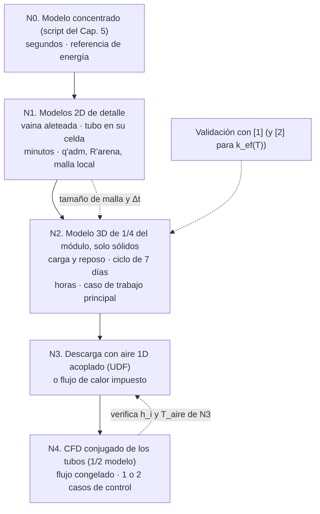
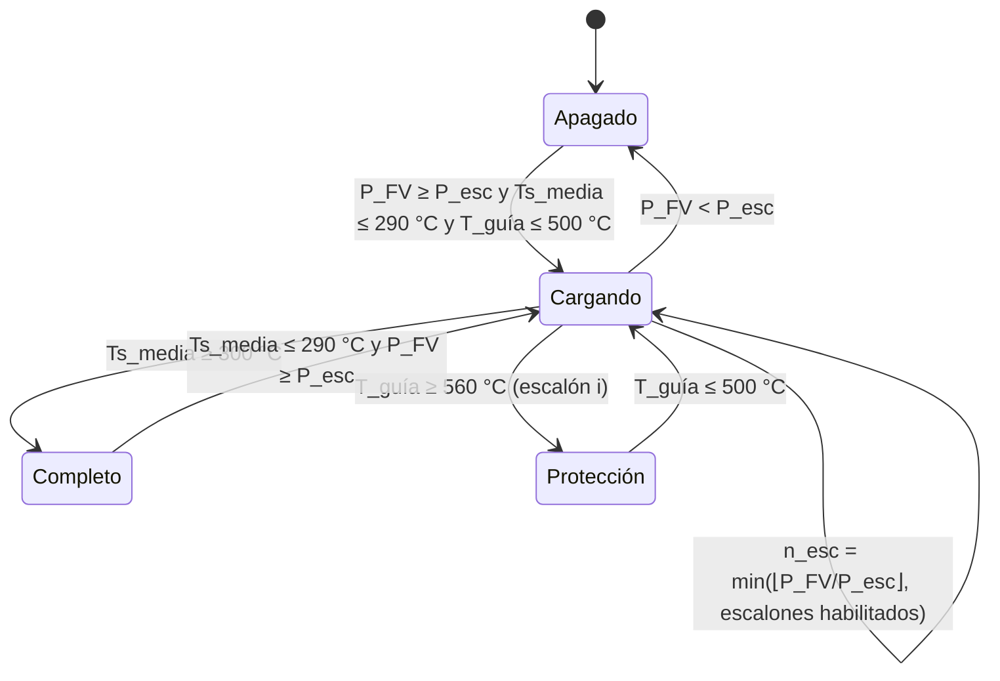
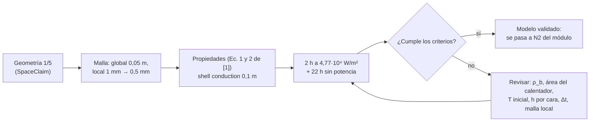

# Capítulo 6. Modelo térmico y plan de simulación
## 6.1 Objetivo y estrategia
Este capítulo define el modelo numérico transitorio del módulo dimensionado en el Cap. 5 [11] y el plan para construirlo, verificarlo y validarlo en **ANSYS Fluent** (Workbench). 

La simulación tiene que responder lo que el cálculo analítico dejó como supuesto:
- el factor de utilización $\varphi_u$ y la $T_{min}$ útil (S4 y 5.1.2 del Cap. 5);
- la temperatura local de la arena junto a las vainas, que debe quedar ≤ 573 °C (S1 del Cap. 3, S7 y S8 del Cap. 5);
- las pérdidas reales con aristas, puentes térmicos e inercia de la aislación;
- la autonomía de 14 h con la regulación por mezcla, y la energía que realmente capta la pila con el perfil del panel y los escalones de carga.

Debido al **bajo costo de cómputo** el modelo es jerárquico: cada nivel se usa solo para la pregunta que el nivel anterior no puede responder.

## 6.2 Enfoque de medio continuo efectivo
La arena se modela como un **sólido homogéneo con propiedades efectivas** ($\rho_b$, $c_p(T)$, $k_{ef}(T)$), sin resolver granos ni poros. Es el enfoque de "parámetros sustitutos" de [1]: el más rápido y de menor demanda, a cambio de que las propiedades tengan que obtenerse aparte (modelo discreto y medio poroso quedan descartados por costo). 
En el Cap. 3 (3.7.3) [9] se justificó para arena estática con aire por tubos: no hay advección en el lecho, el gas de los poros no almacena energía apreciable, el grano es isotérmico ($Bi$ ≈ 0,04–0,05) y está validado en lechos de arena calentados por resistencias, con diferencias medias de 9–20 K en [1] y RMSE < 8 °C en [2].

En todas las zonas sólidas Fluent resuelve solo la ecuación de energía. En la arena es (3.26) del Cap. 3:
$$
\rho_b\,c_p(T)\,\frac{\partial T}{\partial t} = \nabla\cdot\big(k_{ef}(T)\,\nabla T\big) + Q_v(\mathbf x, t)
\tag{6.1}
$$
donde $\rho_b$ es la densidad aparente [kg/m³], $c_p(T)$ el calor específico [J/(kg·K)], $T$ la temperatura [K], $t$ el tiempo [s], $k_{ef}(T)$ la conductividad efectiva [W/(m·K)] y $Q_v$ la generación volumétrica [W/m³], no nula solo en las resistencias si se modelan como volumen. La misma ecuación, sin fuente y con sus propiedades, rige en la chapa, los tubos, el aire estancado y la aislación.

> [!note] Corrección respecto de [1]
> La ecuación de conducción transcripta en la nota de [1] ($\rho\,\partial T/\partial t = (k_c/C_p)\nabla^2 T$) es dimensionalmente inconsistente (Cap. 3, 3.8). Fluent resuelve la forma correcta (6.1) y agrega solo el término $(dk/dT)|\nabla T|^2$ cuando $k$ se carga como función de $T$.
### 6.2.1 Zonas y propiedades del modelo

| Zona | $\rho$ [kg/m³] | $c_p$ [J/(kg·K)] | $k$ [W/(m·K)] | Fuente / supuesto |
|---|---|---|---|---|
| Arena | 1586 | polinomio $427 + T$ (323–846 K); constante 850 por debajo de 323 K | lineal por tramos con la tabla ZBS + radiación (banda inferior); caso de sensibilidad con $0{,}0006\,T - 0{,}0102$ (banda superior) | [1], [6], [9]; S1 |
| Aire estancado en tubos (carga y reposo) | gas ideal o 1,0 | 1007–1040 | $k_a(T)$ molecular | [1]; S5 |
| Tubos y vainas guía AISI 304 | 7900 | 500 | 16 | S2 |
| Chapa interior de acero al carbono | 7850 | 480 | 45 | $k$ del acero de [3]; S2 |
| Lana de roca alta densidad | 120 | 840 | tabla $k(T)$ del Cap. 5 (0,037–0,093 W/(m·K) entre 50 y 400 °C) | Cap. 5, S9; S3 |
| Silicato de calcio (apoyos) | 250 | 1000 | 0,08 | S3 |
| Huelgo resistencia–vaina guía (si se modela) | — | — | $k_{eq}(T)$ de (6.2) | 6.3.2 |

> [!warning] Supuesto crítico S1. Banda de $k_{ef}(T)$
> La conductividad es la propiedad más incierta (Cap. 3, D2). Todos los casos se corren con la **banda inferior** (conservadora para la extracción y para la temperatura de las vainas). La banda superior se corre como sensibilidad (caso S-k). Cuando se mida la arena real (D5 del Cap. 5), se reemplaza la tabla.

> [!note] La aislación tiene inercia térmica
> La lana de roca del caso base (≈ 0,42 m³ × 120 kg/m³ × 840 J/(kg·K) ≈ 42 kJ/K) tiene **más de la mitad de la capacidad térmica de la arena** (85 kg × ~900 J/(kg·K) ≈ 77 kJ/K), y su profundidad de penetración en 24 h, $\sqrt{\alpha_{ais}\,t}$ ≈ 0,2 m, es del orden de su espesor (cálculo propio, S3). El modelo concentrado del Cap. 5 usó un $UA$ estacionario y no la consideró: la simulación la representa al mallar la aislación (6.3.3).
## 6.3 Condiciones de borde e iniciales
### 6.3.1 Tabla de condiciones

| Frontera / zona | Condición en Fluent | Expresión | Valor del caso base | Origen |
|---|---|---|---|---|
| Resistencias, alternativa 1 (casos de trabajo) | *Wall – Heat Flux* en la cara interior de la vaina guía | $q_s = P_{el}(t)/A_s$ | $P_{el}$ ≈ 104 W; $A_s = \pi \cdot 0{,}014 \cdot 0{,}28$ m² → $q_s$ ≈ 8,4·10³ W/m² | Mismo criterio que [1] (1400 W / 2,93·10⁻² m² = 4,77·10⁴ W/m²) |
| Resistencias, alternativa 2 (caso de vaina) | *Cell Zone – Source Term* en el volumen de la resistencia | $Q_v = P_{el}(t)/V_h$ | $V_h = \pi/4 \cdot 0{,}01^2 \cdot 0{,}28$ m³ → $Q_v$ ≈ 4,7·10⁶ W/m³ | [2], [3] |
| Contacto arena–tubo y arena–vaina | *Wall – thin wall* (espesor + material) en la interfaz | $R''_c$ [m²·K/W] | $R''_c$ ≈ 0,015 m²·K/W (huelgo de 0,5 mm de aire) | Cap. 5, S11 |
| Cara exterior de la carcasa | *Wall – Mixed* (convección + radiación) | $-k\,\partial T/\partial n = h_c\,(T_w - T_\infty) + \varepsilon\,\sigma\,(T_w^4 - T_\infty^4)$ | $h_c$ = 2,9 (superior), 2,5 (lateral), 1,1 (inferior) W/(m²·K); $\varepsilon$ = 0,9; $T_\infty$ = 10 °C | Correlaciones por cara de [1] (tabla 5 de su nota) evaluadas con el Cap. 5 |
| Planos de simetría x = 0, y = 0 | *Symmetry* | $\partial T/\partial n = 0$ | — | [1] (usó 1/5 del cilindro) |
| Aislación (opción A, recomendada) | Zona sólida mallada | (6.1) con $k(T)$ | 0,20 m | 6.3.3 |
| Aislación (opción B) | *Wall – Shell Conduction* sobre la cara de la arena | $q = (T_i - T_o)/\sum (t_n/k_n)$ | solo con la corrección (6.3) | [1] |
| Tubos en carga y reposo | Zona sólida "aire estancado" | (6.1) con $k_a(T)$ | compuertas cerradas | [1]; 6.4 |
| Tubos en descarga | Ver 6.4 (N3 o N4) | — | ṁ ≤ 25 kg/h, $T_{in}$ = $T_{ret}$ ≈ 35 °C | Cap. 5, 5.4 |
| Inicial | *Initialization* | $T(\mathbf x, 0) = T_0$ | ver 6.3.4 | [1], [5] |

donde $q_s$ es el flujo de calor impuesto [W/m²], $P_{el}(t)$ la potencia eléctrica del elemento en cada instante [W], $A_s$ la superficie calefactada [m²], $V_h$ el volumen de la resistencia [m³], $R''_c$ la resistencia de contacto por unidad de área [m²·K/W], $h_c$ el coeficiente de convección natural exterior [W/(m²·K)], $T_w$ la temperatura de la pared [K], $T_\infty$ la del invernadero [K], $\varepsilon$ la emisividad exterior y $\sigma$ = 5,67·10⁻⁸ W/(m²·K⁴).

> [!note] Por qué $h_c$ es tan bajo
> Con 20 cm de aislación la carcasa queda a ~14 °C con el invernadero a 10 °C: el $\Delta T$ de la convección natural es de ~4 K y $h_c$ cae a 1–3 W/(m²·K), mientras que la radiación aporta ~4,7 W/(m²·K) (cálculo propio con el script del Cap. 5). Por eso se usa *Mixed* y no un $h$ único de 5 W/(m²·K) como en [2]. Como la resistencia exterior es <5 % de la total, el resultado es poco sensible a $h_c$, en línea con la baja sensibilidad a las pérdidas que reportó [2].

### 6.3.2 Las resistencias: flujo impuesto o fuente volumétrica
- **Alternativa 1 (flujo en la vaina guía).** No se mallan la resistencia ni el huelgo, que son las zonas más finas del modelo. La temperatura de la arena junto a la vaina sale directo; la de la vaina de la resistencia se calcula después con (5.11) del Cap. 5, $T_{vaina} = T_{guía} + q'\,R'_h$. Es el criterio de [1], que impuso el flujo en la superficie del calentador.
- **Alternativa 2 (fuente volumétrica).** Se mallan la resistencia ($Q_v$) y el huelgo como una zona sólida con conductividad equivalente de conducción + radiación (IE):

$$
k_{eq}(T) = \frac{\ln(r_{gi}/r_r)}{2\pi\,R'_h(T)}
\tag{6.2}
$$

donde $k_{eq}$ es la conductividad equivalente del huelgo [W/(m·K)], $r_{gi}$ = 7 mm y $r_r$ = 5 mm los radios de la cara interior de la vaina guía y de la resistencia [m] y $R'_h(T)$ la resistencia por metro del huelgo de (5.11) [m·K/W]. Resulta $k_{eq}$ ≈ 0,06 / 0,12 / 0,20 W/(m·K) a 200 / 400 / 600 °C (cálculo propio). Se usa solo en el caso que verifica la temperatura de vaina (caso R-v).
### 6.3.3 Aislación: mallada y no como cáscara
La conducción en cáscara (*shell conduction*) de [1] trata la aislación como una capa delgada plana sobre la cara de la arena. Con 10 cm de aislación sobre un cilindro de 59 cm era aceptable, pero en este módulo la aislación (20 cm) es comparable al lado del lecho (38 cm) y pesan las aristas y los vértices. Con el factor de forma (5.15) del Cap. 5, la relación entre la conductancia real y la de la cáscara es (cálculo propio):
$$
F_{sh} = \frac{S_{cubo}}{6\,a^2/t} = \frac{6a^2/t + 6{,}48\,a + 1{,}2\,t}{6a^2/t} \approx 1{,}63
\tag{6.3}
$$

donde $F_{sh}$ es el factor de corrección [–], $S_{cubo}$ el factor de forma de la caja hueca [m], $a$ = 0,377 m el lado del lecho y $t$ = 0,20 m el espesor. **La cáscara subestimaría en ~39 % las pérdidas por las paredes** y además no tendría la inercia de la aislación (6.2.1). Por eso:

- **Opción A (recomendada):** aislación como zona sólida mallada, con celdas de 10–15 mm, que agregan pocas celdas porque el gradiente es suave.
- **Opción B (solo para pruebas rápidas):** cáscara con $k$ multiplicada por $F_{sh}$ y sin inercia.
### 6.3.4 Condición inicial y régimen periódico
- **Validación (V1):** lecho a temperatura ambiente, como en [1].
- **Primera carga (C1):** todo el módulo a $T_{inv}$ = 10 °C.
- **Ciclos (C5, C6):** para ahorrar días simulados, se inicializa con el estado periódico estimado por el Cap. 5: arena a $T_{min}$ ≈ 105 °C al comienzo de la carga, aislación con un perfil lineal entre $T_{min}$ y la cara exterior. El ciclo se repite hasta el **régimen periódico**:

$$
\left|\bar T_s(t + 24\,\text{h}) - \bar T_s(t)\right| < 1\ \text{K}
\quad\text{y}\quad
\left|\frac{U(t+24\,\text{h}) - U(t)}{E_{in,24h}}\right| < 1\ \%
\tag{6.4}
$$

donde $\bar T_s$ es la temperatura media volumétrica de la arena [K], $U$ la energía interna de todas las zonas sólidas (6.11) [J] y $E_{in,24h}$ la energía eléctrica que entró en el día [J]. Se espera llegar en 3–4 días desde el estado estimado (supuesto S6), en lugar de los 7 días que [1] necesitó para cargar un lecho desde frío.

> [!example] Imagen a insertar 1: geometría y ubicación de las condiciones de borde en [1]
> ![[Numerical analysis of the prototype of the high-temperature thermal energy storage based on sand bed-1791502047397.webp]]
> **Descripción:** Fig. 5 de [1]. Ubicación de las condiciones de borde (flujo en calentadores, simetría, convección en caras superior, lateral e inferior) sobre el dominio de arena. Es la plantilla de la tabla 6.3.1.
## 6.4 Tratamiento de los tubos de extracción
### 6.4.1 Carga y reposo: aire estancado como sólido equivalente
Con las compuertas cerradas, el aire dentro de los tubos se modela como una **zona sólida con la conductividad molecular del aire**. En [1] se comparó esta hipótesis con un caso extremo, con convección natural exagerada ($k_{eff}$ = 0,21 W/(m·K), obtenida de una correlación de recinto inclinado con $\Delta T$ ≈ 114 K), y la diferencia en el comportamiento global del lecho no superó el 0,2 %. Además, a medida que la carga avanza, el aire y la arena se igualan y el gradiente que impulsa la convección tiende a cero [1].

> [!warning] Supuesto S5. Validez para tubos verticales
> El resultado de [1] es para un tubo helicoidal. En este módulo los tubos son **verticales y con salida hacia arriba**: el aire de los tramos que cruzan la aislación se calienta desde abajo y puede convectar (Cap. 5, 5.5.4). En el lecho la diferencia debería ser chica, igual que en [1], pero en los pasamuros puede pesar. Se verifica con el caso S-a: $k_{aire}$ × 10 en todos los tubos.

> [!example] Imagen a insertar 2: aire encerrado en [1]
> `![[Numerical analysis of the prototype of the high-temperature thermal energy storage based on sand bed-1791510269344.webp]]`
> **Descripción:** Fig. 11 de [1]. Comparación entre aire estancado con conductividad molecular y con convección exagerada; la desviación relativa máxima es 0,2 %. Justifica 6.4.1.

### 6.4.2 Descarga: tres niveles de modelo
En la descarga el aire circula a caudal variable: al comienzo de la noche solo el 13 % del caudal pasa por la pila ($x$ = 0,13) y al final pasa todo (Cap. 5, 5.4.4). Con 2 circuitos, el número de Reynolds en la pila va de ~1000 a ~7400, es decir **de laminar a turbulento en la misma noche**. Un CFD completo de 14 h con caudal variable no es viable con poco cómputo. Se usan tres niveles:

**N3-a. Sumidero impuesto (sin UDF, primer paso).** En la pared interior de los tubos se impone un flujo de calor que extrae la potencia de la cama:

$$
q_t = -\frac{P_{cama}}{A_{t,int}}
\quad\text{mientras}\quad
\bar T_{w,t} - T_{ret} \ge \frac{P_{cama}}{\bar h_i\,A_{t,int}}
\tag{6.5}
$$

donde $q_t$ es el flujo en la pared del tubo [W/m²], $A_{t,int}$ el área interior total de tubos en el lecho [m²], $\bar T_{w,t}$ la temperatura media de esa pared [K], $T_{ret}$ la temperatura de retorno del aire (≈ 35 °C) y $\bar h_i$ el coeficiente interno con caudal máximo [W/(m²·K)]. Cuando deja de cumplirse la desigualdad, la pila ya no puede entregar $P_{cama}$: es la $T_{min}$ útil "medida". Reparte la extracción en forma uniforme (en la realidad los primeros pasos extraen más), así que sobreestima un poco la autonomía.

**N3-b. Convección con aire 1D acoplado (UDF, caso de trabajo).** Cada paso $j$ de tubo tiene una condición *Wall – Convection* con su propio coeficiente y temperatura de aire, calculados por una UDF que integra el balance (3.28) del Cap. 3 a lo largo del circuito:

$$
-k\,\frac{\partial T}{\partial n}\bigg|_{w,j} = h_{i,j}(\dot m_p)\,\big(T_{w,j} - T_{a,j}\big),
\qquad
T_{a,j+1} = T_{a,j} + \frac{Q_j}{\dot m_p\,c_{p,a}},
\qquad
T_{a,1} = T_{ret}
\tag{6.6}
$$

donde $h_{i,j}$ es el coeficiente interno del paso $j$ (Gnielinski o laminar, Cap. 3, 3.9.2) [W/(m²·K)], $T_{w,j}$ la temperatura de la pared [K], $T_{a,j}$ la del aire a la entrada del paso [K], $Q_j$ el calor que toma el aire en el paso [W] (integral de superficie del paso anterior de tiempo), $\dot m_p = x\,\dot m$ el caudal por la pila [kg/s] y $c_{p,a}$ el calor específico del aire [J/(kg·K)]. La misma UDF aplica la regulación: ajusta $\dot m_p$ para que $\sum Q_j = P_{cama}$, con $\dot m_p \le$ 25 kg/h (6.5.2).

**N4. CFD conjugado (verificación).** Se mallan el aire y la pared de los tubos de **medio módulo** (un circuito, simetría en x = 0) y se resuelve el flujo con caudal fijo. Con $Re$ < 2300 se usa el modelo laminar; con $Re$ > 3000, k-ω SST con $y^+$ ≈ 1 o k-ε con funciones de pared y $y^+$ entre 20 y 200, como en [1]. Para que sea viable se usa la técnica de [1]: **el flujo se resuelve primero sin transferencia de calor** y se usa como condición inicial; después se **congela** (en *Solution Controls → Equations* se resuelve solo energía) y se integra el transitorio térmico. Se corren 2–3 caudales constantes (por ejemplo $x$ = 0,2 y 1) durante 2–4 h y se comparan $Q_j$ y $T_{a,j}$ con N3-b.

> [!warning] Dato faltante D1. Resistencia de contacto arena–tubo
> En los tres niveles entra $R''_c$ ≈ 0,015 m²·K/W (huelgo de 0,5 mm, S11 del Cap. 5) como *thin wall*. Es ~10 % de la resistencia arena–aire y no está en las notas. Se corre con 0 y con el doble (caso S-c).

> [!example] Imagen a insertar 3: condiciones de borde de la descarga en [1]
> `![[Numerical analysis of the prototype of the high-temperature thermal energy storage based on sand bed-1791760909261.webp]]`
> **Descripción:** Fig. 21 de [1]. Entrada de aire con velocidad constante y salida a presión atmosférica en el intercambiador de tubos: es la configuración de N4.

---
## 6.5 Lógica de control

### 6.5.1 Carga
La potencia disponible del panel se representa con un perfil de día claro de invierno, media onda senoidal con la misma energía que el Cap. 5 ($P_{inst}\cdot HSP$):

$$
P_{FV}(t) = P_{inst}\,\sin\!\left(\frac{\pi\,(t - t_0)}{t_{sol}}\right),
\qquad
t_{sol} = \frac{\pi}{2}\,HSP \approx 7{,}1\ \text{h}
\tag{6.7}
$$

donde $P_{FV}(t)$ es la potencia que llega a las resistencias [W], $P_{inst}$ ≈ 934 W la potencia máxima (Cap. 5, 5.3.1), $t_0$ el inicio del día solar [s], $t_{sol}$ su duración [s] y $HSP$ = 4,5 h (S6 del Cap. 5).

> [!note] El perfil alarga la ventana de carga
> El Cap. 5 supuso una ventana de 5,5 h (S2). Con un perfil senoidal de igual energía, el panel produce durante ~7,1 h con potencia baja en los extremos. La simulación usa (6.7) y corrige los tiempos de reposo; el día nublado se representa con $P_{inst}$ × 0,5 (S7).

Hay dos niveles de control, cada uno con histéresis (en la línea de [1], que encendía las resistencias con $T \le$ 673 K y las apagaba con $T \ge$ 1073 K, con temperatura de reinicio baja para no ciclar los contactores):

| Lazo | Variable medida | Apaga | Reenciende | Acción |
|---|---|---|---|---|
| Energía (carga completa) | $\bar T_s$ estimada con 3 termocuplas de arena | $\bar T_s \ge$ 300 °C | $\bar T_s \le$ 290 °C | todos los escalones |
| Protección local | máxima T de pared de vaina guía de cada escalón | $T_{guía} \ge$ 560 °C | $T_{guía} \le$ 500 °C | ese escalón |
| Disponibilidad FV | $P_{FV}(t)$ | $P_{FV} < P_{esc}$ | $P_{FV} \ge P_{esc}$ | número de escalones activos |

*Umbrales: supuesto S8; se fijan en el cap. 10 del plan.*

En Fluent la lógica va en una UDF: un `DEFINE_EXECUTE_AT_END` lee las temperaturas de los "sensores" (promedios en pequeños volúmenes o superficies) al final de cada paso de tiempo y actualiza variables de estado; un `DEFINE_PROFILE` (o `DEFINE_SOURCE` en la alternativa 2) aplica $q_s$ de cada escalón según ese estado y $P_{FV}(t)$. Las *Named Expressions* de Fluent permiten escribir (6.7) y un On/Off simple, pero la histéresis necesita memoria, por eso la UDF. La alternativa sin C es un lazo con **PyFluent** que avanza la simulación de a un paso y cambia las condiciones de borde.

> [!warning] Los escalones discretos pierden energía
> Con 3 escalones de ~310 W, cada escalón solo entra cuando el panel da toda su potencia: con el perfil (6.7) la pila capta **~69 %** de la energía FV. Con 9 elementos conmutables, ~90 %, y con modulación continua (PWM o MPPT), ~100 % (cálculo propio). El Cap. 5 supuso captación total. La simulación compara las tres variantes (caso R-e) y el resultado va al subsistema electrónico (D2 del Cap. 5).

### 6.5.2 Descarga
Se modela el lazo del Cap. 4 (4.3.4) [10]: el ventilador (PWM) fija la potencia y la compuerta fija la mezcla. En el dominio de la pila solo aparece $\dot m_p = x\,\dot m$; la UDF de N3-b lo ajusta en cada paso de tiempo para entregar $P_{cama}$:

$$
\dot m_p^{\,n+1} = \dot m_p^{\,n}\left[1 + K_p\,\frac{P_{cama} - \sum_j Q_j^{\,n}}{P_{cama}}\right],
\qquad
\dot m_p \le \dot m_{max}
\tag{6.8}
$$

donde $\dot m_p^{\,n}$ es el caudal por la pila en el paso $n$ [kg/s], $K_p$ ≈ 0,5 una ganancia proporcional adimensional (S9), $Q_j^{\,n}$ el calor tomado en cada paso de tubo [W] y $\dot m_{max}$ = 25 kg/h. Cuando $\dot m_p = \dot m_{max}$ y la potencia cae por debajo de $P_{cama}$, termina la descarga útil. La temperatura de impulsión a la cama ($T_{mez}$ ≤ 60 °C) y la caja de mezcla se calculan fuera del dominio con (4.5) del Cap. 4.

---
## 6.6 Discretización: malla y paso de tiempo

### 6.6.1 Dominio y simetría
- **Carga y reposo (N2):** 1/4 del módulo, con simetría en x = 0 e y = 0. La grilla de 4 × 4 tubos y las 9 vainas en 3 niveles del croquis del Cap. 5 son simétricas respecto de esos planos. Se omiten las curvas de los tubos y los pasamuros (rompen la simetría); los puentes térmicos se suman con $UA_b$ de (5.17) del Cap. 5 y se verifican con un único caso 3D completo (caso P).
- **Descarga N4:** 1/2 módulo (un circuito), con simetría en x = 0.
- **Modelos 2D (N1):** (a) sección perpendicular a una vaina guía aleteada con su celda de influencia ($r_2$ ≈ 4,5 cm), para verificar $q'_{adm}$, $r_{eq}$ y la temperatura local junto a la vaina (S7 y S8 del Cap. 5); (b) un tubo en su celda cuadrada de 9,4 cm, para verificar $R'_{arena}$ (3.31) y la profundidad de penetración (3.32).

### 6.6.2 Tamaños de celda y costo estimado
[1] encontró que el tamaño global de celda (0,1–0,0025 m) casi no cambiaba las temperaturas en los puntos de medición ni la media de la arena, pero que la temperatura del calentador y la máxima de la arena solo se estabilizaban con un **tamaño local de 0,0005 m en la superficie del calentador**. Lo mismo se espera acá: el tamaño local junto a las vainas es la variable crítica.

| Zona | Tamaño de partida | Estudio | Comentario |
|---|---|---|---|
| Arena (global) | 5 mm | 8 / 5 / 3,5 mm | poliedros |
| Superficie de la vaina guía y aletas | 1 mm, crecimiento 1,2 | 2 / 1 / 0,5 mm | en N1 primero; se lleva a N2 el valor elegido |
| Tubos (aire estancado y pared) | 2 mm; 3 celdas en el espesor de pared | — | sin capa límite en carga y reposo [1] |
| Tubos en N4 | capas de inflación para $y^+$ objetivo | según modelo de turbulencia | solo en N4 |
| Aislación | 10–15 mm | 20 / 12 / 8 mm | gradiente suave |

Orden de magnitud del modelo N2 de 1/4 (cálculo propio): ~4·10⁴ celdas en la arena global, 1–2·10⁵ en el refinamiento de vainas y tubos y ~3·10⁴ en la aislación, es decir **2–3·10⁵ celdas**, frente a 8,3·10⁵ celdas para 1/5 del prototipo de [1] y ~4,9·10⁶ para su modelo completo con intercambiador. Un modelo solo de sólidos de ese tamaño es abordable en una computadora de escritorio. Hay que medir el tiempo por iteración en la primera corrida y recalcular el plan (supuesto S10).

### 6.6.3 Criterio de independencia de malla
Se usan tres mallas con relación de refinamiento $r \ge$ 1,3 y el índice de convergencia de malla (GCI, IE):

$$
p = \frac{\ln\left|(f_3 - f_2)/(f_2 - f_1)\right|}{\ln r},
\qquad
GCI_{fino} = \frac{1{,}25\,\left|(f_1 - f_2)/f_1\right|}{r^p - 1}
\tag{6.9}
$$

donde $f_1$, $f_2$, $f_3$ son el valor de una variable de salida en las mallas fina, media y gruesa, $p$ el orden de convergencia observado [–] y $GCI_{fino}$ la incertidumbre de discretización de la malla fina [–]. Variables de control: $T_{guía,max}$, $T_{s,max}$, $\bar T_s$ y la energía almacenada a las 2 h y al final de la carga. **Criterio: $GCI$ < 2 % en $\bar T_s$ y en la energía, y < 5 % en $T_{guía,max}$** (supuesto S11). El mismo esquema de refinamiento y la tasa de convergencia observada es el que usa [7] para su modelo FEM.

### 6.6.4 Paso de tiempo
Fluent resuelve el transitorio en forma implícita: no hay límite de estabilidad, pero sí de precisión. El tiempo característico de difusión de una celda es (IE):

$$
\tau_c = \frac{\Delta x^2}{\alpha_{ef}},
\qquad
\alpha_{ef} = \frac{k_{ef}}{\rho_b\,c_p}
\tag{6.10}
$$

donde $\tau_c$ es el tiempo característico [s], $\Delta x$ el tamaño de celda [m] y $\alpha_{ef}$ ≈ 1,75·10⁻⁷ m²/s la difusividad efectiva. Da ~6 s para celdas de 1 mm y ~140 s para 5 mm (cálculo propio). Se adopta:

- **carga:** $\Delta t$ = 30–60 s, para que el control reaccione a tiempo y no "salte" la histéresis;
- **reposo y descarga:** *adaptive time stepping* entre 60 y 600 s.

Estudio: 120 / 60 / 30 s en un día de carga; criterio de diferencia < 1 K en $T_{guía,max}$ (S11). Convergencia por paso: residuo de energía < 10⁻⁷ (doble precisión) y error de balance $\epsilon_E$ (6.12) < 0,5 %.

> [!example] Imagen a insertar 4: sensibilidad de malla en [1]
> `![[Numerical analysis of the prototype of the high-temperature thermal energy storage based on sand bed-1791505456380.webp]]`
> **Descripción:** Fig. 6 de [1]. Temperaturas en los puntos de medición, del calentador y de la arena en función del número de celdas, al cambiar (A) el tamaño global y (B) el tamaño local en la superficie del calentador. Muestra que solo el tamaño local importa para las temperaturas máximas.

---
## 6.7 Variables de salida
Se definen como *Report Definitions* de Fluent y se guardan en archivos de reporte cada paso:

$$
U(t) = \sum_{zonas}\int_V \rho \int_{T_{ref}}^{T} c_p\,dT\,dV,
\qquad
E_{in} = \int P_{el}\,dt,
\qquad
E_{out} = \int \sum_j Q_j\,dt,
\qquad
E_{loss} = \int \oint_{ext} q\,dA\,dt
\tag{6.11}
$$

$$
SR = \frac{E_{nett}}{E_{in}},
\qquad
DR = \frac{E_{out}}{E_{out} + E_{loss}},
\qquad
\eta_{alm} = \frac{E_{out,24h}}{E_{in,24h}},
\qquad
\epsilon_E = \frac{E_{in} - E_{out} - E_{loss} - \Delta U}{E_{in}}
\tag{6.12}
$$

donde $U$ es la energía interna de las zonas sólidas respecto de $T_{ref}$ [J], $E_{in}$ la energía eléctrica entregada a las resistencias [J], $E_{out}$ la extraída por el aire [J], $E_{loss}$ la perdida por la cara exterior más los puentes [J], $E_{nett} = U(t) - U(0)$ la energía neta almacenada [J], $SR$ la relación de almacenamiento y $DR$ la de descarga definidas en [1], $\eta_{alm}$ la eficiencia térmica diaria del Cap. 1 y $\epsilon_E$ el error de balance de energía [–].

| Salida | Qué responde | Criterio o comparación |
|---|---|---|
| $\bar T_s$, $T_{s,max}$, $T_{s,min}$, $\Delta T_s$ | carga y uniformidad del lecho | $\bar T_s$ = 300 °C al final de la carga |
| $T_{s,loc}$ (máximo junto a vainas) y $T_{vaina}$ | límite del cuarzo y del calefactor | ≤ 573 °C y ≤ admisible de Incoloy 800 (D10 del Cap. 5) |
| $SR$, $DR$, $\eta_{alm}$ | eficiencias | Cap. 5: $\eta_{alm}$ = 58 %; [1]: SR 0,61–0,85, DR 0,88–0,97 |
| $P_{out}(t)$, autonomía a 174 W | función principal | ≥ 14 h (RT3) |
| $\bar T_s$ al fin de la descarga útil y $\varphi_u$ medido | supuestos del Cap. 5 | $T_{min}$ ≈ 105 °C; $\varphi_u$ = 0,90 |
| Pérdidas por cara y por puentes | aislación | Cap. 5: 73 W medios; puentes 23 % |
| $T_{ext,max}$ y calor que sale por la tapa | seguridad (RM4) y RT5 en U1 | ≤ 50 °C; flujo diurno hacia la cama |
| Energía FV captada | control | 69 / 90 / 100 % (6.5.1) |
| $\epsilon_E$ | calidad numérica | < 0,5 % |

---
## 6.8 Matriz de casos

| ID | Nivel | Qué | Duración simulada | Variantes | Salidas principales |
|---|---|---|---|---|---|
| **V0** | N1 | Verificación con soluciones analíticas: pared plana transitoria y cilindro estacionario (5.10) | — | malla 2 / 1 / 0,5 mm | error < 1 % frente a la solución exacta |
| **V1** | N2* | Validación con el prototipo de [1] (6.9) | 2 h carga + 22 h reposo | malla, $\rho_b$, banda de $k$ | $T_1$–$T_3$; $\bar T_s$, $T_{s,max}$, $T_{s,min}$ a 2, 12 y 24 h |
| **V2** | N2* | Validación de $k_{ef}(T)$ con el lecho de [2] (opcional) | ~7 h | ZBS con y sin radiación | $T_1$–$T_4$, RMSE |
| **R-1** | N1 | Vaina guía aleteada en su celda | 1 día de carga | con y sin aletas; $r_2$; $F_a$ | $q'$ admisible real; $T_{s,loc}$ |
| **C1** | N2 | Primera carga desde 10 °C | hasta $\bar T_s$ = 300 °C (2–3 días) | — | energía de arranque (Cap. 5: 21,3 MJ + aislación), tiempo |
| **C2** | N2 | Un día de carga desde el estado periódico | 24 h | control con histéresis | $T_{s,loc}$, $T_{vaina}$, SR, energía captada |
| **C3** | N2 | Reposo sin extracción | 48 h | — | autodescarga, $\tau$ (Cap. 5: 56 h) |
| **C4** | N3-a / N3-b | Descarga nocturna a 174 W | 16 h | ṁ máx. 12 / 18 / 25 / 35 kg/h | $P_{out}(t)$, autonomía, $T_{min}$, $\varphi_u$, DR |
| **C5** | N2 + N3-b | Ciclo de 7 días, **nominal** | 7 días | $\bar f$ = 0,75; día claro; $T_{inv}$ = 10 °C | régimen periódico (6.4), $\eta_{alm}$, autonomía |
| **C6** | N2 + N3-b | Ciclo de 7 días, **peor caso** | 7 días | $\bar f$ = 1; día 4 nublado (FV × 0,5) | recuperación tras el día nublado, noches incompletas |
| **R-a** | N2 | Variantes de resistencias | 1 día (C2) | 9 elementos (base) / 6 / sin aletas | $T_{s,loc}$, $\Delta T_s$, SR |
| **R-e** | N2 | Estrategia de escalones | 3 días | 3 escalones / 9 conmutables / PWM continuo | energía captada, ciclos de contactor por día |
| **R-2k** | N2 | 2 × 1 kW (verificación del Cap. 5) | 2 h | — | $T_{s,loc}$, $T_{vaina}$ (se espera que no cumpla) |
| **R-v** | N2 | Temperatura de vaina con fuente volumétrica | 1 día | alternativa 2 de 6.3.2 | $T_{vaina}$ frente a (5.11) |
| **Q-1** | N4 | CFD conjugado de un circuito | 2–4 h | $x$ = 0,2 y 1 | $h_{i,j}$, $T_{a,j}$ frente a N3-b |
| **P** | 3D completo | Puentes térmicos con pasamuros | 24 h | — | pérdidas por puentes frente a (5.17) |
| **S-k / S-c / S-a / S-T** | N2 | Sensibilidad | 1 ciclo | $k_{ef}$ banda superior; $R''_c$ × 0 y × 2; $k_{aire}$ × 10; $T_{inv}$ = 15 °C | variación de autonomía, pérdidas, $T_{s,loc}$ |

*N2\*: misma técnica que N2, con la geometría del paper.*

> [!note] Orden de ejecución
> V0 → R-1 → V1 → (V2) → C2 → C3 → C4 → C1 → C5 → C6 → variantes. La validación va antes de los casos del módulo, y la vaina aleteada (R-1) va antes de todo porque fija el tamaño local de malla y confirma, o no, el número de resistencias del Cap. 5.

> [!warning] Dato faltante D2. Caso nominal
> Sin el balance de la cama (cap. 3 del plan) no hay un caso nominal con fundamento. Se adopta $\bar f$ = 0,75 (S12) solo para tener un caso intermedio; se reemplaza cuando se conozca D7 del Cap. 5.

---
## 6.9 Plan de validación con el prototipo de [1]

### 6.9.1 Caso a reproducir
Se reproduce el ensayo de validación de [1]: **2 h de calentamiento y 22 h de estabilización** del prototipo de laboratorio.

| Dato de [1] | Valor |
|---|---|
| Tanque | cilíndrico de acero, Ø 59 cm × 70 cm, 205 dm³ |
| Arena | cuarzo, 300 kg; $c_p(T) = T + 427$, $k_c(T) = 0{,}0006\,T - 0{,}0102$ (323–846 K) |
| Aislación | lana mineral de 10 cm, λ = 0,040 W/(m·K), como *shell conduction* |
| Resistencias | 5 × 1400 W; flujo impuesto $4{,}77 \cdot 10^4$ W/m² sobre $2{,}93 \cdot 10^{-2}$ m² cada una |
| Dominio | 1/5 del volumen (simetría), solo la arena; resistencias como huecos |
| Exterior | convección natural por cara: superior $Nu = 0{,}54\,Ra^{1/4}$ ($10^4$–$10^7$) o $0{,}15\,Ra^{1/3}$ ($10^7$–$10^{11}$); lateral Churchill-Chu; inferior $Nu = 0{,}27\,Ra^{1/4}$ |
| Malla | poliedros, 828 081 celdas; global 0,05 m; local 0,0005 m en los calentadores |
| Resultados de comparación | diferencias medias de 14, 9 y 20 K en $T_1$, $T_2$, $T_3$; tabla de $\bar T_s$ / $T_{s,max}$ / $T_{s,min}$: 470 / 1392 / 293 K a 2 h, 469 / 554 / 391 K a 12 h, 436 / 491 / 400 K a 24 h |

> [!warning] Datos faltantes D3. Lo que hay que sacar de las figuras de [1]
> - Dimensiones y posición de las resistencias (Fig. 2 de [1]) y coordenadas de $T_1$–$T_3$ (Fig. 3).
> - Curvas experimentales de $T_1$–$T_3$ (Fig. 7): digitalizarlas, por ejemplo con WebPlotDigitizer.
> - Temperatura inicial y ambiente del ensayo (se lee del inicio de la Fig. 7).
> - Densidad usada en el modelo: 300 kg en 205 dm³ dan ~1460 kg/m³, mientras que [6] da 1586 kg/m³. Se corre con ambas.
> - La nota indica "0,005 m" y "0,05 m" como tamaño global en dos lugares; se usa 0,05 m (valor de los ajustes finales) y se incluye en el estudio de malla.

> [!example] Imagen a insertar 5: geometría del prototipo y puntos de medición
> `![[Numerical analysis of the prototype of the high-temperature thermal energy storage based on sand bed-1791484994645.webp]]` y `![[Numerical analysis of the prototype of the high-temperature thermal energy storage based on sand bed-1791485147051.webp]]`
> **Descripción:** Figs. 2 y 3 de [1]. Dimensiones del modelo y sector de 1/5 con la ubicación de los puntos de medición. De acá salen los datos D3.

### 6.9.2 Procedimiento y criterio de aceptación

| Variable | Criterio de aceptación (S13) |
|---|---|
| $T_1$, $T_2$, $T_3$ en el tiempo | diferencia media frente a la simulación de [1] ≤ 5 K y frente al ensayo del orden de la de [1] (≤ 20 K) |
| $\bar T_s$ a 2, 12 y 24 h | ±2 % de 470 / 469 / 436 K |
| $T_{s,max}$ a 12 y 24 h | ±5 % de 554 / 491 K (a 2 h, 1392 K depende mucho de la malla local) |
| Balance $\epsilon_E$ | < 0,5 % |

Después, la **validación del modelo de $k_{ef}(T)$** (V2, opcional) usa el lecho de [2]: arena en un contenedor de aluminio de ~0,6 × 0,4 × 0,3 m con dos calentadores, $h$ = 5 W/(m²·K), emisividades 0,9 (arena) y 0,1 (aluminio), $T_{amb}$ = 285,15 K; allí solo el modelo ZBS con radiación dio RMSE < 8 °C [2]. Es el que se usa en este módulo, así que V2 valida directamente la tabla de $k_{ef}(T)$.

> [!note] Lecciones de los otros modelos de las notas
> - En el prototipo con Stirling [3], el modelo (COMSOL, 66 dominios, ~10 millones de elementos, $h$ = 5 W/(m²·K)) supuso contacto ideal, conductividad uniforme y no modeló el PID que limitaba la resistencia a ~700 °C; por eso predijo más duración y menos pérdidas que el ensayo. **Este plan modela el control y la resistencia de contacto** e incluye los puentes (caso P).
> - [4] reporta desviaciones superiores al 12 % en la energía almacenada si se ignora la variación de las propiedades con $T$: todas las propiedades van función de $T$.
> - La validación de la **descarga** con [1] (velocidades de 0,5 a 5 m/s, potencia máxima de 280 a 2083 W, DR de 0,88 a 0,97) solo es posible si se reconstruye su intercambiador helicoidal (Fig. 12 de [1]), cuya geometría no está en la nota. Queda como validación opcional de N4.

> [!example] Imagen a insertar 6: comparación ensayo-simulación en [1]
> `![[Numerical analysis of the prototype of the high-temperature thermal energy storage based on sand bed-1791506541409.webp]]`
> **Descripción:** Fig. 7 de [1]. Temperaturas medidas y simuladas en $T_1$–$T_3$ durante 2 h de carga y 22 h de reposo. Es la curva objetivo de V1.

---
## 6.10 Plan de estudio para ANSYS Fluent
El plan va de lo simple a lo complejo: cada etapa deja un entregable que verifica la anterior. Las etapas 0–4 se pueden hacer antes de tener la geometría final.

| Etapa | Qué aprender | Ejercicio | Entregable | Duración estimada |
|---|---|---|---|---|
| **E0** | Flujo de Workbench: geometría (SpaceClaim, o CATIA → STEP), *Named Selections*, Meshing, Fluent, CFD-Post | Cursos gratuitos de Ansys (Innovation Courses) de conducción y transitorios | proyecto de prueba funcionando | 1 semana |
| **E1** | Materiales, condiciones de borde, transitorio, *Report Definitions* | Pared plana transitoria y cilindro estacionario 2D frente a la solución analítica (V0) | error < 1 %; estudio de malla y de $\Delta t$ | 1 semana |
| **E2** | Propiedades función de T (polinomio y tabla), *Mixed*, *thin wall*, *shell conduction* | Caja con aislación: cáscara frente a aislación mallada; comprobar $F_{sh}$ ≈ 1,63 (6.3) | nota con la diferencia | 1 semana |
| **E3** | Malla local, inflación, calidad (ortogonalidad, asimetría), GCI | Vaina aleteada 2D (R-1) | $q'_{adm}$ real; tamaño local elegido | 1–2 semanas |
| **E4** | Simetría, flujo impuesto, comparación con ensayos | Validación V1 con [1] | informe de validación | 2–3 semanas |
| **E5** | UDF: compilar (en Windows requiere el compilador de Visual Studio), `DEFINE_PROFILE`, `DEFINE_EXECUTE_AT_END`; alternativa PyFluent | Histéresis On/Off en V1 extendida a 48 h | control funcionando y comparado a mano | 2 semanas |
| **E6** | Modelo del módulo N2 (1/4) | C2, C3, C1 y estudio de malla del módulo | primeras curvas del módulo | 2–3 semanas |
| **E7** | UDF del aire 1D (N3-b); flujo congelado en Fluent (N4) | C4 y Q-1 | autonomía y $T_{min}$ simuladas | 3 semanas |
| **E8** | Corridas largas en modo *batch* con *journal* (.jou) y sin interfaz gráfica; post-proceso en Python de los archivos de reporte | C5 y C6 | régimen periódico, $\eta_{alm}$ | 2 semanas |
| **E9** | Variantes y sensibilidad | R-a, R-e, R-2k, R-v, P, S-* | tabla de resultados para la ingeniería de detalle | 3 semanas |

*Duraciones: supuesto S14, con dedicación parcial. Las simulaciones se ejecutan en la ingeniería de detalle (hasta el 04/11/2027 [8]).*

**Recomendaciones para poco cómputo:**

1. Resolver todo lo posible con modelos de sólidos: Fluent solo resuelve energía y cada paso es barato.
2. Usar simetría (1/4 o 1/2) y modelos 2D para las preguntas locales.
3. Arrancar los ciclos desde el estado periódico estimado (6.3.4), no desde frío.
4. Paso de tiempo adaptativo en reposo y descarga; guardar el archivo de datos completo cada 6 h y los reportes en cada paso.
5. Correr en paralelo con todos los núcleos físicos y en modo *batch* (de noche), con doble precisión para que el balance de energía de 7 días cierre.
6. Dejar el CFD de flujo (N4) para 1–2 casos de verificación con flujo congelado.

> [!example] Imagen a insertar 7: perfiles de carga con FV en [1]
> `![[Numerical analysis of the prototype of the high-temperature thermal energy storage based on sand bed-1791579321269.webp]]`
> **Descripción:** Fig. 17 de [1]. Evolución de la temperatura media del lecho con distintos esquemas de calentamiento en 168 h. Ilustra el tipo de resultado de los casos C1 y R-e.

---
## 6.11 Cierre del capítulo

### 6.11.1 Supuestos usados

| ID | Supuesto | Justificación | Dónde impacta |
|---|---|---|---|
| S1 | $k_{ef}(T)$ de banda inferior en todos los casos; banda superior como sensibilidad | Cap. 3, D2; conservador | Extracción, $T_{s,loc}$ |
| S2 | Aceros: AISI 304 $k$ = 16, $c_p$ = 500; carbono $k$ = 45, $c_p$ = 480 | Valores típicos (IE); $k$ del acero de [3] | Inercia y conducción en tubos y chapa |
| S3 | Lana de roca: $\rho$ = 120 kg/m³, $c_p$ = 840 J/(kg·K); $k(T)$ del Cap. 5; silicato de calcio $k$ = 0,08 W/(m·K) | Valores típicos (IE); Cap. 5, S9 | Pérdidas, inercia de la aislación |
| S4 | $c_p$ de la arena = 850 J/(kg·K) por debajo de 323 K | Valor medido a 20 °C [6]; (3.1) no vale debajo de 323 K | Primera carga, validación |
| S5 | Aire estancado con conductividad molecular en carga y reposo | Diferencia < 0,2 % en [1]; se verifica (S-a) | Carga, reposo, puentes |
| S6 | Régimen periódico en 3–4 días desde el estado estimado | Inicialización con el Cap. 5 | Costo de los ciclos |
| S7 | Día claro de invierno: media senoidal (6.7); día nublado = 50 % | Misma energía que el Cap. 5; sin datos del sitio | Carga, C5, C6 |
| S8 | Umbrales de control: 300/290 °C de media; 560/500 °C en la vaina guía | Margen de 13 K respecto de 573 °C y histéresis amplia, como en [1] | Carga, $T_{s,loc}$ |
| S9 | Regulación de la descarga proporcional con $K_p$ ≈ 0,5 | Suficiente para seguir una consigna constante; se ajusta en la corrida | C4–C6 |
| S10 | Modelo N2 de 2–3·10⁵ celdas | Estimación propia con los tamaños de 6.6.2 | Plan de cómputo |
| S11 | GCI < 2 % (medias y energía) y < 5 % ($T$ máximas); Δt con diferencia < 1 K | Criterios usuales (IE) | Malla y paso de tiempo |
| S12 | Caso nominal con $\bar f$ = 0,75 | Sin balance de la cama (D2) | C5 |
| S13 | Criterios de aceptación de V1 (tabla de 6.9.2) | Del orden de las diferencias de [1] | Validación |
| S14 | Duraciones del plan de estudio | Estimación con dedicación parcial | Cronograma de detalle |

### 6.11.2 Datos faltantes

| ID | Dato | Necesario para |
|---|---|---|
| D1 | Resistencia de contacto arena–tubo y arena–vaina | *Thin wall* de todos los casos |
| D2 | Factor de uso $\bar f$ (caso nominal) | C5 |
| D3 | Geometría y puntos de medición del prototipo de [1] (Figs. 2, 3 y 7); densidad usada en su modelo; geometría del intercambiador helicoidal (Fig. 12) | V1; validación de la descarga |
| D4 | Medición de $k_{ef}(T)$ y $\rho_b$ de la arena real | Reemplazar la banda de S1 |
| D5 | Perfil FV del sitio (horario, invierno) y estrategia de conversión de electrónica (escalones o PWM/MPPT) | (6.7), R-e |
| D6 | Temperatura admisible de la vaina de Incoloy 800 del proveedor | Criterio de $T_{vaina}$ |
| D7 | Capacidad de la computadora (núcleos, RAM) y tiempo por iteración medido | Ajustar mallas y plan de corridas |

> [!warning] Dato faltante D7. Capacidad de cómputo
> Antes de la etapa E6 conviene medir el tiempo por iteración con el modelo de validación (V1, ~8·10⁵ celdas). Si un día simulado tarda más de ~2 h, se reduce el modelo N2 (malla global de 8 mm, 1/8 de módulo si se acepta simetría también en altura) o se pasa a una estación de la facultad.

### 6.11.3 Capítulos que dependen de este
- **Instrumentación, control y seguridad (cap. 10 del plan):** umbrales de la histéresis (S8), ubicación de las termocuplas que usa el control (los "sensores" del modelo) y estrategia de escalones (R-e).
- **Fabricación y montaje (cap. 11 del plan):** resistencia de contacto (D1) y compactación de la arena alrededor de tubos y vainas.
- **Riesgos y especificación (caps. 13 y 14 del plan):** las salidas de la matriz confirman o corrigen $T_{min}$, $\varphi_u$, el número de resistencias y la autonomía del Cap. 5.
- **Ingeniería de detalle:** el plan de estudio y la matriz de casos son su programa de simulación; el CAD en CATIA alimenta la geometría.
- **Predimensionamiento (Cap. 5):** se actualiza con los resultados, en especial la captación de energía con escalones (6.5.1), que el Cap. 5 supuso completa.

---
## Referencias del capítulo
1. *Numerical analysis of the prototype of the high-temperature thermal energy storage based on sand bed* (2025). [[Numerical analysis of the prototype of the high-temperature thermal energy storage based on sand bed]]
2. *Improved effective thermal conductivity of sand bed in thermal energy storage systems* (2024). [[Improved effective thermal conductivity of sand bed in thermal energy storage systems]]
3. *Stirling engine-based Carnot battery with sand as heat storage medium - 1 kWe prototype* (2026). [[Stirling engine-based Carnot battery with sand as heat storage medium - 1 kWe prototype]]
4. *Comprehensive review of dynamical simulation models of packed-bed systems for thermal energy storage applications in renewable power production* (2025). [[Comprehensive review of dynamical simulation models of packed-bed systems for thermal energy storage applications in renewable power production]]
5. *Parametric Optimization of Sensible Thermocline Packed Bed Thermal Energy Storage Systems - A Computation Fluid Dynamics Study* (2026). [[Parametric Optimization of Sensible Thermocline Packed Bed Thermal Energy Storage Systems - A Computation Fluid Dynamics Study]]
6. *Properties of granular materials as heat transfer and storage medium in CSP application* (2015). [[Properties of granular materials as heat transfer and storage medium in CSP application]]
7. *Experimental determination and finite element modeling of thermal conductivity in moist sand* (2026). [[Experimental determination and finite element modeling of thermal conductivity in moist sand]]
8. *Plan del informe de ingeniería conceptual y básica de la pila de arena* (nota del proyecto). [[Cap 0 - Plan informe ingenieria conceptual y basica]]
9. *Capítulo 3. Fundamentos físicos, propiedades y modelos matemáticos* (este informe). [[Cap 3 - Fundamentos físicos, propiedades y modelos matemáticos]]
10. *Capítulo 4. Ingeniería conceptual: alternativas y selección* (este informe). [[Cap 4 - Ingenieria conceptual, alternativas y seleccion]]
11. *Capítulo 5. Ingeniería básica: predimensionamiento* (este informe). [[Cap 5 - Ingenieria basica, predimensionamiento]]
