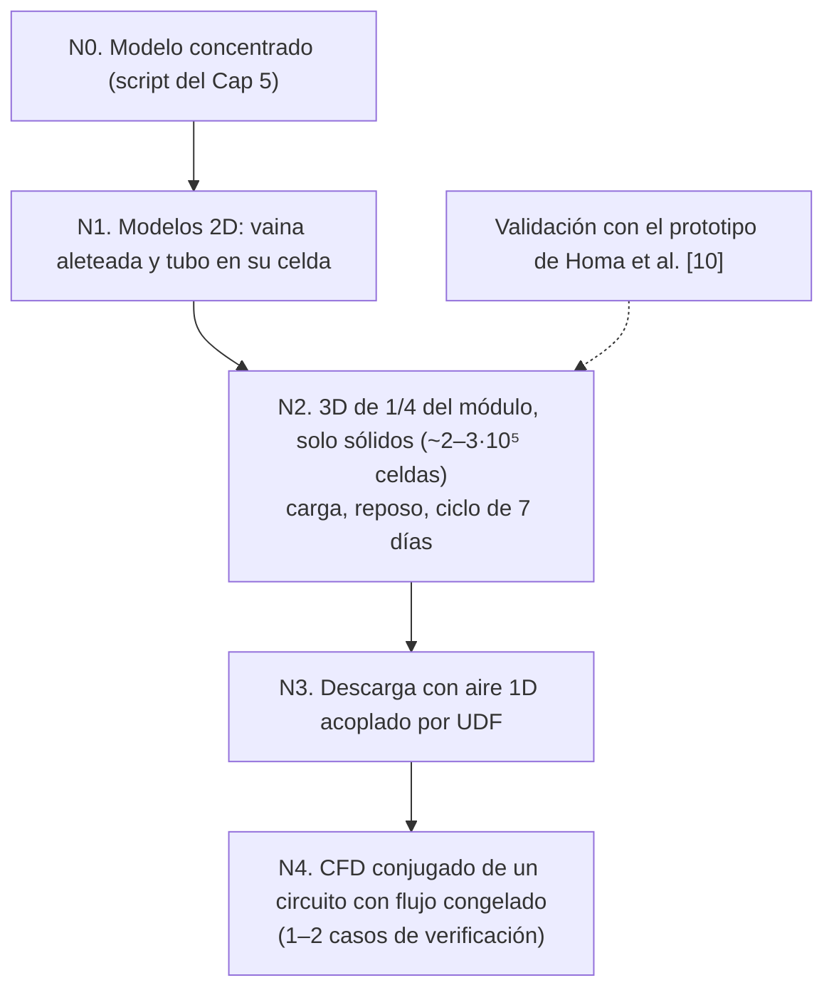

# Resumen de avance: ingeniería conceptual y básica de la pila de arena
*Subsistema mecánico · avance al 05/11/2026 · fin de la ingeniería básica: 02/12/2026*

Este documento resume los capítulos 1 a 6 del informe de ingeniería conceptual y básica [2]–[7]. Presenta los resultados, las ecuaciones que los sostienen, los hallazgos que cambian el planteo original y las decisiones que necesitan validación. El desarrollo completo, los supuestos numerados y los scripts de cálculo están en cada capítulo.

## 0. Estado del avance

| Capítulo del plan [8] | Nota del informe | Estado |
|---|---|---|
| Introducción, objetivo y alcance | Cap 1 [2] | Redactado |
| Requerimientos y criterios de diseño | Incluido en Cap 1, §1.7 [2] | Redactado en versión preliminar |
| Entorno operativo y demanda térmica de la cama | — | **Pendiente** (define el factor de uso $\bar f$) |
| Estado del arte y matriz comparativa | Cap 2 [3] | Redactado |
| Fundamentos físicos, propiedades y modelos | Cap 3 [4] | Redactado |
| Arquitectura del sistema | — | **Pendiente** |
| Ingeniería conceptual: alternativas y selección | Cap 4 [5] | Redactado |
| Ingeniería básica: predimensionamiento | Cap 5 [6] | Redactado, con script |
| Modelo térmico y plan de simulación | Cap 6 [7] | Redactado (las simulaciones se corren en la ingeniería de detalle) |
| Instrumentación y control, fabricación, costos, riesgos, especificación, mejoras futuras | — | **Pendientes** |

---
## 1. Resumen ejecutivo
**Problema.** La cama caliente de enraizamiento de olivos se calefacciona hoy con una resistencia de 174 W por mesa conectada a la red. El objetivo es operarla con energía fotovoltaica, sin red ni baterías químicas [1]. Para eso hay que **trasladar energía del día a la noche**, y la herramienta elegida es un acumulador de calor sensible en arena.

**Configuración seleccionada** [5]. Un módulo por mesa de 1 m², con un lecho de arena de cuarzo estático en un contenedor prismático. La carga se hace con resistencias tubulares blindadas embebidas, y la extracción con aire forzado que circula por tubos embebidos, en lazo cerrado con la cama, con bypass de mezcla para entregar como máximo 60 °C al sustrato.

**Cifras principales del predimensionamiento** [6] (caso de diseño: noche de 14 h a 174 W, es decir $\bar f$ = 1):

| Magnitud | Valor |
|---|---|
| Temperatura máxima / mínima útil de la arena | 300 °C / ~105 °C |
| Masa de arena / lado del lecho | 85 kg / 0,38 m (cubo) |
| Módulo exterior / peso total | cubo de ~0,78 m / ~180 kg |
| Aislación | 0,20 m de lana de roca de alta densidad |
| Pérdidas medias / eficiencia térmica diaria $\eta_{alm}$ | 73 W / 58 % |
| Energía diaria requerida al panel | ≈ 4,4 kWh/día, unos **1,2 kWp por módulo** (sin nebulización) |
| Resistencias | 9 × ~105 W en 3 escalones (~0,93 kW en total) |
| Extracción | 2 serpentinas Ø32 mm (5,1 m de tubo), 25 kg/h máx., ventilador de ~7 W |

**Tres conclusiones que conviene discutir:**
1. **La pila no gana por eficiencia.** Con $\eta_{alm}$ = 58 %, le pide al panel 1,7 veces la energía nocturna, contra ~1,1 veces de una batería de litio. Su ventaja está en el costo, la vida útil y los materiales.
2. **Las pérdidas son el problema central.** En un módulo chico, las pérdidas diarias llegan al 73 % de la energía que se entrega a la cama, y el diseño está dominado por la aislación y los puentes térmicos.
3. **El cuello de botella es la carga, no la descarga.** El límite de 573 °C en la arena junto a las resistencias descarta las temperaturas altas (> 400 °C) y las resistencias concentradas (2 × 1 kW).

---
## 2. Contexto, problema y alcance [2]
### 2.1 Sistema actual y demanda
Hay dos mesas de 1 m² con cobertor, que se usan para comparar variedades. El sustrato tiene que mantenerse entre 20 y 30 °C, con el aire confinado ≤ 30 °C y el elemento calefactor ≤ 60 °C. El invernadero garantiza entre 10 y 35 °C, y el exterior (NOA/Cuyo) va de −9,2 a 47 °C. La calefacción actual es una resistencia flexible regulada por TRIAC:

$$
P_{nom} = q'\,L = 20\ \tfrac{\text{W}}{\text{m}} \times 8{,}70\ \text{m} = 174\ \text{W por mesa}
\tag{R.1}
$$

$$
E_{noche} = \int_0^{t_n} P_{cama}(t)\,dt = \bar f\,P_{nom}\,t_n \;\le\; 174\ \text{W} \times 14\ \text{h} \approx 2{,}44\ \text{kWh} = 8{,}77\ \text{MJ}
\tag{R.2}
$$

donde $q'$ [W/m] es la potencia lineal de la resistencia, $L$ [m] su largo, $P_{cama}(t)$ [W] la potencia demandada en cada instante, $t_n$ [s] la duración de la noche y $\bar f$ [–] el factor de uso medio. Como el TRIAC entrega solo lo que pide el sustrato, **174 W es un máximo y no la demanda real**. Mientras no se conozca $\bar f$, todo se dimensiona con $\bar f = 1$.

> [!warning] Dato faltante: factor de uso $\bar f$
> Sale del balance térmico de la cama (capítulo pendiente) o de registros de la resistencia actual en invierno. Es el dato que más cambia el diseño (§7.1).

### 2.2 Pila de arena frente a batería de litio
Las dos cadenas terminan en calor en el sustrato. Para la misma $E_{noche}$, la energía diaria que cada una le pide al panel es:

$$
E_{FV}^{\,Li} = \frac{E_{noche}}{\eta_{rt}},
\qquad
E_{FV}^{\,arena} = \frac{E_{noche}}{\eta_{alm}},
\qquad
\eta_{alm} = \frac{E_{entregada}}{E_{carga}} = 1 - \frac{E_{perd,24h}}{E_{carga}}
\tag{R.3}
$$

donde $\eta_{rt}$ [–] es la eficiencia eléctrica de ida y vuelta de la batería (80–95 % [14], [15]), $\eta_{alm}$ [–] la eficiencia térmica diaria del acumulador, $E_{carga}$ [J] la energía que entra a la arena, $E_{entregada}$ [J] el calor que llega a la cama y $E_{perd,24h}$ [J] las pérdidas por la envolvente en 24 h. Las eficiencias bajas que reporta la literatura (47,4 % [14], 20–35 % [15]) incluyen la reconversión a electricidad y no se aplican a este caso. La arena compite por vida útil (20–50 años frente a 10–20), costo y ausencia de materiales críticos [9], [14]. Su punto débil es que las pérdidas relativas crecen al achicar el equipo ($A/V \propto V^{-1/3}$), y un módulo por m² es chico.

![[Cap 1 - Introduccion, objetivo y alcance-1793828999007.webp]]
*Figura 1. Ciclo diario: carga con excedente FV, reposo con pérdidas activas, descarga nocturna regulada hacia el sustrato [2].*

### 2.3 Planteo del problema de diseño
En régimen periódico de 24 h la energía útil y los límites de temperatura son:

$$
E_{util} = m\int_{T_{min}}^{T_{max}} c_p(T)\,dT \;\ge\; E_{noche} + E_{perd,noche},
\qquad
T_{sustrato} < T_{fluido} < T_{min} < T_{max} < T_{lim}
\tag{R.4}
$$

donde $m$ [kg] es la masa de arena, $c_p(T)$ [J/(kg·K)] su calor específico, $T_{min}$ y $T_{max}$ [K] las temperaturas al final de la descarga y de la carga, $E_{perd,noche}$ [J] las pérdidas durante la descarga, $T_{fluido}$ [K] la temperatura del fluido de extracción y $T_{lim}$ [K] el límite de materiales. El salto térmico, la masa, la aislación y la geometría se tratan como **variables de diseño**: se plantean las ecuaciones, se recorre el rango posible y se elige con un criterio explícito.

### 2.4 Alcance
- **Incluye:** pila final modular (un módulo por m², replicable), autonomía de una noche (~14 h) y fases conceptual y básica validadas por cálculo y simulación contrastada con papers.
- **Excluye:** selección del panel y de la electrónica (el informe entrega la energía diaria requerida y las interfaces), ingeniería de detalle, autonomía de varios días (se trata como riesgo) y aspectos agronómicos.
- **Prototipo de 40 × 40 × 40 cm:** se saltea. Un prototipo de otro tamaño no reproduce la relación $A/V$ ni las pérdidas del módulo real, que son el problema central.

### 2.5 Requerimientos que más condicionan el diseño
La matriz completa (RG1–RG5, RT1–RT7, RM1–RM9) y los KPI están en el Cap 1 [2].

| ID | Requisito | Por qué condiciona |
|---|---|---|
| RT1 / RT4 | Entregar $P_{cama}$ ≤ 174 W con el elemento del sustrato ≤ 60 °C | Obliga a regular la temperatura de entrega con arena a cientos de grados |
| RT5 | Aire confinado ≤ 30 °C | Limita la ubicación del módulo debajo de la cama (las pérdidas diurnas la calientan) |
| RG2 | Modularidad: un módulo por m² | Inclina la elección de escala pese a las mayores pérdidas |
| RG4 | Carga solo desde el panel FV | El consumo propio (ventilador, control) sale del mismo panel |
| RM1 / RM9 | Ambiente húmedo por nebulización; seguridad eléctrica | Descarta el agua dentro de la arena y los elementos desnudos |
| RM3 | Aislación que limite $E_{perd,24h}$ | Es la variable dominante del tamaño exterior |
| RM8 | Reemplazar resistencias sin vaciar la arena | Lleva a vainas guía extraíbles |

---
## 3. Estado del arte: qué se traslada al proyecto [3]
Se analizaron 20 fichas bibliográficas, que incluyen siete tipos de baterías de arena. El lecho empacado fijo es el más maduro (TRL 8–9 en calefacción de distrito [9]). La variante con tubos embebidos solo tiene evidencia de laboratorio y simulación (TRL 4–5, supuesto propio). El lecho fluidizado y el móvil quedan descartados por complejidad y consumo para 174 W, y el híbrido con PCM queda como mejora futura. Las cuatro lecciones que más pesan son:

**(a) La arena conduce mal y el calor avanza poco.** Con $k_{lecho}$ = 0,25–0,30 W/(m·K), $\rho_b$ = 1586 kg/m³ y $c_p$ ≈ 850 J/(kg·K) [13]:

$$
\alpha = \frac{k_{lecho}}{\rho_b\,c_p} \approx 2\cdot10^{-7}\ \text{m}^2/\text{s},
\qquad
\delta \approx \sqrt{\alpha\,t}\;\Rightarrow\;\delta(14\ \text{h}) \approx 10\ \text{cm}
\tag{R.5}
$$

donde $\alpha$ [m²/s] es la difusividad, $\delta$ [m] la profundidad de penetración térmica y $t$ [s] el tiempo. Resistencias y tubos tienen que distribuirse con pasos del orden de $2\delta$. Las mejoras de conductividad (virutas al 20 % en volumen: ×1,70–1,79 en la tasa de calentamiento [12]; 8 aletas radiales: −78,5 % en el tiempo de descarga [17]) aceleran el proceso, pero bajan el $c_p$ de la mezcla o agregan costo.

**(b) La escala y los puentes térmicos mandan en las pérdidas.** En un tanque de 160 m³ las pérdidas son menores al 0,2 % [19]. En el prototipo Stirling (0,2 m³) se perdió el **64,4 %** de la energía de carga, sobre todo por soportes y pasamuros que el modelo no representaba [11]. El "espesor óptimo" de 0,403 m de [10] no se explica por el radio crítico ($r_c = k/h$ ≈ 4–8 mm) y no se traslada.

**(c) Ningún estudio entrega calor a ≤ 60 °C desde arena caliente.** En [10], a 0,5 m/s el aire sale casi a la temperatura de la arena: 280 W de pico con un salto del aire de ~380 K. A mayor velocidad aumenta la potencia pico, pero se enfría la arena junto al tubo, y después de ~33 h todas las velocidades convergen a ~257 W porque manda la conducción. Este proyecto necesita **mezcla con aire frío o un circuito intermedio**.

**(d) Los lechos estáticos se modelan como medio continuo.** [10] y [12] validan con diferencias de 8 a 20 K usando una sola ecuación de energía con propiedades efectivas. El prototipo Stirling [11] muestra el riesgo contrario: con contacto ideal y sin modelar el control, la simulación predijo más autonomía y menos pérdidas que el ensayo.

![[Stirling engine-based Carnot battery with sand as heat storage medium - 1 kWe prototype-1793757541192.webp]]
*Figura 2. Balance del ciclo de 300 °C del prototipo Stirling [11]: de 53 kWh eléctricos, 34,13 kWh se pierden por la envolvente y los puentes térmicos.*

---
## 4. Fundamentos, propiedades y modelo [4]
### 4.1 Propiedades de diseño de la arena
| Propiedad | Valor | Fuente |
|---|---|---|
| Densidad aparente / porosidad | 1586 kg/m³ / 0,44 | [13] |
| $c_p(T)$ | $T + 427$ J/(kg·K), con $T$ en K, válido entre 323 y 846 K; ≈ 850 medido a 20 °C | [10], [13] |
| $k_{ef}(T)$ | banda: ZBS con radiación (inferior) a ajuste lineal $0{,}0006\,T - 0{,}0102$ (superior) | [12], [10] |
| Inversión α→β del cuarzo | 573 °C: pico de $c_p$ y +0,8 % de volumen | [13] |
| Arena húmeda | $k$ = 1,0–1,5 W/(m·K), de 3 a 5 veces la seca | [18] |

Con el ajuste lineal de $c_p$, la energía específica se integra en forma cerrada:

$$
\Delta h(T_1,T_2) = \int_{T_1}^{T_2}(T + 427)\,dT = \frac{T_2^2 - T_1^2}{2} + 427\,(T_2 - T_1)
\tag{R.6}
$$

donde $\Delta h$ [J/kg] es la energía específica entre $T_1$ y $T_2$ [K]. Usar $c_p$ constante de 20 °C subestima la energía hasta un 16 % entre 60 y 560 °C.

> [!warning] Supuesto crítico: el límite de 573 °C es local
> En la validación de [10], con la arena a 470 K de media había **1392 K de máxima** junto a las resistencias. El límite de la inversión del cuarzo se aplica a la temperatura **local** junto a las vainas, no a la media. Esta condición termina definiendo el diseño de la carga (§6.4 y §7.2).

### 4.2 Conductividad efectiva
El lecho conduce mucho menos que el grano, porque dominan el aire de los poros y los contactos puntuales. De las siete correlaciones comparadas, solo el modelo **Zehner-Bauer-Schlünder (ZBS) con radiación** reprodujo mediciones a 500 °C en un lecho calentado por resistencias (RMSE < 8 °C) [12]:

$$
k_{ef} = k_f\Big[\big(1-\sqrt{1-\varepsilon}\big) + \sqrt{1-\varepsilon}\,\big(\omega\kappa + (1-\omega)\,\Gamma(\kappa,B)\big)\Big] + 4\,F_B\,\sigma\,d_p\,T^3
\tag{R.7}
$$

donde $k_f$ [W/(m·K)] es la conductividad del aire, $\varepsilon$ [–] la porosidad, $\kappa = k_s/k_f$ [–] la relación entre las conductividades del grano y del gas, $\omega$ [–] la fracción de contacto sólido, $\Gamma$ [–] el término de celda unitaria de Zehner-Schlünder con factor de forma $B$, $F_B$ [–] el factor de intercambio radiativo, $\sigma$ la constante de Stefan-Boltzmann, $d_p$ [m] el diámetro de grano y $T$ [K] la temperatura. Con $d_p$ = 0,5 mm la radiación supera el 10 % de $k_{ef}$ desde ~450 °C, y con 2 mm desde ~110 °C.

![[keff_arena_ZBS.png]]
*Figura 3. $k_{ef}(T)$ de arena seca con ZBS con y sin radiación, comparado con el ajuste de [10] y la medición de [13] [4].*

> [!warning] Dato faltante: $k_{ef}$ de la arena real
> ZBS da 0,15 W/(m·K) a 20 °C y [13] midió 0,25–0,30 W/(m·K) en otra arena. Hasta medir la arena que se va a comprar, el diseño usa la **banda**: la inferior es conservadora para la extracción y la superior para la temperatura de las vainas.

### 4.3 Modelo elegido
Con arena estática y aire por tubos no hay advección en el lecho, el gas de los poros no almacena energía apreciable ($\varepsilon\rho_f c_f / \rho_b c_p \sim 10^{-4}$) y el grano es isotérmico ($Bi$ ≈ 0,04–0,05). Alcanza el **medio continuo efectivo**:

$$
\rho_b\,c_p(T)\,\frac{\partial T}{\partial t} = \nabla\cdot\big(k_{ef}(T)\,\nabla T\big) + Q_v
\tag{R.8}
$$

donde $\rho_b$ [kg/m³] es la densidad aparente, $T$ [K] la temperatura, $t$ [s] el tiempo, $k_{ef}(T)$ [W/(m·K)] la conductividad de (R.7) y $Q_v$ [W/m³] la generación en las resistencias. Si se eligiera aire a través del lecho habría que pasar a LTE o LTNE según el NTU, y la granulometría quedaría regida por Ergun.

### 4.4 Cadena de resistencias hacia el aire
Por metro de tubo, el calor atraviesa cuatro resistencias en serie. Integrando el balance del aire con $T_s$ uniforme:

$$
R'_{tot} = \underbrace{\frac{\ln(1{,}08\,w/D_o)}{2\pi k_{ef}}}_{\text{arena}} + R'_c + \underbrace{\frac{\ln(D_o/D_i)}{2\pi k_w}}_{\text{pared}} + \underbrace{\frac{1}{h_i\,\pi D_i}}_{\text{convección}},
\qquad
\dot Q = \dot m\,c_{p,a}\,(T_s - T_{a,in})\left(1 - e^{-L_t/(\dot m\,c_{p,a}\,R'_{tot})}\right)
\tag{R.9}
$$

donde $R'_{tot}$ [m·K/W] es la resistencia por metro, $w$ [m] el paso entre tubos, $D_o$ y $D_i$ [m] los diámetros exterior e interior, $R'_c$ [m·K/W] la resistencia de contacto arena–tubo, $k_w$ [W/(m·K)] la conductividad de la pared, $h_i$ [W/(m²·K)] el coeficiente interno (Gnielinski o laminar), $\dot Q$ [W] la potencia extraída, $\dot m$ [kg/s] el caudal, $c_{p,a}$ [J/(kg·K)] el calor específico del aire, $T_s$ y $T_{a,in}$ [K] las temperaturas de la arena y del aire de entrada, y $L_t$ [m] el largo de tubo. **Hallazgo:** con aire en régimen laminar, la convección interna (~2,8 m·K/W) pesa más que la arena (0,4–1,7 m·K/W). El intercambiador no se puede diseñar mirando solo la arena.

---
## 5. Ingeniería conceptual: alternativas y selección [5]
### 5.1 Método
Cada decisión pasa primero por **tres filtros excluyentes**:

- **F1:** entregar 174 W regulados con ≤ 60 °C en el elemento.
- **F2:** cargar la energía diaria sin superar la temperatura admisible de la arena junto a las vainas.
- **F3:** operar en ambiente húmedo sin riesgo eléctrico ni ingreso de agua a la arena.

Las alternativas que pasan se comparan **cualitativamente** frente a ocho criterios: costo, pérdidas, simplicidad, seguridad, consumo propio, modularidad, fabricabilidad local y TRL. No se ponderan, y la comparación se apoya en cálculos de orden de magnitud. El filtro F2 exige:

$$
\frac{w}{2} \lesssim \delta_c = \sqrt{\alpha_{ef}\,t_c}\;\Rightarrow\; w \lesssim 12\text{–}15\ \text{cm para } t_c = 5\text{–}6\ \text{h}
\tag{R.10}
$$

donde $w$ [m] es el paso entre resistencias, $\delta_c$ [m] la penetración en la carga, $\alpha_{ef}$ [m²/s] la difusividad efectiva y $t_c$ [s] la ventana de carga.

### 5.2 Cálculos que deciden la extracción
**Caudal mínimo del lado del sustrato** (aire en tubos bajo la cama, 60 °C de impulsión y sustrato a 25 °C):

$$
\dot m_{min} = \frac{P_{cama}}{c_{p,a}\,(T_{mez,max} - T_{sus})} \approx 4{,}9\cdot10^{-3}\ \text{kg/s} \approx 18\ \text{kg/h}
\tag{R.11}
$$

**Tiro natural disponible frente a la pérdida de carga:**

$$
\Delta p_{tiro} = g\,H\,(\rho_{frío} - \rho_{caliente}) \approx 0{,}6\text{–}1{,}7\ \text{Pa}
\quad\ll\quad
\Delta p_{lazo} \approx 6\ \text{Pa (laminar en la cama)} \text{ a } 370\text{–}940\ \text{Pa (lazo completo)}
\tag{R.12}
$$

donde $g$ [m/s²] es la gravedad, $H$ [m] la altura entre la entrada fría y la salida caliente y $\rho$ [kg/m³] la densidad del aire. Un termosifón no puede mover el caudal necesario.

**Regulación por mezcla.** El aire sale de la pila casi a la temperatura de la arena, y bajar el caudal lo calienta todavía más. La temperatura se limita mezclando con el retorno:

$$
T_{mez} = x\,T_{pila,sal} + (1-x)\,T_{ret},
\qquad
P_{cama} = x\,\dot m\,c_{p,a}\,(T_{pila,sal} - T_{ret})
\tag{R.13}
$$

donde $x$ [–] es la fracción del caudal que pasa por la pila y $T_{ret}$ [K] la temperatura del aire que vuelve de la cama. Hay dos actuadores para dos variables: la compuerta de bypass fija $T_{mez}$ ≤ 60 °C y el PWM del ventilador fija $P_{cama}$. Ante una falla, la compuerta queda en bypass total y un termostato independiente corta el aire caliente.

### 5.3 Escala, geometría y límite de la carga
**Escala.** Con igual forma y aislación, repartir el volumen en $N$ módulos multiplica las pérdidas:

$$
\frac{\dot Q_{p,\,N\ \text{módulos}}}{\dot Q_{p,\,\text{central}}} = \frac{N\,(V/N)^{2/3}}{V^{2/3}} = N^{1/3}
\tag{R.14}
$$

Para las 2 mesas actuales, dos módulos pierden 1,26 veces lo que una pila central, sin contar los conductos de distribución de la central.

**Geometría.** Con una relación de aspecto cercana a 1 el área es mínima. El cilindro tiene 7,7 % menos área que el cubo, pero el prisma simplifica la chapa, la aislación en placas, la grilla de tubos y la ubicación bajo la mesa.

**Límite de las resistencias.** La arena junto a la vaina no debe superar $T_{lim}$ = 573 °C con el lecho ya en $T_{max}$:

$$
q'_{adm} = \frac{2\pi\,k_{ef}\,(T_{lim} - T_{max})}{\ln(r_2/r_{eq})},
\qquad
L_{res} \ge \frac{P_{carga}}{q'_{adm}}
\tag{R.15}
$$

donde $q'_{adm}$ [W/m] es la potencia admisible por metro, $r_2$ [m] el radio de influencia de cada elemento (≈ medio paso), $r_{eq}$ [m] el radio equivalente de la vaina, $L_{res}$ [m] el largo calefactado y $P_{carga}$ [W] la potencia de carga. A 500 °C harían falta 14–25 m de resistencia por kW dentro de un lecho de ~25 cm de lado, lo que es inviable.

### 5.4 Resultado de la selección

| Decisión | Seleccionada | Descartadas y motivo | Estado |
|---|---|---|---|
| Lecho | L1: estático con tubos embebidos | L2 termoclina (complejidad, polvo, consumo); L3 placas conductoras (puentes térmicos) | Firme |
| Extracción | E2: aire forzado por tubos, lazo cerrado con bypass | E1 termosifón (no pasa F1); E3 agua (no pasa F3: ebullición y fugas en la arena) | Firme |
| Escala | S1: un módulo por mesa | S2 pila central (26 % menos pérdidas, pero sin modularidad ni independencia entre mesas) | **Provisoria** |
| Ubicación | U1: debajo de la mesa | U2 junto a la mesa, si no cumple RT5 o la altura libre | **Condicional** |
| Geometría | G2: prisma con $H/a$ ≈ 1 | G1 cilindro (8 % menos área, peor fabricación) | Firme |
| $T_{max}$ | R2: rango medio (300–400 °C) | R3 > 450 °C (no pasa F2) | Ajustado a 300 °C en el Cap 5 |
| Conductividad | M0: arena pura, con aletas en los tubos como provisión | Virutas de aluminio junto a las resistencias (funden a 660 °C) | Firme |
| Resistencias | C1: tubulares blindadas en vainas guía extraíbles | C2 cartucho (F2); C3 hilo desnudo (F3) | Firme |
| Distribución | D3/D2: grilla intercalada con los tubos, retirada de las paredes | D1 central única (F2) | Firme |

---
## 6. Ingeniería básica: predimensionamiento [6]
El problema está acoplado: la masa depende de las pérdidas y de $T_{min}$; las pérdidas dependen del tamaño; y $T_{min}$ depende del intercambiador, que depende del tamaño. Se resuelve con un lazo iterativo, con modelo concentrado y régimen periódico de 24 h (script `predimensionamiento_cap5.py`).

### 6.1 Balance, temperatura mínima útil y masa
El día se divide en descarga (14 h), reposo a $T_{min}$ (2 h), carga (5,5 h) y reposo a $T_{max}$ (2,5 h):

$$
E_{perd,24h} = UA\Big[(\bar T - T_{inv})(t_n + t_c) + (T_{min} - T_{inv})\,t_{r1} + (T_{max} - T_{inv})\,t_{r2}\Big],
\qquad
E_{carga} = E_{noche} + E_{perd,24h}
\tag{R.16}
$$

donde $UA$ [W/K] es la conductancia total de pérdidas, $\bar T = (T_{max}+T_{min})/2$ [K], $T_{inv}$ = 10 °C (conservador) y $t_n$, $t_c$, $t_{r1}$, $t_{r2}$ [s] las duraciones de cada tramo. La arena deja de ser útil cuando, con todo el caudal por la pila, ya no puede entregar $P_{cama}$:

$$
T_{min} = T_{ret} + \frac{P_{cama}}{\dot m\,c_{p,a}\left(1 - e^{-UA_x/(\dot m\,c_{p,a})}\right)},
\qquad
UA_x = \frac{L_t}{R'_{tot}}
\tag{R.17}
$$

donde $UA_x$ [W/K] es la conductancia arena–aire del intercambiador. Con $R'_{tot}$ ≈ 1,47 m·K/W (arena 1,05; contacto 0,15; convección 0,26) y $L_t$ ≈ 5 m, $UA_x$ ≈ 3 W/K y $T_{min}$ ≈ **105 °C**. Es mucho mayor que los 60 °C de la entrega: ese salto es lo que necesita la cadena arena → tubo → aire para mover 174 W. La masa sale de:

$$
m = \frac{E_{noche} + E_{perd,n} + E_{perd,r2}}{\varphi_u\,\Delta h(T_{min},T_{max})}
\tag{R.18}
$$

donde $E_{perd,n}$ y $E_{perd,r2}$ [J] son las pérdidas desde el final de la carga hasta el final de la descarga y $\varphi_u$ = 0,90 [–] el factor de utilización del lecho (a verificar por simulación). El caso base da **85 kg** de arena, con $E_{carga}$ = 4,20 kWh/día y $\eta_{alm}$ = 58 %. La primera carga, que también calienta la arena por debajo de $T_{min}$, requiere ~5,9 kWh, es decir **unos dos días de sol**.

**Sensibilidad a la demanda real:**

| $\bar f$ | $E_{noche}$ [kWh] | $m$ [kg] | $E_{perd,24h}$ [kWh] | $E_{carga}$ [kWh] | $\eta_{alm}$ |
|---|---|---|---|---|---|
| 0,50 | 1,22 | 61 | 1,65 | 2,87 | 43 % |
| 0,75 | 1,83 | 73 | 1,71 | 3,53 | 52 % |
| 1,00 | 2,44 | 85 | 1,77 | 4,20 | 58 % |

Las pérdidas casi no bajan con la demanda, porque el área escala con $m^{2/3}$. Con una demanda real baja, **la pila pierde por día más de lo que entrega**.

### 6.2 Estudio de la temperatura máxima
Se barrió $T_{max}$ entre 150 y 550 °C cerrando el lazo en cada punto. El costo de referencia (con precios supuestos, a cotizar) incluye el panel extra necesario para cubrir las pérdidas.

![[cap5_estudio_Tmax.png]]
*Figura 4. Masa, pérdidas, $\eta_{alm}$, panel requerido y costo de referencia en función de $T_{max}$ [6].*

| $T_{max}$ [°C] | $T_{min}$ [°C] | $m$ [kg] | $a$ / $a_{ext}$ [cm] | Pérdida [W] | $\eta_{alm}$ | $P_{FV,p}$ [Wp] | $L_{res,min}$ [m] | Costo ref. [USD] |
|---|---|---|---|---|---|---|---|---|
| 150 | 73 | 213 | 51 / 91 | 52 | 66 % | 1028 | 1,1 | 1351 |
| 250 | 94 | 106 | 41 / 81 | 65 | 61 % | 1116 | 1,5 | 1348 |
| **300** | **105** | **85** | **38 / 78** | **73** | **58 %** | **1167** | **1,8** | **1399** |
| 400 | 126 | 61 | 34 / 74 | 89 | 53 % | 1277 | 2,9 | 1596 |
| 500 | 146 | 48 | 31 / 71 | 107 | 49 % | 1397 | 6,9 | 2199 |
| 550 | 156 | 44 | 30 / 70 | 116 | 46 % | 1460 | 22,2 | 3466 |

- La masa baja con $T_{max}$, pero **el tamaño exterior casi no**: con 20 cm de aislación, en un módulo chico la aislación domina el tamaño.
- Las pérdidas crecen con $T_{max}$, porque $T_{min}$ también sube al achicarse el intercambiador.
- Por encima de 400 °C la carga se vuelve inviable (largo de resistencias) y el costo se dispara.

**Recomendación: $T_{max}$ = 300 °C.** Es el valor más compacto dentro de la zona de costo mínimo, con acero al carbono, lana de roca sola y 270 K de margen respecto de la inversión del cuarzo. Una alternativa a evaluar es 250 °C: cuesta ~4 % menos, da $\eta_{alm}$ = 61 % y suma 21 kg de arena y 3 cm por lado.

### 6.3 Sistema de carga y dato de salida al panel

$$
E_{FV,req} = E_{carga} + \frac{E_{aux,pila}}{\eta_{bat}},
\qquad
P_{FV,p} = \frac{E_{FV,req}}{HSP\cdot PR}
\tag{R.19}
$$

donde $E_{aux,pila}$ [kWh] es el consumo propio de la pila (ventilador de noche y control, ~0,18 kWh), $\eta_{bat}$ = 0,85 el rendimiento del almacenamiento eléctrico que lo alimenta de noche, $HSP$ = 4,5 h las horas solares pico de invierno (valor genérico) y $PR$ = 0,80 el rendimiento global de la cadena FV. Resulta **≈ 4,4 kWh/día y ≈ 1,2 kWp por módulo** (dos o tres paneles de 450–550 Wp), sin contar la nebulización.

**Resistencias seleccionadas:** 9 calefactores tubulares Ø10 × 280 mm con vaina de Incoloy 800 y MgO, de ~105 W cada uno. Van dentro de vainas guía AISI 304 de 16 × 1 mm con 4 aletas radiales de 15 mm, en 3 niveles × 3, agrupados en 3 escalones de ~310 W. La carga de superficie es 1,2 W/cm², cuatro veces menor que la de los prototipos de [10] y [15]. Con $T_{max}$ = 300 °C, la arena junto a la vaina llega a ~490 °C y la vaina a ~620 °C.

| Variante | $q'$ [W/m] | Arena junto a la vaina [°C] | ¿Cumple? |
|---|---|---|---|
| 2 elementos rectos de 1 kW | 3571 | ~2100 | No: físicamente imposible |
| 2 kW repartidos en 9 elementos | 794 | ~700 | No: supera 573 °C |
| **~0,93 kW en 9 elementos (selección)** | **371** | **~490** | **Sí** |

> [!warning] Interfaz con electrónica: la potencia depende de la tensión
> Una resistencia "de 105 W" lo es solo a su tensión nominal ($P = V^2/R$). Conectada a un panel sin conversión, trabaja donde la curva I-V del panel corta la recta $V/R$. Hay que definir con electrónica si se alimenta en CA con inversor, en CC con MPPT o con conmutación directa de escalones, y especificar $R$ en consecuencia.

### 6.4 Sistema de extracción
La grilla es de 4 × 4 pasos verticales de tubo Ø32 × 1,5 mm AISI 304 con paso de 9,4 cm, conectados en **2 serpentinas de 8 pasos en paralelo** ($L_t$ = 5,1 m). Respecto de una serpentina única, se pierden 7 K de $T_{min}$ y el ventilador baja de 20,7 a 7,4 W (Δp del lazo ≈ 370 Pa). El caudal de diseño es 25 kg/h: casi no cambia $T_{min}$, porque la arena domina, y lo fija el lado del sustrato (§5.2). La descarga se integra con el modelo concentrado:

$$
\varphi_u\,m\,c_p(T_s)\,\frac{dT_s}{dt} = -P_{cama} - UA\,(T_s - T_{inv})
\tag{R.20}
$$

![[cap5_descarga.png]]
*Figura 5. Descarga nocturna con regulación por mezcla: temperatura de la arena y de salida de la pila, potencia a la cama, fracción $x$ y pérdidas [6].*

- La pila entrega **174 W durante las 14 h**, y el balance cierra.
- Al comienzo de la noche el aire sale de la pila a ~230 °C con solo el 13 % del caudal ($x$ = 0,13), y $x$ llega a ~0,9 al final. La caja de mezcla, la compuerta y el primer tramo de conducto tienen que soportar ~250 °C. El ventilador queda en la rama fría.

### 6.5 Aislación y puentes térmicos
Con aislación gruesa respecto del lecho (20 cm frente a 38 cm) no vale el cálculo de pared plana. Se usa el factor de forma de una caja hueca (paredes, aristas y vértices) y se itera con $k(T)$:

$$
S_i = \frac{6\,a_i^2}{t_i} + 12\cdot0{,}54\,a_i + 8\cdot0{,}15\,t_i,
\qquad
UA_w = \left[\sum_i \frac{1}{k_i(\bar T_i)\,S_i} + \frac{1}{\sum_j h_j A_j}\right]^{-1},
\qquad
UA_b = \frac{1}{t}\sum_b n_b\,(kA)_b
\tag{R.21}
$$

donde $S_i$ [m] es el factor de forma de la capa $i$, $a_i$ [m] su lado interior, $t_i$ [m] su espesor, $k_i$ [W/(m·K)] su conductividad a la temperatura media, $h_j$ [W/(m²·K)] el coeficiente exterior de cada cara (convección natural más radiación), $A_j$ [m²] su área y $UA_b$ [W/K] la conductancia de los puentes (tubos, vainas, termocuplas y apoyos, con $n_b$ elementos de cada tipo).

![[cap5_aislacion.png]]
*Figura 6. Pérdida media y costo de referencia frente al espesor de aislación, $T_{max}$ = 300 °C [6].*

| $t$ [cm] | $m$ [kg] | $a_{ext}$ [cm] | Pérdida [W] | $\eta_{alm}$ | $\tau$ [h] |
|---|---|---|---|---|---|
| 10 | 103 | 60 | 129 | 44 % | 38 |
| **20** | **85** | **78** | **73** | **58 %** | **56** |
| 30 | 79 | 97 | 56 | 64 % | 69 |

- **Rendimiento decreciente:** pasar de 10 a 20 cm divide las pérdidas por 1,8; pasar de 20 a 30 cm, solo por 1,3. El óptimo de costo es plano entre 20 y 25 cm, y **se adopta 0,20 m** para ahorrar tamaño.
- **Los puentes térmicos son el 23 % de las pérdidas** (~17 W). Por eso los pasamuros salen por una o dos caras, se usan tubos de acero inoxidable de pared fina (nunca de cobre) y la chapa interior apoya sobre silicato de calcio, sin perfiles de acero que la unan con la carcasa exterior.
- La manta cerámica no se justifica a 300 °C. La carcasa exterior queda a ~14 °C, así que el riesgo de contacto está en los pasamuros y la caja de mezcla, no en las paredes.

### 6.6 Contenedor
La chapa interior es de acero al carbono de 2 mm. Su dilatación (≈ 12,5·10⁻⁶ K⁻¹) es parecida a la de la arena, lo que limita el *ratcheting*. Presión del material granular (Janssen):

$$
\sigma_h(z) = \frac{\rho_b\,g\,D_h}{4\,\mu_w}\left(1 - e^{-4\mu_w K z/D_h}\right),
\qquad K = 1 - \sin\phi
\tag{R.22}
$$

donde $\sigma_h$ [Pa] es la presión horizontal, $z$ [m] la profundidad, $D_h$ [m] el diámetro hidráulico de la sección, $\mu_w$ ≈ 0,35 la fricción arena–pared, $K$ el coeficiente de Jaky y $\phi$ ≈ 32° el ángulo de fricción interna (valores supuestos). Da ~2 kPa en las paredes y ~4,3 kPa en el fondo. Con 2 mm, la tensión de flexión es de ~28 MPa y la flecha de ~1,7 mm, por lo que se agrega un rigidizador a media altura. El peso total es de ~180 kg, que apoya en el piso (~2,9 kPa) y no en la mesa. El módulo se ancla al piso por la sismicidad de NOA y Cuyo.

![[croquis_pila_cap5.png]]
*Figura 7. Croquis de predimensionamiento: planta en el nivel 1 de resistencias y corte vertical por una fila de tubos, cotas en cm [6].*

![[Resumen de avance para tutores - Pila de arena-1793944728618.webp|465]]

---
## 7. Plan de simulación [7]
### 7.1 Estrategia para poco cómputo
La simulación en ANSYS Fluent tiene que verificar lo que el cálculo dejó como supuesto: $\varphi_u$ y $T_{min}$, la temperatura local junto a las vainas, las pérdidas con aristas, puentes e inercia de la aislación, y la autonomía con la regulación real. Como la licencia es completa pero la computadora es limitada, el modelo es **jerárquico**:

### 7.2 Decisiones de modelado con impacto numérico
- **La aislación se malla; no se trata como cáscara.** Con 20 cm sobre un lecho de 38 cm, la conducción en cáscara subestima las pérdidas por las paredes:

$$
F_{sh} = \frac{6a^2/t + 6{,}48\,a + 1{,}2\,t}{6a^2/t} \approx 1{,}63
\tag{R.23}
$$

donde $F_{sh}$ [–] es la relación entre la conductancia real de la caja y la de la cáscara, $a$ = 0,377 m y $t$ = 0,20 m. La cáscara subestimaría ~39 % de las pérdidas y no tendría la inercia de la lana, que suma más de la mitad de la capacidad térmica de la arena.
- **Resistencias:** como flujo impuesto en la vaina guía en los casos de trabajo, y con fuente volumétrica más el huelgo como $k_{eq}(T)$ en el caso que verifica la temperatura de vaina.
- **Tubos:** en carga y reposo, aire estancado como sólido (en [10] la diferencia fue < 0,2 %). En descarga, aire 1D por UDF, porque $Re$ pasa de ~1000 a ~7400 en la misma noche.
- **Control:** histéresis en una UDF o con PyFluent (300/290 °C de media; 560/500 °C en la vaina guía). **Hallazgo:** con 3 escalones discretos la pila capta solo el **~69 %** de la energía FV de un día claro, con 9 elementos conmutables ~90 % y con modulación continua ~100 %. El Cap 5 supuso captación total.
- **Salidas de control:**

$$
SR = \frac{E_{nett}}{E_{in}},
\qquad
DR = \frac{E_{out}}{E_{out} + E_{loss}},
\qquad
\epsilon_E = \frac{E_{in} - E_{out} - E_{loss} - \Delta U}{E_{in}} < 0{,}5\ \%
\tag{R.24}
$$

donde $E_{in}$ [J] es la energía eléctrica entregada, $E_{nett}$ [J] la neta almacenada, $E_{out}$ [J] la extraída por el aire, $E_{loss}$ [J] la perdida y $\Delta U$ [J] la variación de energía interna de todas las zonas sólidas. Malla con GCI < 2 % en medias y < 5 % en temperaturas máximas. El tamaño local junto a las vainas es la variable crítica, como en [10].

### 7.3 Validación y matriz de casos
- **V1:** reproducir el ensayo de [10] (205 L y 300 kg de cuarzo, 2 h de carga y 22 h de reposo). Criterio: $\bar T_s$ dentro de ±2 % de 470 / 469 / 436 K a 2, 12 y 24 h, y diferencias en $T_1$–$T_3$ del orden de las de [10] (≤ 20 K).
- **V2 (opcional):** validar $k_{ef}(T)$ con el lecho de [12].
- **Casos del módulo:**
  - R-1: vaina aleteada en 2D, que fija la malla local y confirma el número de resistencias.
  - C1–C4: primera carga, un día de carga, reposo de 48 h y descarga.
  - C5–C6: ciclos de 7 días, nominal y peor caso con un día nublado.
  - Variantes: escalones, 2 × 1 kW, puentes térmicos y sensibilidades de $k_{ef}$, contacto y aire.
- **Plan de estudio de Fluent (E0–E9):** desde ejercicios con solución analítica hasta corridas *batch* de 7 días. Las simulaciones se ejecutan en la ingeniería de detalle.

![[Numerical analysis of the prototype of the high-temperature thermal energy storage based on sand bed-1791506541409.webp]]
*Figura 8. Temperaturas medidas y simuladas en $T_1$–$T_3$ del prototipo de [10]: curva objetivo de la validación V1.*

---
## 8. Hallazgos críticos y riesgos

| # | Hallazgo | Consecuencia | Dónde se resuelve |
|---|---|---|---|
| H1 | $\eta_{alm}$ = 58 %: la pila pide 1,7 × $E_{noche}$ al panel; el litio ~1,1 × | La justificación tiene que ser por costo, vida útil y materiales, no por eficiencia | Costos (pendiente) |
| H2 | Pérdidas diarias = 73 % de $E_{noche}$, y casi no bajan con la demanda | Con $\bar f$ = 0,5, $\eta_{alm}$ cae a 43 % | Demanda de la cama (pendiente) |
| H3 | El límite local de 573 °C manda sobre la carga | $T_{max}$ ≤ 400 °C; resistencias de baja carga superficial y distribuidas | Resuelto (Cap 5); verificar con R-1 |
| H4 | El ventilador y el control consumen **de noche** (~0,2 kWh) | Hace falta un almacenamiento eléctrico chico, lo que choca con "sin baterías químicas" | Decisión con tutores y electrónica |
| H5 | Con escalones discretos se capta ~69 % de la energía FV | El panel requerido sube, salvo que se use modulación continua | Electrónica; caso R-e |
| H6 | El módulo exterior es un cubo de ~0,78 m más colectores | Si la altura libre bajo la mesa es < ~0,9 m, la ubicación U1 no es viable | Dato de la instalación |
| H7 | En U1, las pérdidas diurnas (~120 W) calientan la cama | Riesgo de superar 30 °C en el aire confinado (RT5) | Simulación |
| H8 | Puentes térmicos: 23 % de las pérdidas calculadas; 64 % en [11] | El detalle de pasamuros y apoyos es tan importante como el espesor | Detalle; caso P |
| H9 | Humedad: 10 % de agua en 30 kg de arena consume ~6,8 MJ en evaporarse | El contenedor debe ser estanco y tener venteo para el primer secado | Fabricación (pendiente) |

---
## 9. Decisiones a validar con los tutores

| # | Decisión adoptada | Alternativa | Qué cambia si se modifica |
|---|---|---|---|
| T1 | "Prototipo funcional" = **primer módulo a escala real**; se saltea el prototipo de laboratorio | Mantener un prototipo de 40 × 40 × 40 cm | Cronograma y validación: sin prototipo, la validación es solo contra papers hasta construir el módulo |
| T2 | Autonomía de **una noche**; días nublados seguidos fuera de alcance (riesgo) | Autonomía de 2 o más noches | La masa y las pérdidas escalan casi proporcionalmente |
| T3 | Dimensionar con **$\bar f$ = 1** hasta tener el balance de la cama | Esperar el dato o adoptar un valor intermedio | Con $\bar f$ menor baja la masa, pero también $\eta_{alm}$ |
| T4 | Aceptar **$\eta_{alm}$ ≈ 58 %**, por debajo del litio, justificando por costo y vida útil | Reconsiderar el almacenamiento eléctrico | Es el argumento central del proyecto |
| T5 | Un almacenamiento eléctrico chico **solo para ventilador y control** de noche | Extracción sin consumo eléctrico (no hay una viable, §5.2) | Afecta el objetivo "sin baterías químicas" |
| T6 | **Un módulo por mesa** (provisorio) | Pila central para las 2 mesas: ~21 % menos pérdidas, más conductos | Modularidad e independencia del ensayo de variedades |
| T7 | **$T_{max}$ = 300 °C** | 250 °C (−4 % de costo, +21 kg de arena) | Tamaño, peso y margen de seguridad |
| T8 | Selección de alternativas con **filtros y comparación cualitativa**, sin ponderar | Matrices de decisión ponderadas | Forma de justificar las decisiones en el informe |
| T9 | Validación por cálculo y papers en la ingeniería básica; las simulaciones corren en la ingeniería de detalle | Correr parte de las simulaciones antes del 02/12 | Carga de trabajo del próximo mes |
| T10 | Temperatura superficial admisible de 50 °C (a confirmar con una norma, p. ej. ISO 13732-1) | Otro criterio | Diseño de pasamuros, caja de mezcla y conductos |

---
## 10. Datos pedidos por área

> [!warning] Datos faltantes consolidados
> Cada dato indica qué cálculo cierra. Los marcados con ★ cambian el diseño en forma apreciable.

**Dirección del proyecto / tutores**
- ★ Límite de costo por módulo o tope del organismo de financiación (RG1).
- Confirmación de T1, T2, T5 y T10.

**Operación de la cama (sistema actual)**
- ★ Registro de potencia de la resistencia actual en invierno, para obtener $\bar f$.
- Consumo diario de la nebulización y el control: bomba de 0,5 HP, electroválvulas ($E_{aux}$).
- ★ Altura libre y carga admisible bajo la mesa (decide U1 o U2 y la relación $H/a$).
- Largo y diámetro de tubo que admite la cama bajo el sustrato sin impedir el cambio de sustrato (RG3).
- ★ Localidad del invernadero, que define las horas solares pico de invierno y la temperatura nocturna.

**Subsistema electrónico**
- Panel: potencia pico y cantidad por módulo (el informe pide ≈ 1,2 kWp más la nebulización).
- ★ Alimentación de las resistencias: CA con inversor, CC con MPPT o conmutación directa; escalones o modulación continua.
- Fuente de energía nocturna para el ventilador (~7 W) y el control (T5).
- Protocolo e interfaz de sensores y actuadores (UIS, UCA, URT, Modbus/RS-485).

**Proveedores y materiales**
- ★ Arena real: granulometría, densidad aparente en caída libre y compactada, y $k_{ef}(T)$ medido (método de factor de forma de [18]).
- Fichas $k(T)$ de lana de roca de alta densidad y manta cerámica, y precios locales de todos los materiales.
- Calefactores tubulares de un extremo Ø10 × 280 mm en Incoloy 800: disponibilidad local y temperatura de vaina admisible.
- Disponibilidad de cable calefactor MI como alternativa.

**Literatura o ensayo propio**
- Resistencia de contacto arena–tubo y arena–vaina (hoy es un supuesto: ~10 % de $R'_{tot}$).
- Dilatación térmica y ángulo de fricción del lecho de arena (holguras y Janssen).
- Geometría y curvas del prototipo de [10] (Figs. 2, 3 y 7), para la validación V1.

**Recursos**
- Capacidad de la computadora (núcleos, RAM) y tiempo por iteración medido en el modelo de validación.

---
## 11. Próximos pasos
1. Redactar los capítulos que faltan de la ingeniería básica:
   - entorno y demanda térmica de la cama (balance y $\bar f$);
   - arquitectura del sistema (diagrama de bloques, modos de operación, interfaces);
   - instrumentación, control y seguridad;
   - fabricación y montaje;
   - costos;
   - riesgos y supuestos;
   - especificación técnica preliminar;
   - implementaciones futuras.
2. Actualizar el predimensionamiento con los datos de §10 y con las decisiones de §9.
3. Ingeniería de detalle (hasta el 04/11/2027): plan de estudio y simulaciones en Fluent, CAD en CATIA, verificación estructural, fabricación y puesta en marcha del primer módulo.

---
## Referencias
1. *Introducción y Objetivos* (documento del proyecto). [[Introducción y Objetivos]]
2. *Capítulo 1. Introducción, objetivo y alcance*. [[Cap 1 - Introduccion, objetivo y alcance]]
3. *Capítulo 2. Estado del arte y matriz comparativa*. [[Cap 2 - Estado del arte y matriz comparativa]]
4. *Capítulo 3. Fundamentos físicos, propiedades y modelos matemáticos*. [[Cap 3 - Fundamentos físicos, propiedades y modelos matemáticos]]
5. *Capítulo 4. Ingeniería conceptual: alternativas y selección*. [[Cap 4 - Ingenieria conceptual, alternativas y seleccion]]
6. *Capítulo 5. Ingeniería básica: predimensionamiento*. [[Cap 5 - Ingenieria basica, predimensionamiento]]
7. *Capítulo 6. Modelo térmico y plan de simulación*. [[Cap 6 - Modelo termico y plan de simulacion]]
8. *Plan del informe de ingeniería conceptual y básica de la pila de arena*. [[Cap 0 - Plan informe ingenieria conceptual y basica]]
9. *Sand Batteries for Thermal Energy Storage - A Review of Operating Principles, Technologies, Challenges and Future Perspectives* (2026). [[Sand Batteries for Thermal Energy Storage - A Review of Operating Principles, Technologies, Challenges and Future Perspectives]]
10. Homa et al. *Numerical analysis of the prototype of the high-temperature thermal energy storage based on sand bed* (2025). [[Numerical analysis of the prototype of the high-temperature thermal energy storage based on sand bed]]
11. *Stirling engine-based Carnot battery with sand as heat storage medium - 1 kWe prototype* (2026). [[Stirling engine-based Carnot battery with sand as heat storage medium - 1 kWe prototype]]
12. Tetteh et al. *Improved effective thermal conductivity of sand bed in thermal energy storage systems* (2024). [[Improved effective thermal conductivity of sand bed in thermal energy storage systems]]
13. *Properties of granular materials as heat transfer and storage medium in CSP application* (2015). [[Properties of granular materials as heat transfer and storage medium in CSP application]]
14. *Cost-effective Electro-Thermal Energy Storage to balance small scale renewable energy systems* (2021). [[Cost-effective Electro-Thermal Energy Storage to balance small scale renewable energy systems]]
15. *Viabilidad técnica y económica del uso de baterías de arena para el almacenamiento térmico en el autoabastecimiento energético residencial* (2026). [[Viabilidad tecnica y economica del uso de baterias de arena para el almacenamiento termico en el autoabastecimiento energetico residencial]]
16. *Comprehensive review of dynamical simulation models of packed-bed systems for thermal energy storage applications in renewable power production* (2025). [[Comprehensive review of dynamical simulation models of packed-bed systems for thermal energy storage applications in renewable power production]]
17. *Experimental Study of a Silica Sand Sensible Heat Storage System Enhanced by Fins* (2024). [[Experimental Study of a Silica Sand Sensible Heat Storage System Enhanced by Fins]]
18. *Experimental determination and finite element modeling of thermal conductivity in moist sand* (2026). [[Experimental determination and finite element modeling of thermal conductivity in moist sand]]
19. *Parametric Optimization of Sensible Thermocline Packed Bed Thermal Energy Storage Systems - A Computation Fluid Dynamics Study* (2026). [[Parametric Optimization of Sensible Thermocline Packed Bed Thermal Energy Storage Systems - A Computation Fluid Dynamics Study]]
